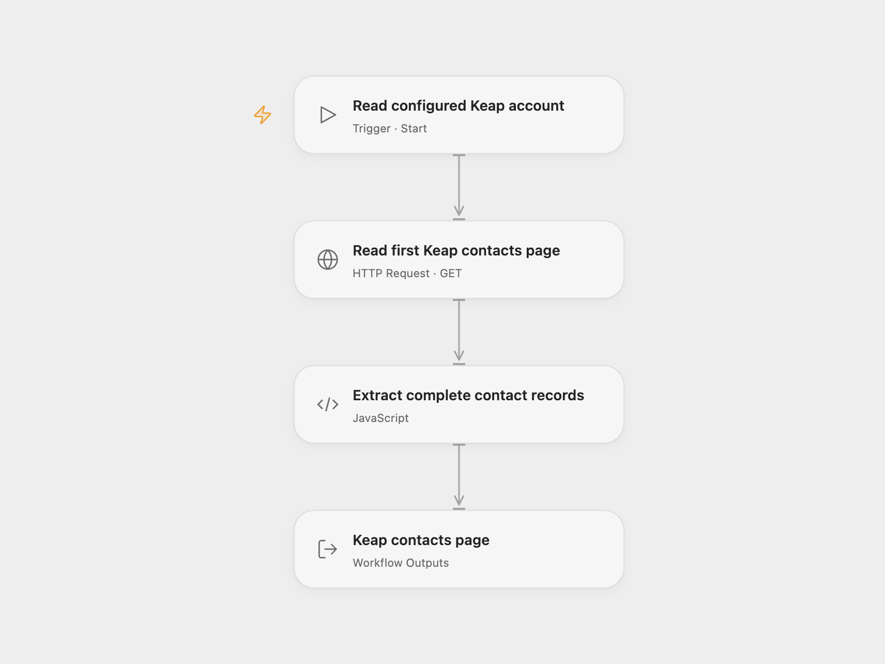

# Keap Contact Reader

Read the first contacts page from an existing Keap REST API v1 application, preserving every returned contact property.

<picture>
  <source media="(prefers-color-scheme: dark)" srcset="preview-dark.png">
  
</picture>

[Open Flow JSON](templates/keap-contact-reader.openflow.json) · [n8n JSON](templates/keap-contact-reader.n8n.json)

## Setup

Use a Keap CRM account and an existing application authorized for REST API v1. Keap recommends v2 for new integrations; this template retains the source’s v1 contacts operation and response format.

In Open Flow, store a valid OAuth access token with Keap’s `full` scope in a secret Variable. Bind **Auth Token** (`auth.token`) in **Read first Keap contacts page** to that Variable. Renew it when it expires. The workflow does not acquire or refresh tokens. Shared JSON contains no token or Variable binding.

In n8n, select a generic **OAuth2 API** credential in **Read first Keap contacts page**. Use **Authorization Code**, your Keap app client ID and secret, authorization URL `https://accounts.infusionsoft.com/app/oauth/authorize`, access-token URL `https://api.infusionsoft.com/token`, and scope `full`. Register the HTTPS callback URL shown by n8n in your Keap application. Leave PKCE and extra query/body parameters unset.

Keap uses different client authentication for the two token operations. Set **Authentication** to **Body**, connect the account, and complete consent. After it is connected, change only **Authentication** to **Header** and save the same credential without reconnecting. This preserves the stored tokens and makes later refresh requests use Basic client authentication. Repeat Body → connect → Header → save whenever you reconnect. Keep the client ID, secret and token URLs unchanged during that switch. The [Keap authentication guide](https://developer.keap.com/authentication/) documents the initial body credentials and Basic refresh. This template uses generic OAuth2 because the source Keap credential fixes both operations to Body. n8n stores each new refresh token for subsequent refreshes. The two formats have different token-management requirements.

Each normal manual run makes one GET request with `limit=100`, with no filter, explicit offset or optional-property expansion. It does not follow the next-page link or read individual contact details. This is a first-page read, not a complete account export. Properties excluded by the API’s default projection remain absent.

Open Flow returns the complete page response, the contact records and their returned count. n8n returns one item per contact. An empty page yields an empty array and count zero in Open Flow, and no result items in n8n. No contacts are created or changed. n8n can refresh an expired token and resend that read once; Open Flow requires manual token renewal. Other errors stop the run and no workflow retry is configured. Both HTTP steps use a 30-second timeout; this is not a total authorization/refresh budget.

Inspiration &amp; credits

## Changes to the source

- Make the source defaults of one page and a 100-contact request limit explicit.
- Use a manually renewed OAuth token Variable in Open Flow. In n8n, use formal HTTP with configurable OAuth2 so initial authorization uses Body and refresh uses Header; expand the returned contacts into the source’s one-item-per-contact output.
- Preserve full records and expose the page metadata in Open Flow.

Adapted from [Keap contacts workflow](https://github.com/Zie619/n8n-workflows/blob/ae8cf6dc5b873cbb4f74587aa9180ed3a9f70682/workflows/Manual/1022_Manual_Keap_Automate_Triggered.json) in [Zie619/n8n-workflows](https://github.com/Zie619/n8n-workflows). The source export does not identify a separate template author or license.

The collection’s [MIT notice](https://github.com/Zie619/n8n-workflows/blob/94007c1445d9258a7da116646b79473e7c7c3282/LICENSE) is pinned at a later revision. This is the collection notice at that revision; it does not establish a separate original template author's license. Our changes are listed above; see [repository licensing](../../README.md#licensing).

> MIT License
>
> Copyright (c) 2025 Zie619
>
> Permission is hereby granted, free of charge, to any person obtaining a copy
> of this software and associated documentation files (the "Software"), to deal
> in the Software without restriction, including without limitation the rights
> to use, copy, modify, merge, publish, distribute, sublicense, and/or sell
> copies of the Software, and to permit persons to whom the Software is
> furnished to do so, subject to the following conditions:
>
> The above copyright notice and this permission notice shall be included in all
> copies or substantial portions of the Software.
>
> THE SOFTWARE IS PROVIDED "AS IS", WITHOUT WARRANTY OF ANY KIND, EXPRESS OR
> IMPLIED, INCLUDING BUT NOT LIMITED TO THE WARRANTIES OF MERCHANTABILITY,
> FITNESS FOR A PARTICULAR PURPOSE AND NONINFRINGEMENT. IN NO EVENT SHALL THE
> AUTHORS OR COPYRIGHT HOLDERS BE LIABLE FOR ANY CLAIM, DAMAGES OR OTHER
> LIABILITY, WHETHER IN AN ACTION OF CONTRACT, TORT OR OTHERWISE, ARISING FROM,
> OUT OF OR IN CONNECTION WITH THE SOFTWARE OR THE USE OR OTHER DEALINGS IN THE
> SOFTWARE.

