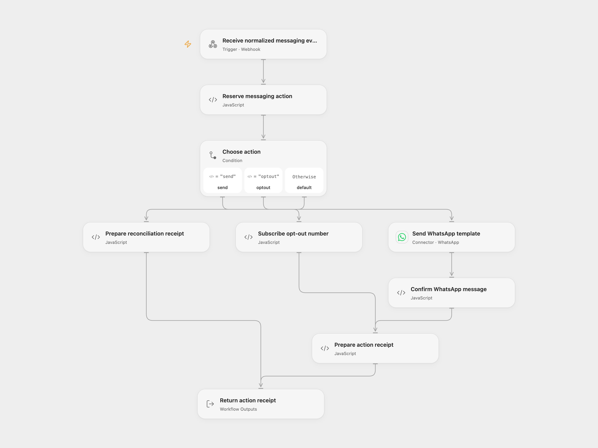

# KlickTipp WhatsApp Offers and Opt-Outs

Send personalized WhatsApp templates from KlickTipp events and route incoming replies or opt-outs.

<picture>
  <source media="(prefers-color-scheme: dark)" srcset="preview-dark.png">
  
</picture>

[Open Flow JSON](templates/klicktipp-whatsapp-offers-and-opt-outs.openflow.json) · [n8n JSON](templates/klicktipp-whatsapp-offers-and-opt-outs.n8n.json)

## Setup

Install the official n8n-nodes-klicktipp community package version 1.0.48 and configure its webhook trigger, WhatsApp trigger and account credentials. Register the KlickTipp webhook as POST JSON with the required contact fields and static body authentication; register the WhatsApp webhook using its trigger, which verifies Meta’s signature. Configure your approved German offer template with three body parameters and a URL button, and support template with one body parameter. Set the WhatsApp phone number ID and opt-out list ID. In **Prepare outbound event** replace the product, company and link field names with your KlickTipp custom field names. Configure one Data Table with text columns item_key and status and prevent overlapping runs.

For Open Flow configure the webhook URL in both forwarding nodes, set mode to relay in **Prepare outbound event** and **Normalize incoming messages**, connect WhatsApp, bind secret Variables KLICKTIPP_USERNAME and KLICKTIPP_PASSWORD, set the opt-out list ID, phone number ID and approved template names, and enable persistent State. Restrict the Open Flow webhook to the relay; it has no built-in authentication. For n8n direct mode use the original triggers and credentials and leave both modes as direct. Use one mode and one format.

## Behavior

A KlickTipp outbound event sends the offer template with the contact's first name, product, company and link suffix. A WhatsApp text message whose lowercase, space-stripped text starts with STOP subscribes its number to the configured KlickTipp opt-out list; other text messages receive the support template. Configure the KlickTipp campaign to suppress that list from future WhatsApp offers. Non-text events are ignored. Incoming messages are processed individually and matched to the correct contact. Template and opt-in approval depend on your accounts. Event and contact data can appear in execution history.

If a message or subscription result is unknown, inspect WhatsApp or KlickTipp before replaying. In Open Flow enter the pending key in **Reserve messaging action**, select confirmed if applied or absent if not, replay the same event and clear the fields. Outbound pending state blocks further offers until reconciled. In n8n inspect the pending Data Table row and service; remove an outbound row only after reconciliation, mark an inbound row done if the action happened, or remove it only after confirming it did not happen. A successful send means accepted by Meta, not delivered.

Inspiration &amp; credits

Normalize each incoming message, remove account-specific fields and checkpoint external writes.

Adapted from [KlickTipp and WhatsApp personalized messaging](https://github.com/Zie619/n8n-workflows/blob/ae8cf6dc5b873cbb4f74587aa9180ed3a9f70682/workflows/Filter/0917_Filter_Whatsapp_Create_Triggered.json) in [Zie619/n8n-workflows](https://github.com/Zie619/n8n-workflows). The source export does not identify a separate template author or license.

The collection’s [MIT notice](https://github.com/Zie619/n8n-workflows/blob/94007c1445d9258a7da116646b79473e7c7c3282/LICENSE) is pinned at a later revision. This is the collection notice at that revision; it does not establish a separate original template author's license. Our changes are listed above; see [repository licensing](../../README.md#licensing).

> MIT License
>
> Copyright (c) 2025 Zie619
>
> Permission is hereby granted, free of charge, to any person obtaining a copy
> of this software and associated documentation files (the "Software"), to deal
> in the Software without restriction, including without limitation the rights
> to use, copy, modify, merge, publish, distribute, sublicense, and/or sell
> copies of the Software, and to permit persons to whom the Software is
> furnished to do so, subject to the following conditions:
>
> The above copyright notice and this permission notice shall be included in all
> copies or substantial portions of the Software.
>
> THE SOFTWARE IS PROVIDED "AS IS", WITHOUT WARRANTY OF ANY KIND, EXPRESS OR
> IMPLIED, INCLUDING BUT NOT LIMITED TO THE WARRANTIES OF MERCHANTABILITY,
> FITNESS FOR A PARTICULAR PURPOSE AND NONINFRINGEMENT. IN NO EVENT SHALL THE
> AUTHORS OR COPYRIGHT HOLDERS BE LIABLE FOR ANY CLAIM, DAMAGES OR OTHER
> LIABILITY, WHETHER IN AN ACTION OF CONTRACT, TORT OR OTHERWISE, ARISING FROM,
> OUT OF OR IN CONNECTION WITH THE SOFTWARE OR THE USE OR OTHER DEALINGS IN THE
> SOFTWARE.

