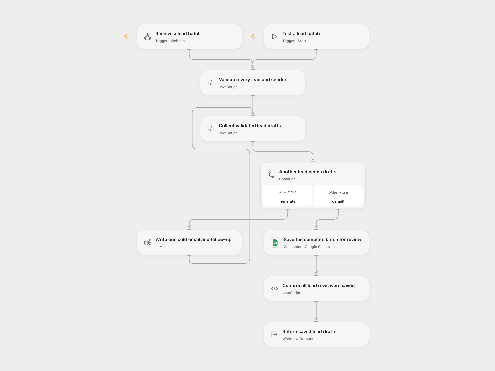

# LeadPilot Cold Email Drafts

Supply a lead list and sender brief. Generate a personalized cold email and a follow-up for every lead, and save the complete batch in Google Sheets for review before sending.

<picture>
  <source media="(prefers-color-scheme: dark)" srcset="preview-dark.png">
  
</picture>

[Open Flow JSON](templates/leadpilot-cold-email-drafts.openflow.json) · [n8n JSON](templates/leadpilot-cold-email-drafts.n8n.json)


## Configure

Create a **Lite Pipeline** sheet with these headers in order: `Name`, `Email`, `Title`, `Company`, `Subject Line`, `Email Body`, `Follow-up`, `Generated At`, `Sent`. Select your Google Sheets account and spreadsheet on the save node. The template appends one row per lead with `Sent` set to `No`; it does not send email or change that flag later. `Follow-up` stores the follow-up body. The follow-up subject is retained in the returned draft object.

Configure the generation node with the source model, `gpt-4o-mini`, temperature `0.7`, an 800-token output budget and JSON object mode. Open Flow uses its native LLM node to retain these generation settings and its per-lead retry boundary. Its model service must expose that route. n8n uses its native LLM Chain and OpenAI Chat Model with OpenAI credentials; the adapter's internal retries are disabled so they do not multiply the workflow allowance. OpenAI’s [model page](https://developers.openai.com/api/docs/models/gpt-4o-mini) currently lists `gpt-4o-mini-2024-07-18` as this alias’s default snapshot. Its [deprecation notice](https://developers.openai.com/api/docs/deprecations) names that snapshot for shutdown on January 14, 2027. Recheck your service’s alias routing and update/test the generation settings before that date; a provider’s alias can change. Model availability depends on your service/account. Both inspected adapters send `max_tokens: 800` and JSON object mode. Open Flow adds a JSON instruction before the source system prompt. Generated wording can differ.

Protect the published POST webhook using your deployment's access controls. This template does not add caller authentication. Send a lead object directly or a `leads` array with sender settings:

```json
{
  "leads": [
    {"name": "Alex", "email": "alex@example.com", "title": "Operations Lead", "company": "Example Co", "industry": "Services", "company_description": "A distributed service team", "notes": "Reviewing manual reporting"}
  ],
  "sender_name": "Sam",
  "sender_company": "Example Automation",
  "value_prop": "We help operations teams automate weekly reporting.",
  "calendar_link": "https://example.com/book"
}
```

Every lead needs a nonempty `name`; other fields are optional text. `linkedin_url` is retained with the lead but is not scraped or added to the source writing prompt. Sender defaults are `Your Name`, `Your Company` and `We help companies save time with automation.`; supply your real sender brief in each request. There is no environment-variable dependency. Open Flow also provides a manual test entry accepting the same request object.

## Run and review

The workflow validates the entire input, generates drafts sequentially for every lead, validates every subject/body and follow-up subject/body, then appends the complete batch once. A later generation failure prevents the whole batch from being saved. No lead is silently skipped or truncated. Review the saved copy before sending it yourself. The prompt asks for a 3–7 word subject, a 50–80 word email and a 30–50 word follow-up for three days later; these are model instructions, not deterministic length checks or a scheduled send.

Generation allows up to three attempts per lead with two-second gaps. Open Flow retries transient HTTP429/5xx failures; fatal authentication/configuration errors stop immediately. n8n's node retry also retries ordinary errors. Malformed JSON can use the same three-attempt generation allowance. A valid JSON object with missing or empty required copy stops without another generation request. Earlier successful generations are retained during a later lead's retry. Both formats send one Google Sheets API append containing every row. This is a batch write, with no workflow transaction or rollback covering generation and saving. The Sheet append has no workflow retry or deduplication. A lost response can leave rows saved, so inspect the sheet before repeating a request. Literal text is stored with `RAW`, including text beginning with `=`.

Success is returned after the append completes. The result includes the first lead's original response fields, `count`, the complete associated `drafts` array and a review reminder. Open Flow additionally checks the returned updated row count and includes `updatedRange`; n8n's native append returns mapped row objects rather than that API receipt. A successful response confirms the append operation, not email delivery or copy quality.

The source suggests small lists of 5–20 leads without enforcing a fixed cap. Choose a batch that completes within your deployment's webhook window. Open Flow waits up to **60 seconds** for the final response; a timeout is not proof that processing or writing stopped. Do not automatically resubmit. Complete collections must fit model context and platform limits, including 1 MiB per Code input/result in the inspected Open Flow host. Oversized input fails without a partial output. Your lead details and sender brief are sent to your selected model service and Google Sheets.

## Changes to the source

- Replace the incompatible OpenAI node type/version with a native Chain/Chat Model, configure its supported model/JSON/token-budget fields and parse JSON within the generation attempt.
- Remove an unused UUID module dependency, validate every lead and preserve each lead's association through generation and saving.
- Validate the complete generated batch, save before responding, and return every draft rather than only the first item.
- Retry only the current lead's generation and remove automatic Sheet-write replay after an unknown outcome.
- Store literal text with `RAW` and make sender/spreadsheet configuration explicit.


<details>
<summary>Source and license</summary>

Adapted from [LeadPilot Lite - AI Cold Email Writer](https://github.com/enescingoz/awesome-n8n-templates/blob/827110332c21cbe000ab13f6d292d5adb1f1f8db/Gmail_and_Email_Automation/LeadPilot%20Lite%20-%20AI%20Cold%20Email%20Writer.json) in [enescingoz/awesome-n8n-templates](https://github.com/enescingoz/awesome-n8n-templates).

Source collection notice: © 2024–2026 Enes Cingoz, [CC BY 4.0](https://github.com/enescingoz/awesome-n8n-templates/blob/827110332c21cbe000ab13f6d292d5adb1f1f8db/LICENSE). The source export does not identify a separate template author or license. See [repository licensing](../../README.md#licensing) for the scope of OOMOL contributions and third-party material.

</details>
