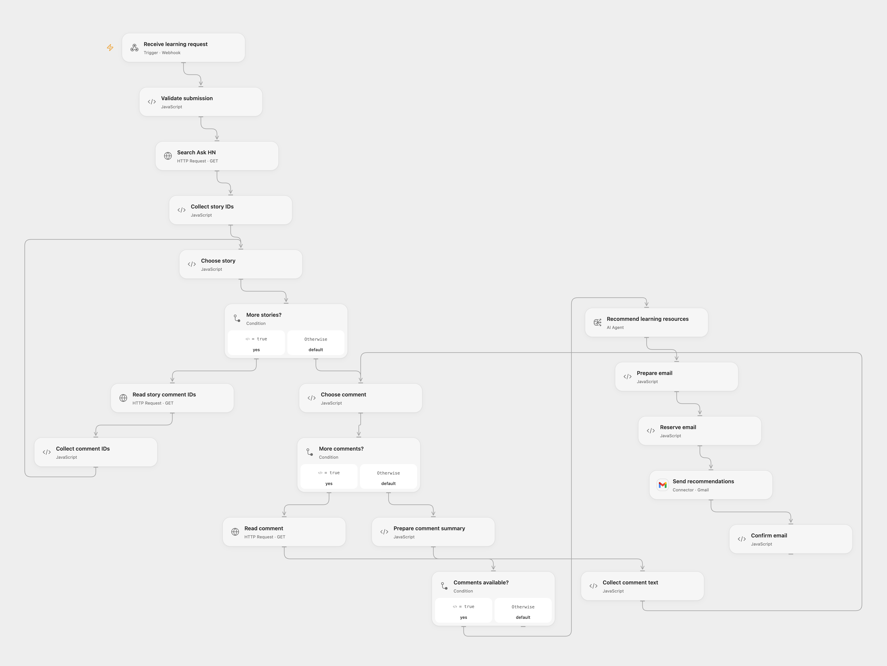

# Learn with Hacker News Recommendations

Find learning resources in Ask HN comments and email a categorized summary.

<picture>
  <source media="(prefers-color-scheme: dark)" srcset="preview-dark.png">
  
</picture>

[Open Flow JSON](templates/learn-with-hacker-news-recommendations.openflow.json) · [n8n JSON](templates/learn-with-hacker-news-recommendations.n8n.json)

## Setup

Import the n8n workflow and configure SMTP, Gemini, the sender address and a Data Table with item_key and status text columns for direct mode. For Open Flow mode, enable the alternate form frontend, set the Open Flow URL, connect Gmail and the model, and enable persistent State. Use one mode.

Submit a topic and email address. The topic is optional. Up to 150 Ask HN results are selected in relevance order; direct comments are read and summarized into learning resource categories. No email is sent when no comment text is available. Comment content is sent to the model; review its recommendations and links. Open Flow sends the model’s Markdown as plain text within the email; the direct n8n workflow converts Markdown to HTML. Large comment collections are subject to Open Flow Code and model input limits.

If email delivery has an unknown outcome, inspect the mailbox and resolve the persistent submission key or n8n Data Table row only after confirming the result. Reuse the same submission ID for retries; a new form submission has a new ID. Avoid overlapping retries.

Inspiration &amp; credits

## Changes to the source

Retrieve each search hit’s Firebase story to obtain its direct comment IDs; search hits do not include the children array. Update the model and use the submitted topic throughout.

Adapted from [Learn Anything from HN](https://github.com/enescingoz/awesome-n8n-templates/blob/827110332c21cbe000ab13f6d292d5adb1f1f8db/AI_Research_RAG_and_Data_Analysis/Learn%20Anything%20from%20HN%20-%20Get%20Top%20Resource%20Recommendations%20from%20Hacker%20News.json) in [enescingoz/awesome-n8n-templates](https://github.com/enescingoz/awesome-n8n-templates).

Source collection notice: © 2024–2026 Enes Cingoz, [CC BY 4.0](https://github.com/enescingoz/awesome-n8n-templates/blob/827110332c21cbe000ab13f6d292d5adb1f1f8db/LICENSE). The source export does not identify a separate template author or license. See [repository licensing](../../README.md#licensing) for the scope of OOMOL contributions and third-party material.

