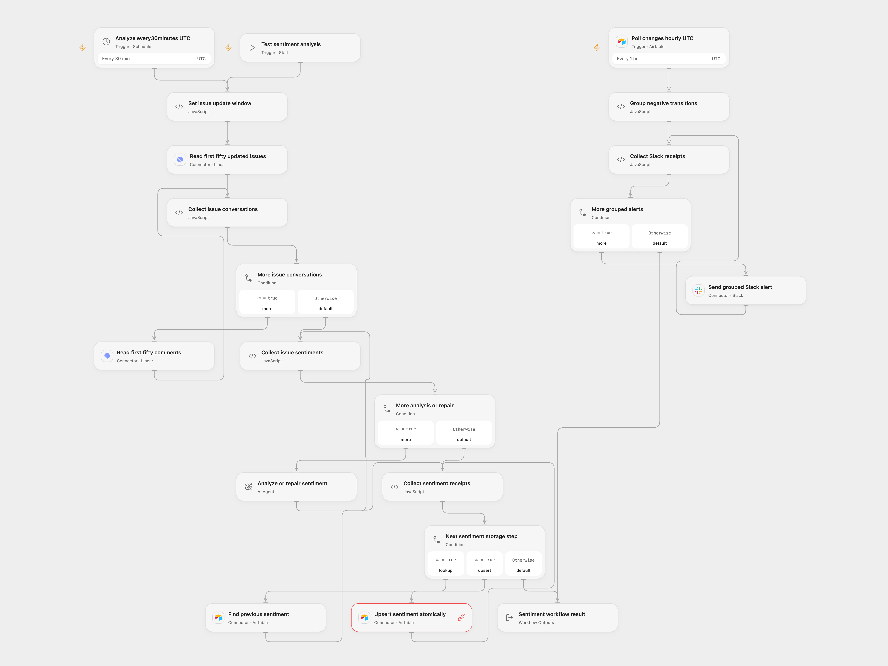

# Linear Support Sentiment to Slack

Track customer-support conversation sentiment in Airtable and notify the team when issue sentiment turns negative.

<picture>
  <source media="(prefers-color-scheme: dark)" srcset="preview-dark.png">
  
</picture>

[Open Flow JSON](templates/linear-support-sentiment-to-slack.openflow.json) · [n8n JSON](templates/linear-support-sentiment-to-slack.n8n.json)


## Configure

Connect Linear, Airtable and Slack. In n8n, the Linear GraphQL node uses Header Auth with name `Authorization` and the raw Linear personal API key; Open Flow uses the Linear connection. Use one Airtable base/table and connection for lookup, atomic upsert and change polling. Replace the example base/table identifiers on all three nodes and in the upsert endpoint. The Airtable connection needs read/write access and Proxy permission for `PATCH /v0/<base>/<table>` with `performUpsert`. The highlighted upsert node in the preview still needs this connection and permission configuration.

Create these columns: `Issue ID` (unique text), `Previous Sentiment` and `Current Sentiment` (single select: Positive, Negative, Neutral, N/A), `Summary`, `Issue Title`, `Assigned` (text), `Issue Created` and `Issue Updated` (dates), and `Last Modified` (Airtable last-modified time). Configure the last-modified field to observe the sentiment fields. Set your Slack channel and the Linear organization issue URL on the notification preparation node or native Notification Settings. Configure `gpt-5-mini`. Schedules start with UTC; the source inherited the n8n instance timezone.

## Analysis and storage

Every thirty minutes, select issues updated in the previous thirty minutes. Preserve the source [API default window](https://linear.app/developers/pagination): the first fifty issues and first fifty comments per issue. Further issue/comment pages are not traversed. Open Flow uses native issue-list and issue-detail Actions, adding separate read-only detail requests to the original combined GraphQL query. It does not promise a shared snapshot across those requests.

Read every selected conversation and generate every sentiment before writing any Airtable row. Empty comment text stops the batch, as the source extractor requires text. Deleted comment authors and unassigned issues use readable empty/fallback values. The structured result requires positive, negative or neutral sentiment; its optional summary defaults to empty text.

Each generation allows at most one additional content-format repair. Open Flow uses a one-round native Agent without tools, memory or code, followed by explicit validation and a format-repair feedback call only when needed. Both formats retain the extraction instruction and the fixed native format-repair template. The native gpt-5-mini adapter sends its extraction instruction as a developer message; the Open Flow Agent receives it in its prompt under the deployment's own Agent instructions. Format repair includes each validator's own error details. The Open Flow validator parses complete JSON or a JSON code fence; it does not promise the native parser's partial-JSON leniency. If generation or its single repair fails, no row is written. Transport retries are separate: the native ChatOpenAI adapter permits two transient retries, while the Open Flow Agent executor does not retry that transport failure. Model quality and live route support need your own test. Large conversations must fit the deployment's current1MiB Code input/output budget; over-limit data stops without truncation.

For each issue, finish the existing-row lookup, move its current sentiment to previous (N/A when no current value exists), and atomically upsert by `Issue ID`. Do not replace the atomic upsert with a separate create/update decision. Duplicate existing Issue IDs reject before that issue's write. A failure leaves earlier issue writes intact and stops later issues. No write automatically retries, and there is no batch transaction or concurrency lock.

## Negative-transition notifications

Poll Airtable changes hourly using the `Last Modified` time field. The source incorrectly selected the text sentiment column as its time cursor; both templates correct it. Automatic initial activation establishes a baseline rather than notifying every historical row. A native n8n manual poll returns one existing sample row, which can produce a test alert if it matches the transition. The polling trigger owns its persistent cursor/deduplication state. Keep Issue IDs unique and keep the time field/configuration stable; changing or resetting the subscription establishes a new baseline.

The formats have different polling boundaries. Native n8n reads every page in one poll cycle before emitting the combined batch. Open Flow admits a separate run for each Provider page containing fresh events, with at most 100 candidate events per page. Empty or fully deduplicated pages advance the checkpoint without creating a run. Each Open Flow run selects and validates all matching transitions in that page before sending, and its transition/message counts describe that page rather than the whole hourly cycle.

Select transitions with previous sentiment other than Negative and current sentiment Negative. Aggregate each page's complete matching batch in Open Flow, or the complete poll-cycle batch in n8n, retaining each issue's own identifier/title/summary and a link to your configured Linear organization. The original message incorrectly referenced the current row inside its array mapping; each row is now associated correctly. Repeated issue/time keys within the batch are removed. Native n8n also keeps its original persistent Remove Duplicates node/history with its default 10,000-entry limit; Open Flow uses the Provider's persistent record/time cursor and delivery deduplication instead of that node's separate history store.

Open Flow page runs are independent. A later-page read failure cannot withdraw or prevent messages from an earlier admitted run, and one failed notification run does not cancel other page runs. Transient read failures retain the page checkpoint for retry; previously admitted event identities are suppressed when paging resumes. Inspect the polling state and failed runs when recovering. There is no cross-page validation barrier, transaction or shared message count.
To preserve all content within Slack's limits, split long section text into complete chunks of at most3,000 characters and group at most50 blocks per message, with header/divider included. The native n8n workflow footer is disabled so it cannot add a fifty-first block. Send the grouped messages sequentially. A failure or uncertain send stops later messages without automatic replay; earlier messages remain sent. Open Flow records page admission, checkpoint and deduplication before Slack finishes. A Slack failure is not automatically replayed by polling; an uncertain or failed alert needs human inspection, and delivery is not guaranteed exactly once. Polling/formatting tests use deterministic fixtures, not live Airtable/Slack accounts.

<details>
<summary>Inspiration &amp; credits</summary>

Adapted from [Sentiment Analysis Tracking on Support Issues with Linear and Slack](https://github.com/enescingoz/awesome-n8n-templates/blob/827110332c21cbe000ab13f6d292d5adb1f1f8db/Slack/Sentiment%20Analysis%20Tracking%20on%20Support%20Issues%20with%20Linear%20and%20Slack.json) in [enescingoz/awesome-n8n-templates](https://github.com/enescingoz/awesome-n8n-templates).

Source collection notice: © 2024–2026 Enes Cingoz, [CC BY 4.0](https://github.com/enescingoz/awesome-n8n-templates/blob/827110332c21cbe000ab13f6d292d5adb1f1f8db/LICENSE). The source export does not identify a separate template author or license. See [repository licensing](../../README.md#licensing) for the scope of OOMOL contributions and third-party material.

The embedded JSON-format and repair instructions derive from [@langchain/classic1.0.27](https://www.npmjs.com/package/@langchain/classic/v/1.0.27), distributed under the MIT License:

```text
MIT License

Copyright (c) LangChain, Inc.

Permission is hereby granted, free of charge, to any person obtaining a copy
of this software and associated documentation files (the "Software"), to deal
in the Software without restriction, including without limitation the rights
to use, copy, modify, merge, publish, distribute, sublicense, and/or sell
copies of the Software, and to permit persons to whom the Software is
furnished to do so, subject to the following conditions:

The above copyright notice and this permission notice shall be included in all
copies or substantial portions of the Software.

THE SOFTWARE IS PROVIDED "AS IS", WITHOUT WARRANTY OF ANY KIND, EXPRESS OR
IMPLIED, INCLUDING BUT NOT LIMITED TO THE WARRANTIES OF MERCHANTABILITY,
FITNESS FOR A PARTICULAR PURPOSE AND NONINFRINGEMENT. IN NO EVENT SHALL THE
AUTHORS OR COPYRIGHT HOLDERS BE LIABLE FOR ANY CLAIM, DAMAGES OR OTHER
LIABILITY, WHETHER IN AN ACTION OF CONTRACT, TORT OR OTHERWISE, ARISING FROM,
OUT OF OR IN CONNECTION WITH THE SOFTWARE OR THE USE OR OTHER DEALINGS IN THE
SOFTWARE.
```

</details>
