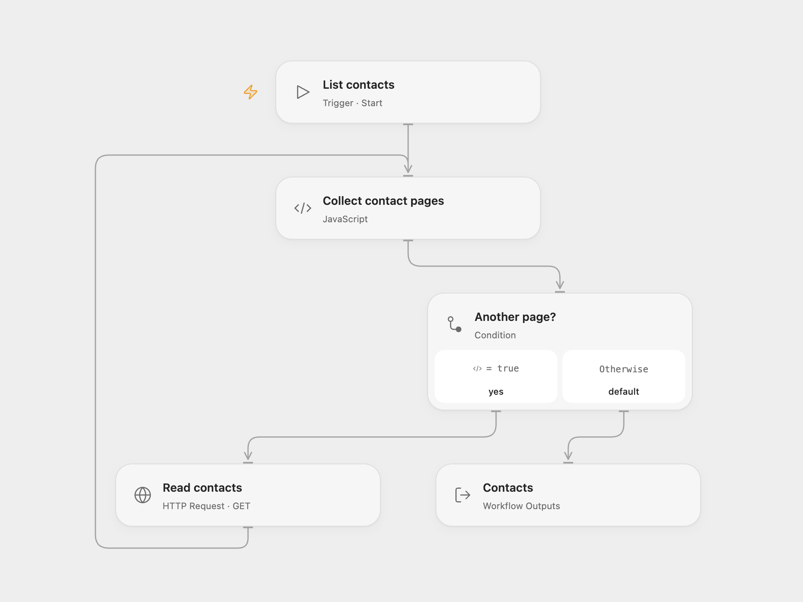

# List All HubSpot Contacts

Read all HubSpot contacts using the legacy contacts endpoint.

<picture>
  <source media="(prefers-color-scheme: dark)" srcset="preview-dark.png">
  
</picture>

[Open Flow JSON](templates/list-all-hubspot-contacts-legacy.openflow.json) · [n8n JSON](templates/list-all-hubspot-contacts-legacy.n8n.json)

## Setup

Configure a HubSpot bearer token with contacts read access. Bind it to the secret Variable **HUBSPOT_CONTACTS_TOKEN** in Open Flow. In n8n, configure a Header Auth credential containing the bearer token on **Read contacts**. Run manually.

## Behavior

The workflow follows the legacy endpoint’s cursor and reads pages of 100 until no pages remain. Open Flow returns an array; n8n returns one item per contact. An empty account returns an empty array or no items respectively. Contact records are held in execution memory; large accounts can exceed runtime limits. Avoid exposing execution history because it contains contact data. HubSpot has announced that v1–v3 APIs will become unsupported in September 2027.

Inspiration &amp; credits

## Changes to the source

- Use bearer authentication and explicit HTTP pagination. The fixed n8n HubSpot v1 helper reads a literal `propertyName` field instead of the contacts array, so the replacement collects the actual contacts.

Adapted from [List all HubSpot contacts](https://github.com/Zie619/n8n-workflows/blob/ae8cf6dc5b873cbb4f74587aa9180ed3a9f70682/workflows/Manual/1136_Manual_HubSpot_Automation_Triggered.json) in [Zie619/n8n-workflows](https://github.com/Zie619/n8n-workflows). The source export does not identify a separate template author or license.

The collection’s [MIT notice](https://github.com/Zie619/n8n-workflows/blob/94007c1445d9258a7da116646b79473e7c7c3282/LICENSE) is pinned at a later revision. This is the collection notice at that revision; it does not establish a separate original template author's license. Our changes are listed above; see [repository licensing](../../README.md#licensing).

> MIT License
>
> Copyright (c) 2025 Zie619
>
> Permission is hereby granted, free of charge, to any person obtaining a copy
> of this software and associated documentation files (the "Software"), to deal
> in the Software without restriction, including without limitation the rights
> to use, copy, modify, merge, publish, distribute, sublicense, and/or sell
> copies of the Software, and to permit persons to whom the Software is
> furnished to do so, subject to the following conditions:
>
> The above copyright notice and this permission notice shall be included in all
> copies or substantial portions of the Software.
>
> THE SOFTWARE IS PROVIDED "AS IS", WITHOUT WARRANTY OF ANY KIND, EXPRESS OR
> IMPLIED, INCLUDING BUT NOT LIMITED TO THE WARRANTIES OF MERCHANTABILITY,
> FITNESS FOR A PARTICULAR PURPOSE AND NONINFRINGEMENT. IN NO EVENT SHALL THE
> AUTHORS OR COPYRIGHT HOLDERS BE LIABLE FOR ANY CLAIM, DAMAGES OR OTHER
> LIABILITY, WHETHER IN AN ACTION OF CONTRACT, TORT OR OTHERWISE, ARISING FROM,
> OUT OF OR IN CONNECTION WITH THE SOFTWARE OR THE USE OR OTHER DEALINGS IN THE
> SOFTWARE.

