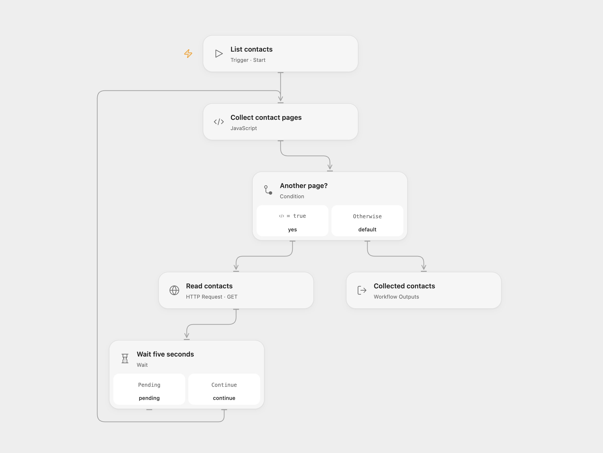

# List HubSpot Contacts with Pagination

Read every page of HubSpot contacts and return the collected records.

<picture>
  <source media="(prefers-color-scheme: dark)" srcset="preview-dark.png">
  
</picture>

[Open Flow JSON](templates/list-all-hubspot-contacts-with-pagination.openflow.json) · [n8n JSON](templates/list-all-hubspot-contacts-with-pagination.n8n.json)

## Setup

Create a HubSpot private app token with `crm.objects.contacts.read` scope. Bind it as the secret Variable **HUBSPOT_PRIVATE_APP_TOKEN** in Open Flow. In n8n, create a Header Auth credential with `Authorization: Bearer YOUR_TOKEN` and select it in **Read contacts**. Run manually.

## Behavior

The workflow reads contacts in pages of 100 and returns the API records with the endpoint’s default contact properties, waiting five seconds between requests. It does not request every custom property. Open Flow also waits after the final page, as in the source. Open Flow returns one array; n8n returns one item per contact. Empty accounts produce an empty array in Open Flow and no items in n8n. A failed page or malformed cursor stops the run; repeated cursors stop Open Flow instead of looping forever. The list is not a transactional snapshot, so concurrent contact changes can affect results. The complete result and intermediate pages are held in execution memory; very large accounts may exceed platform runtime or payload limits. Restrict access to execution history because it contains contact data.

Inspiration &amp; credits

## Changes to the source

- Replace the retired HubSpot API key query parameter with a private app bearer token.
- Keep the 100-record page size and collect all pages using the API cursor. n8n uses its HTTP pagination and waits between requests rather than a Code timer.

Adapted from [HubSpot contacts pagination](https://github.com/Zie619/n8n-workflows/blob/ae8cf6dc5b873cbb4f74587aa9180ed3a9f70682/workflows/Manual/0074_Manual_HTTP_Monitor_Webhook.json) in [Zie619/n8n-workflows](https://github.com/Zie619/n8n-workflows). The matching [n8n listing](https://n8n.io/workflows/1169-handle-pagination-in-http-requests/) credits Harshil Agrawal. The original template does not state a separate license.

The collection’s [MIT notice](https://github.com/Zie619/n8n-workflows/blob/94007c1445d9258a7da116646b79473e7c7c3282/LICENSE) is pinned at a later revision. This is the collection notice at that revision; it does not establish a separate original template author's license. Our changes are listed above; see [repository licensing](../../README.md#licensing).

> MIT License
>
> Copyright (c) 2025 Zie619
>
> Permission is hereby granted, free of charge, to any person obtaining a copy
> of this software and associated documentation files (the "Software"), to deal
> in the Software without restriction, including without limitation the rights
> to use, copy, modify, merge, publish, distribute, sublicense, and/or sell
> copies of the Software, and to permit persons to whom the Software is
> furnished to do so, subject to the following conditions:
>
> The above copyright notice and this permission notice shall be included in all
> copies or substantial portions of the Software.
>
> THE SOFTWARE IS PROVIDED "AS IS", WITHOUT WARRANTY OF ANY KIND, EXPRESS OR
> IMPLIED, INCLUDING BUT NOT LIMITED TO THE WARRANTIES OF MERCHANTABILITY,
> FITNESS FOR A PARTICULAR PURPOSE AND NONINFRINGEMENT. IN NO EVENT SHALL THE
> AUTHORS OR COPYRIGHT HOLDERS BE LIABLE FOR ANY CLAIM, DAMAGES OR OTHER
> LIABILITY, WHETHER IN AN ACTION OF CONTRACT, TORT OR OTHERWISE, ARISING FROM,
> OUT OF OR IN CONNECTION WITH THE SOFTWARE OR THE USE OR OTHER DEALINGS IN THE
> SOFTWARE.

