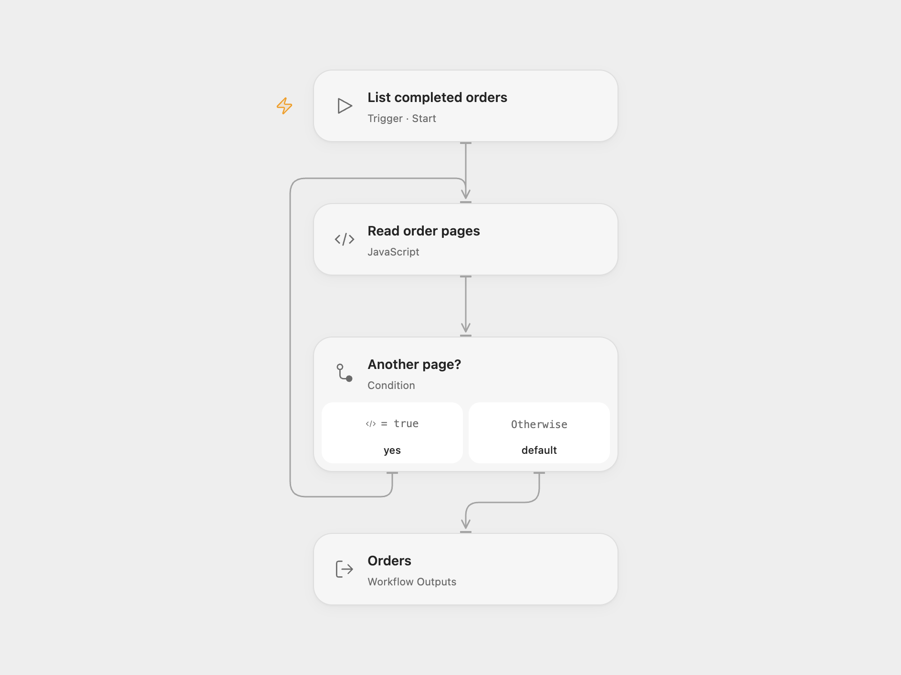

# List Completed Unleashed Sales Orders

Read all completed sales orders from Unleashed.

<picture>
  <source media="(prefers-color-scheme: dark)" srcset="preview-dark.png">
  
</picture>

[Open Flow JSON](templates/list-completed-unleashed-sales-orders.openflow.json) · [n8n JSON](templates/list-completed-unleashed-sales-orders.n8n.json)

## Setup and use

In Open Flow, bind your Unleashed API key to secret Variable **UNLEASHED_API_KEY** and API ID to secret Variable **UNLEASHED_API_ID** in **Read order pages**. Set **clientType** to your lowercase account/application identifier.

In n8n, create a Custom Auth credential with headers `api-auth-id` containing your API ID and `api-auth-signature` containing the base64 HMAC-SHA256 of the exact string `orderStatus=Completed&pageSize=100` using your API key. The Custom Auth JSON is `{"headers":{"api-auth-id":"YOUR_API_ID","api-auth-signature":"YOUR_SIGNATURE"}}`. Select that credential and set the **client-type** header in **Read completed orders**. If you change the filter, page size, query order, or API key, recompute the signature over the exact new query string and update both the URL and pagination next URL to match. Run manually. Keep both the key and the reusable signature private.

## Behavior

The workflow retrieves every page of completed sales orders, 100 at a time. If an Open Flow request fails at the transport layer, it restarts the read with one order per page. Open Flow limits each response to 1 MiB, so a single larger order still fails. Open Flow returns a result object containing a base64-encoded gzip file; decode and decompress it to obtain a JSON array of orders. n8n returns one item per order. The response keeps the original order fields and converts Unleashed's serialized dates to ISO strings. An empty result produces a gzip file containing an empty JSON array in Open Flow and no items in n8n. Results are held in execution memory and orders can change while pages are read; very large accounts may exceed runtime limits.

Inspiration &amp; credits

## Changes to the source

- Use the current required `client-type` header and smaller pages in both formats. Open Flow signs the fixed query and returns a gzip JSON file; n8n uses a Custom Auth credential with its precomputed signature.

Adapted from [List completed Unleashed sales orders](https://github.com/Zie619/n8n-workflows/blob/ae8cf6dc5b873cbb4f74587aa9180ed3a9f70682/workflows/Manual/1087_Manual_Unleashedsoftware_Automation_Triggered.json) in [Zie619/n8n-workflows](https://github.com/Zie619/n8n-workflows). The source export does not identify a separate template author or license.

The collection’s [MIT notice](https://github.com/Zie619/n8n-workflows/blob/94007c1445d9258a7da116646b79473e7c7c3282/LICENSE) is pinned at a later revision. This is the collection notice at that revision; it does not establish a separate original template author's license. Our changes are listed above; see [repository licensing](../../README.md#licensing).

> MIT License
>
> Copyright (c) 2025 Zie619
>
> Permission is hereby granted, free of charge, to any person obtaining a copy
> of this software and associated documentation files (the "Software"), to deal
> in the Software without restriction, including without limitation the rights
> to use, copy, modify, merge, publish, distribute, sublicense, and/or sell
> copies of the Software, and to permit persons to whom the Software is
> furnished to do so, subject to the following conditions:
>
> The above copyright notice and this permission notice shall be included in all
> copies or substantial portions of the Software.
>
> THE SOFTWARE IS PROVIDED "AS IS", WITHOUT WARRANTY OF ANY KIND, EXPRESS OR
> IMPLIED, INCLUDING BUT NOT LIMITED TO THE WARRANTIES OF MERCHANTABILITY,
> FITNESS FOR A PARTICULAR PURPOSE AND NONINFRINGEMENT. IN NO EVENT SHALL THE
> AUTHORS OR COPYRIGHT HOLDERS BE LIABLE FOR ANY CLAIM, DAMAGES OR OTHER
> LIABILITY, WHETHER IN AN ACTION OF CONTRACT, TORT OR OTHERWISE, ARISING FROM,
> OUT OF OR IN CONNECTION WITH THE SOFTWARE OR THE USE OR OTHER DEALINGS IN THE
> SOFTWARE.

