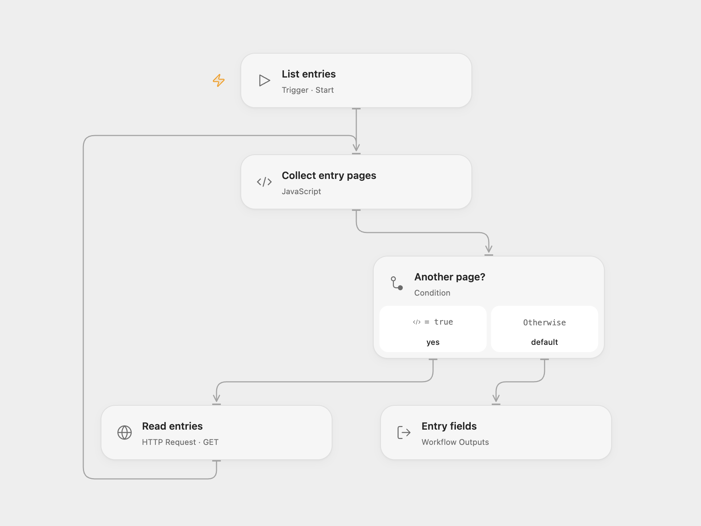

# List Contentful Entry Fields

Read the fields of all published entries in a Contentful environment.

<picture>
  <source media="(prefers-color-scheme: dark)" srcset="preview-dark.png">
  
</picture>

[Open Flow JSON](templates/list-contentful-entry-fields.openflow.json) · [n8n JSON](templates/list-contentful-entry-fields.n8n.json)

## Setup and use

Set your Contentful space ID and environment in **Collect entry pages** in Open Flow. Bind a Content Delivery API access token as the secret Variable **CONTENTFUL_DELIVERY_TOKEN** on **Read entries**. In n8n, set the space and environment in both the URL and pagination next URL in **Read entries**, and select a Bearer Auth credential with the delivery token. Run manually.

## Behavior

The workflow reads published entries in pages of 100 until all available pages have been collected. It returns each entry's `fields` object as returned for the delivery API's default locale. Open Flow returns an array; n8n emits one item per entry. Empty spaces return an empty array or no items respectively. Records are held in execution memory and may change during pagination; very large spaces can exceed runtime limits.

Inspiration &amp; credits

## Changes to the source

- Use explicit HTTP pagination in both formats. The fixed n8n Contentful helper advances its offset incorrectly after the second page; this workflow advances by the number of returned entries instead.
- Use a bearer token rather than putting the delivery token in the query string.

Adapted from [List Contentful entry fields](https://github.com/Zie619/n8n-workflows/blob/ae8cf6dc5b873cbb4f74587aa9180ed3a9f70682/workflows/Manual/1086_Manual_Contentful_Automation_Triggered.json) in [Zie619/n8n-workflows](https://github.com/Zie619/n8n-workflows). The source export does not identify a separate template author or license.

The collection’s [MIT notice](https://github.com/Zie619/n8n-workflows/blob/94007c1445d9258a7da116646b79473e7c7c3282/LICENSE) is pinned at a later revision. This is the collection notice at that revision; it does not establish a separate original template author's license. Our changes are listed above; see [repository licensing](../../README.md#licensing).

> MIT License
>
> Copyright (c) 2025 Zie619
>
> Permission is hereby granted, free of charge, to any person obtaining a copy
> of this software and associated documentation files (the "Software"), to deal
> in the Software without restriction, including without limitation the rights
> to use, copy, modify, merge, publish, distribute, sublicense, and/or sell
> copies of the Software, and to permit persons to whom the Software is
> furnished to do so, subject to the following conditions:
>
> The above copyright notice and this permission notice shall be included in all
> copies or substantial portions of the Software.
>
> THE SOFTWARE IS PROVIDED "AS IS", WITHOUT WARRANTY OF ANY KIND, EXPRESS OR
> IMPLIED, INCLUDING BUT NOT LIMITED TO THE WARRANTIES OF MERCHANTABILITY,
> FITNESS FOR A PARTICULAR PURPOSE AND NONINFRINGEMENT. IN NO EVENT SHALL THE
> AUTHORS OR COPYRIGHT HOLDERS BE LIABLE FOR ANY CLAIM, DAMAGES OR OTHER
> LIABILITY, WHETHER IN AN ACTION OF CONTRACT, TORT OR OTHERWISE, ARISING FROM,
> OUT OF OR IN CONNECTION WITH THE SOFTWARE OR THE USE OR OTHER DEALINGS IN THE
> SOFTWARE.

