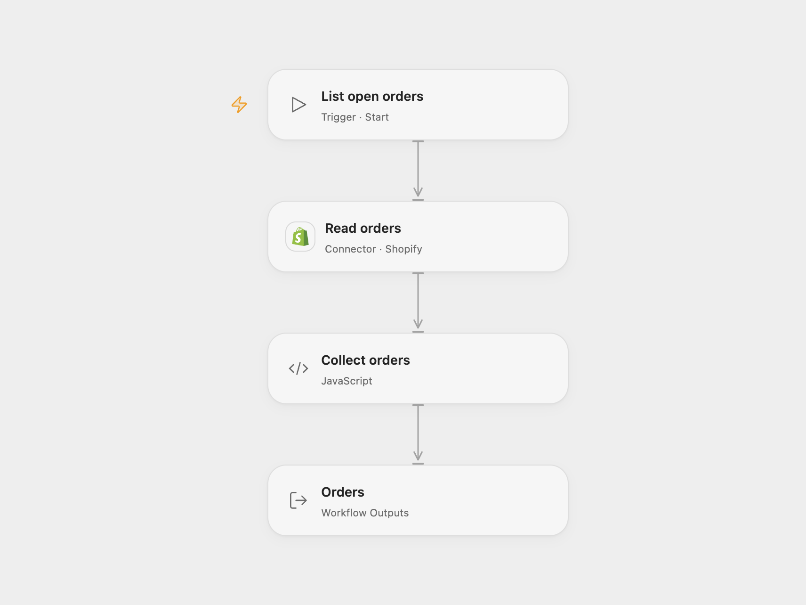

# List the First Open Shopify Orders

Read up to 50 open Shopify orders.

<picture>
  <source media="(prefers-color-scheme: dark)" srcset="preview-dark.png">
  
</picture>

[Open Flow JSON](templates/list-first-open-shopify-orders.openflow.json) · [n8n JSON](templates/list-first-open-shopify-orders.n8n.json)

## Setup and use

Connect a Shopify account with `read_orders` and access to the legacy Admin REST API. Connect Shopify in both formats before running manually. Shopify may restrict access to protected customer fields and older orders.

## Behavior

The source's default operation reads the first page of up to 50 open orders, without requesting specific fields. Open Flow returns an array of the records; n8n emits one item per order. The result can be empty. Shopify normally limits order access to the most recent 60 days unless the app has additional approval. This workflow does not fetch subsequent pages. Protect execution history containing order or customer data.

The Admin REST API is legacy. Open Flow uses the version configured by its Shopify connection; n8n's Shopify node requests its own configured API version, and Shopify may serve a supported version if that version has retired. API access and fields depend on the app's permissions.

Inspiration &amp; credits

## Changes to the source

- Open Flow uses Shopify's Provider API Request to retain the endpoint's raw order fields.

Adapted from [List Shopify orders](https://github.com/Zie619/n8n-workflows/blob/ae8cf6dc5b873cbb4f74587aa9180ed3a9f70682/workflows/Manual/1016_Manual_Shopify_Automate_Triggered.json) in [Zie619/n8n-workflows](https://github.com/Zie619/n8n-workflows). The source export does not identify a separate template author or license.

The collection’s [MIT notice](https://github.com/Zie619/n8n-workflows/blob/94007c1445d9258a7da116646b79473e7c7c3282/LICENSE) is pinned at a later revision. This is the collection notice at that revision; it does not establish a separate original template author's license. Our changes are listed above; see [repository licensing](../../README.md#licensing).

> MIT License
>
> Copyright (c) 2025 Zie619
>
> Permission is hereby granted, free of charge, to any person obtaining a copy
> of this software and associated documentation files (the "Software"), to deal
> in the Software without restriction, including without limitation the rights
> to use, copy, modify, merge, publish, distribute, sublicense, and/or sell
> copies of the Software, and to permit persons to whom the Software is
> furnished to do so, subject to the following conditions:
>
> The above copyright notice and this permission notice shall be included in all
> copies or substantial portions of the Software.
>
> THE SOFTWARE IS PROVIDED "AS IS", WITHOUT WARRANTY OF ANY KIND, EXPRESS OR
> IMPLIED, INCLUDING BUT NOT LIMITED TO THE WARRANTIES OF MERCHANTABILITY,
> FITNESS FOR A PARTICULAR PURPOSE AND NONINFRINGEMENT. IN NO EVENT SHALL THE
> AUTHORS OR COPYRIGHT HOLDERS BE LIABLE FOR ANY CLAIM, DAMAGES OR OTHER
> LIABILITY, WHETHER IN AN ACTION OF CONTRACT, TORT OR OTHERWISE, ARISING FROM,
> OUT OF OR IN CONNECTION WITH THE SOFTWARE OR THE USE OR OTHER DEALINGS IN THE
> SOFTWARE.

