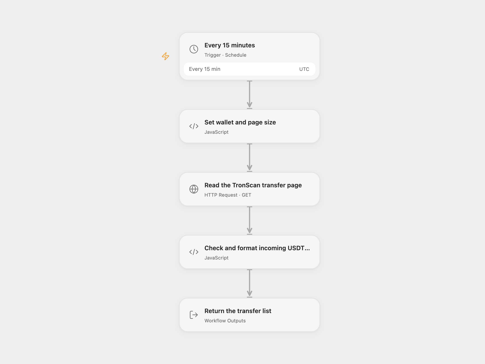

# List Incoming TRON USDT Transfers

Check a TRON wallet every 15 minutes and list older incoming USDT transfers with their confirmation and execution status.

<!-- template-actions:start -->
 
<!-- template-actions:end -->

<picture>
  <source media="(prefers-color-scheme: dark)" srcset="preview-dark.png">
  
</picture>

## Setup

1. In **Set wallet and page size**, enter your public TRON Mainnet wallet address and choose a page size from 1 to 50. The default is 20.
2. Create a [TronScan API key](https://docs.tronscan.org/en/api/api-keys) and save it as an Open Flow secret Variable. Bind that Variable to the API key input in **Read the TronScan transfer page**.
3. Enable the schedule. It runs every 15 minutes in UTC.

## Behavior

Each run reads one [TronScan page](https://docs.tronscan.org/en/api/transactions-and-transfers/token-trc20-transfers) for the official USDT contract and keeps transfer events addressed to the wallet at or before the 15-minute cutoff. The list includes exact USDT amounts as decimal strings, block times, transaction links, and separate confirmation and execution statuses. The monitored address appears as “Your wallet.”

The workflow returns an empty list when no transfers match. If the API reports additional rows, `moreAvailable` is true. Scheduled results can overlap, and the single page leaves older history outside the snapshot. API failures stop the run. The workflow only reads public transfer data.

In n8n

In **Set wallet and page size**, edit the wallet and page size. In **Read the TronScan transfer page**, attach a **Header Auth** credential with name `TRON-PRO-API-KEY` and your TronScan API key as its value. Activate **Every 15 minutes** for 15-minute polling, or run the schedule node manually to test the transfer list.

Inspiration &amp; credits

Adapted from [USDT and TRC20 wallet tracker API workflow](https://github.com/Zie619/n8n-workflows/blob/ae8cf6dc5b873cbb4f74587aa9180ed3a9f70682/workflows/Splitout/0386_Splitout_Filter_Update_Scheduled.json) in [Zie619/n8n-workflows](https://github.com/Zie619/n8n-workflows). Attribution: Nskha (original workflow) and Zie619 (collection). See the [original n8n listing](https://n8n.io/workflows/2053-usdt-and-trc20-wallet-tracker-api-workflow-for-n8n/).

The collection’s [MIT notice](https://github.com/Zie619/n8n-workflows/blob/94007c1445d9258a7da116646b79473e7c7c3282/LICENSE) is pinned at a later revision. This is the collection notice at that revision; it does not establish a separate original template author's license. Our changes are listed above; see [repository licensing](../../README.md#licensing).

> MIT License
>
> Copyright (c) 2025 Zie619
>
> Permission is hereby granted, free of charge, to any person obtaining a copy
> of this software and associated documentation files (the "Software"), to deal
> in the Software without restriction, including without limitation the rights
> to use, copy, modify, merge, publish, distribute, sublicense, and/or sell
> copies of the Software, and to permit persons to whom the Software is
> furnished to do so, subject to the following conditions:
>
> The above copyright notice and this permission notice shall be included in all
> copies or substantial portions of the Software.
>
> THE SOFTWARE IS PROVIDED "AS IS", WITHOUT WARRANTY OF ANY KIND, EXPRESS OR
> IMPLIED, INCLUDING BUT NOT LIMITED TO THE WARRANTIES OF MERCHANTABILITY,
> FITNESS FOR A PARTICULAR PURPOSE AND NONINFRINGEMENT. IN NO EVENT SHALL THE
> AUTHORS OR COPYRIGHT HOLDERS BE LIABLE FOR ANY CLAIM, DAMAGES OR OTHER
> LIABILITY, WHETHER IN AN ACTION OF CONTRACT, TORT OR OTHERWISE, ARISING FROM,
> OUT OF OR IN CONNECTION WITH THE SOFTWARE OR THE USE OR OTHER DEALINGS IN THE
> SOFTWARE.

