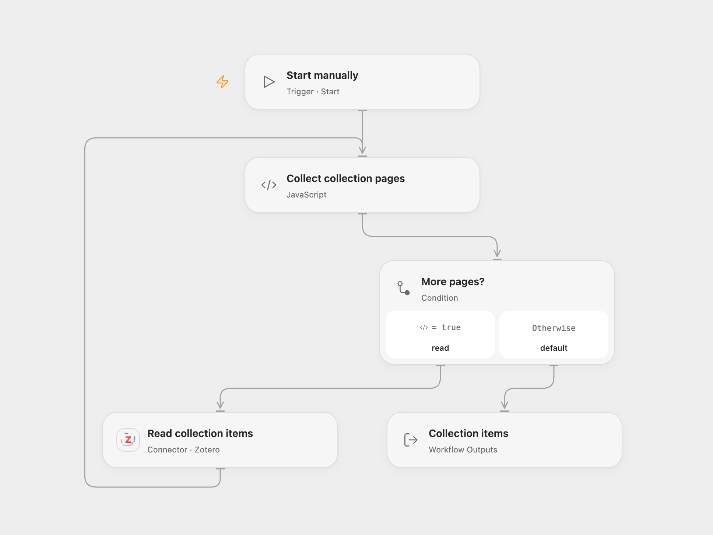

# List Zotero Collection Items

List item keys, titles and creator summaries from a Zotero collection.

<picture>
  <source media="(prefers-color-scheme: dark)" srcset="preview-dark.png">
  
</picture>

[Open Flow JSON](templates/list-zotero-collection-items.openflow.json) · [n8n JSON](templates/list-zotero-collection-items.n8n.json)

## Setup

In Open Flow, connect Zotero on **Read collection items** and set your eight-character collection key there. The connected user library is used by default; set its numeric user ID there if needed. The account must be able to read the library. In n8n, set the user ID and collection key in **Collection settings**, then create a Header Auth credential with name Zotero-API-Key and your Zotero API key as its value on **Read collection items**. Run either workflow manually.

## Behavior

The workflow reads the selected user's collection in pages of up to 100 and returns each item's key, title and creator summary. Missing titles or creator summaries are returned as empty strings. An empty collection returns an empty list. The collection can include notes and attachments, as in the source API request. API errors stop the run. Both formats stop above 10,000 items; Open Flow also requires the accumulated results to fit its Code limits. A collection that changes while pages are being fetched may produce an inconsistent list; rerun if a stable snapshot is required.

Inspiration &amp; credits

## Changes to the source

- Read the specified collection directly and follow pagination, replacing the source's initial first-page collection lookup and broken loop counter. Replace personal identifiers with configuration.
- Return the same key/title/creator fields with explicit empty values for missing optional fields.

Adapted from [List Zotero collection items](https://github.com/Zie619/n8n-workflows/blob/ae8cf6dc5b873cbb4f74587aa9180ed3a9f70682/workflows/Manual/0589_Manual_Filter_Update_Webhook.json) in [Zie619/n8n-workflows](https://github.com/Zie619/n8n-workflows). The source export does not identify a separate template author or license.

The collection’s [MIT notice](https://github.com/Zie619/n8n-workflows/blob/94007c1445d9258a7da116646b79473e7c7c3282/LICENSE) is pinned at a later revision. This is the collection notice at that revision; it does not establish a separate original template author's license. Our changes are listed above; see [repository licensing](../../README.md#licensing).

> MIT License
>
> Copyright (c) 2025 Zie619
>
> Permission is hereby granted, free of charge, to any person obtaining a copy
> of this software and associated documentation files (the "Software"), to deal
> in the Software without restriction, including without limitation the rights
> to use, copy, modify, merge, publish, distribute, sublicense, and/or sell
> copies of the Software, and to permit persons to whom the Software is
> furnished to do so, subject to the following conditions:
>
> The above copyright notice and this permission notice shall be included in all
> copies or substantial portions of the Software.
>
> THE SOFTWARE IS PROVIDED "AS IS", WITHOUT WARRANTY OF ANY KIND, EXPRESS OR
> IMPLIED, INCLUDING BUT NOT LIMITED TO THE WARRANTIES OF MERCHANTABILITY,
> FITNESS FOR A PARTICULAR PURPOSE AND NONINFRINGEMENT. IN NO EVENT SHALL THE
> AUTHORS OR COPYRIGHT HOLDERS BE LIABLE FOR ANY CLAIM, DAMAGES OR OTHER
> LIABILITY, WHETHER IN AN ACTION OF CONTRACT, TORT OR OTHERWISE, ARISING FROM,
> OUT OF OR IN CONNECTION WITH THE SOFTWARE OR THE USE OR OTHER DEALINGS IN THE
> SOFTWARE.

