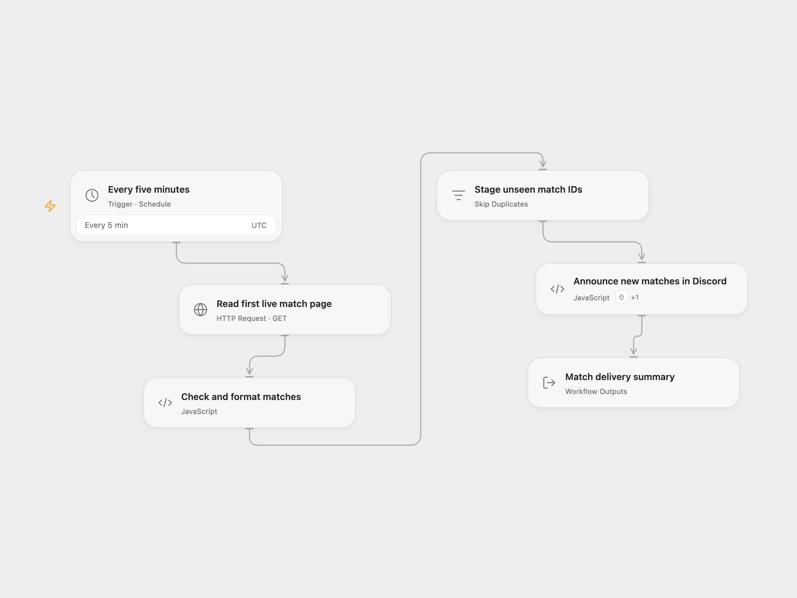

# Live Tennis Discord Alert

Check the first page of currently live tennis matches every five minutes and post a short Discord announcement for each previously unseen match ID.

<picture>
  <source media="(prefers-color-scheme: dark)" srcset="preview-dark.png">
  
</picture>

[Open Flow JSON](templates/live-tennis-discord-alert.openflow.json) · [n8n JSON](templates/live-tennis-discord-alert.n8n.json)

## Setup

Select a secret Variable containing your [Live Tennis API](https://livetennisapi.com/) key on **Read first live match page**. It is sent in the `X-API-Key` header. On **Announce new matches in Discord**, choose a Discord Bot account under Actions and set `channelId` to a channel where the bot can send messages.

In n8n, select a Header Auth credential whose header name is `X-API-Key` on **Get Live Matches**. Select a Discord Bot credential, server, and channel on **Discord**. The template uses a bot connection in both formats instead of the source’s incoming webhook URL.

The schedule is every five minutes in UTC. This uses **288 API requests per day**, plus any manual tests. Check your account’s request limits before enabling the schedule; adjust the schedule in both formats if needed.

## Behavior

Each run reads one page with `status=live`, `limit=50`, and `offset=0`. It does not enumerate later pages. A successful Open Flow result includes `hasMore` from the provider, or `null` if that metadata is absent. When it is true, additional matches were outside this poll. Matches that start and finish between polls can also be missed.

All returned records are checked before history is changed. Duplicate IDs within the same response are collapsed, preserving first appearance. New IDs are staged for deduplication, and messages are sent one at a time in that order. History is retained only after the entire execution succeeds. An empty page or a page containing only known IDs sends nothing. No workflow-level retries are configured.

If a Discord call fails, later messages are not attempted and that execution’s new IDs are not retained. A later poll can resend messages that succeeded earlier in the failed run. Inspect execution results and the channel before rerunning or clearing history. Clearing history also allows still-live matches to be announced again. This is not a guarantee of exactly-once delivery.

Open Flow uses persistent node-scoped deduplication storage, separated between draft and live runs. Its capacity is set by the platform; a full store fails the run before delivery. Use the workflow’s state controls to inspect or clear this node’s history. Replacing the node changes its history identity. n8n uses node-scoped workflow static data capped at 10,000 distinct IDs. At capacity, known IDs are still skipped, while a page with new IDs fails before sending. Reset that node’s static history with an explicit maintenance edit when needed. n8n saves static data only for successful executions of a published workflow called by its trigger; manual tests do not retain history. Static data is experimental and can be unreliable under high-frequency or overlapping executions. Run one workflow instance at a time; this template does not coordinate two independent imports or promise cross-platform shared history.

The Live Tennis API receives your query and key. Discord receives the player names and match status. No scores or betting information are sent.

## Changes to the source

- Make the source’s default first-page limit explicit and expose whether more pages exist.
- Correct the five-minute schedule’s daily request count.
- Validate match IDs, player names, status and Discord message length before recording history.
- Collapse duplicate IDs within a response.
- Retain new IDs only after a successful execution, replacing the source’s record-before-send behavior that could permanently skip messages after a failed delivery. Partial delivery can instead cause duplicate messages on a later poll.
- Use configurable API secrets and Discord Bot connections.

## Source and license

Adapted from [Post New Live Tennis Matches to Discord on a Schedule](https://github.com/enescingoz/awesome-n8n-templates/blob/827110332c21cbe000ab13f6d292d5adb1f1f8db/Discord/Post%20New%20Live%20Tennis%20Matches%20to%20Discord%20on%20a%20Schedule.json) in [enescingoz/awesome-n8n-templates](https://github.com/enescingoz/awesome-n8n-templates). The source identifies **the team behind Live Tennis API** as its contributor and discloses that affiliation. No separate template license is stated in the export.

Source collection notice: © 2024–2026 Enes Cingoz, [CC BY 4.0](https://github.com/enescingoz/awesome-n8n-templates/blob/827110332c21cbe000ab13f6d292d5adb1f1f8db/LICENSE). See [repository licensing](../../README.md#licensing) for the scope of OOMOL contributions and third-party material.
