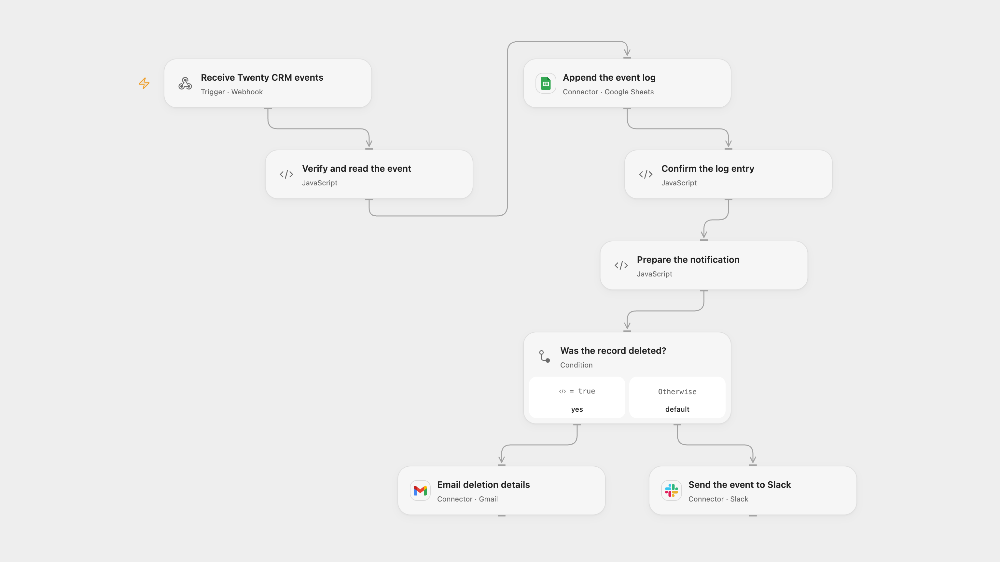

# Log and Route Twenty CRM Events

Log signed Twenty CRM record events and notify email for deletions or Slack for other changes.

<picture>
  <source media="(prefers-color-scheme: dark)" srcset="preview-dark.png">
  
</picture>

[Open Flow JSON](templates/log-and-route-twenty-crm-events.openflow.json) · [n8n JSON](templates/log-and-route-twenty-crm-events.n8n.json)

## Setup

Create a Twenty CRM webhook with a signing secret and subscribe to record events. In Open Flow create a secret Variable named **TWENTY_WEBHOOK_SECRET** with the same secret, bind it in **Verify and read the event**, enable the webhook and enter its URL in Twenty. Connect Google Sheets, Gmail and Slack; set the spreadsheet ID/range, email recipient and Slack channel ID in their respective nodes. Prepare sheet columns in this order: eventName, objectMetadata.id, objectMetadata.nameSingular, record.id, record.__typename.

In n8n configure the same webhook secret as an n8n Variable **TWENTY_WEBHOOK_SECRET**, connect Google Sheets, Gmail and Slack, and set the spreadsheet, recipient and channel in their nodes. Activate the webhook and configure its URL in Twenty. Use one format.

## Behavior

A signed record event is logged once before a notification. Deletion events ending in delete or deleted send email; other events go to Slack. Invalid signatures, timestamps more than 15 minutes away, or missing record identifiers stop before writes. The webhook acknowledges receipt immediately; that response does not confirm signature validation or completion. Open Flow accepts request bodies up to 64 KiB. The workflow expects Twenty's signed record-event payload and stores only the five configured event fields in Sheets. Values are RAW and Slack control characters in event fields are escaped. Restrict access to webhook URLs, secrets and execution history.

A failed or uncertain log append may already have succeeded. A failed notification can leave the log row saved; an uncertain notification may already be delivered. Check Sheets and the destination before replaying. The workflow keeps no event deduplication history and adds no automatic write retry.

## Changes to the source

- Replace private endpoints and destinations with setup and verify the Twenty signature before side effects.
- Fix the source's duplicate direct notification path so each accepted event is logged before one notification. Route current deleted event names as well as delete.

Source and license

Adapted from [Get event triggered notifications / updates on preferred messaging channels with TwentyCRM](https://github.com/Zie619/n8n-workflows/blob/ae8cf6dc5b873cbb4f74587aa9180ed3a9f70682/workflows/Webhook/1477_Webhook_Slack_Update_Webhook.json) in [Zie619/n8n-workflows](https://github.com/Zie619/n8n-workflows). The source export does not identify a separate template author or license.

The collection’s [MIT notice](https://github.com/Zie619/n8n-workflows/blob/94007c1445d9258a7da116646b79473e7c7c3282/LICENSE) is pinned at a later revision. This is the collection notice at that revision; it does not establish a separate original template author's license. Our changes are listed above; see [repository licensing](../../README.md#licensing).

> MIT License
>
> Copyright (c) 2025 Zie619
>
> Permission is hereby granted, free of charge, to any person obtaining a copy
> of this software and associated documentation files (the "Software"), to deal
> in the Software without restriction, including without limitation the rights
> to use, copy, modify, merge, publish, distribute, sublicense, and/or sell
> copies of the Software, and to permit persons to whom the Software is
> furnished to do so, subject to the following conditions:
>
> The above copyright notice and this permission notice shall be included in all
> copies or substantial portions of the Software.
>
> THE SOFTWARE IS PROVIDED "AS IS", WITHOUT WARRANTY OF ANY KIND, EXPRESS OR
> IMPLIED, INCLUDING BUT NOT LIMITED TO THE WARRANTIES OF MERCHANTABILITY,
> FITNESS FOR A PARTICULAR PURPOSE AND NONINFRINGEMENT. IN NO EVENT SHALL THE
> AUTHORS OR COPYRIGHT HOLDERS BE LIABLE FOR ANY CLAIM, DAMAGES OR OTHER
> LIABILITY, WHETHER IN AN ACTION OF CONTRACT, TORT OR OTHERWISE, ARISING FROM,
> OUT OF OR IN CONNECTION WITH THE SOFTWARE OR THE USE OR OTHER DEALINGS IN THE
> SOFTWARE.

