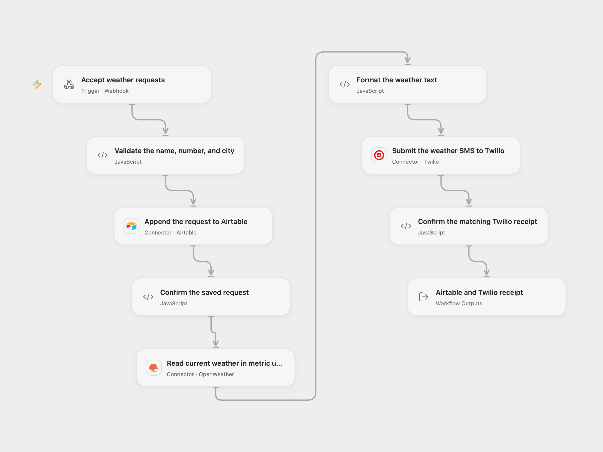

# Log Weather Requests and Send an SMS

Save an incoming name, number, and city to Airtable and text that number the current weather.

<!-- template-actions:start -->
 
<!-- template-actions:end -->

<picture>
  <source media="(prefers-color-scheme: dark)" srcset="preview-dark.png">
  
</picture>

## Setup

1. Create three text fields named `Name`, `Number`, and `City` in Airtable. Connect Airtable and choose the base and table in **Append the request to Airtable**.
2. Connect OpenWeather and Twilio. Configure your SMS-capable Twilio number in E.164 format in **Validate the name, number, and city**.
3. Create the secret variable `WEATHER_WEBHOOK_KEY`. On **Accept weather requests**, configure **Header** authentication with header name `X-Weather-Webhook-Key` and select the secret.
4. Keep **Enable Writes** off while testing the HTTPS webhook. A request without the secret should return HTTP 401. A request with the secret should acknowledge the run, which stops before writing. Turn on **Enable Writes** in **Validate the name, number, and city** and publish the completed configuration.

Send an HTTPS POST with that header and a JSON object containing `name`, `number`, and `city`. Use an E.164 destination such as `+12025550101` and qualify ambiguous cities with a country code, such as `Paris,FR`.

## Behavior

The webhook acknowledges the request immediately. The workflow creates one Airtable row, reads the specified city's current weather, and asks Twilio to text the same number. The message includes the temperature in Celsius, conditions, relative humidity, and wind speed in metres per second. The run returns the Airtable record ID and the Twilio message SID. A queued status confirms submission to Twilio.

If Airtable does not confirm the row, the workflow stops. A weather failure leaves the saved row and stops before sending. If Twilio's result is uncertain, check the Airtable row and Twilio message log before submitting again. Each submission starts a new run.

In n8n

Attach a **Header Auth** credential to **Accept weather requests**, with name `X-Weather-Webhook-Key` and your secret value. Configure the Twilio number in **Validate the name, number, and city**, then connect Twilio, OpenWeatherMap, and Airtable. Select Airtable's base and table by ID. Give the Airtable credential access to create records in that base. Verify authentication, set `enableWrites` to `true` in **Validate the name, number, and city**, and activate the workflow.

Inspiration &amp; credits

Adapted from [Store and send information about the weather for any city via SMS](https://github.com/Zie619/n8n-workflows/blob/ae8cf6dc5b873cbb4f74587aa9180ed3a9f70682/workflows/Openweathermap/1119_Openweathermap_Twilio_Automate_Webhook.json) in [Zie619/n8n-workflows](https://github.com/Zie619/n8n-workflows). Attribution: amudhan (original workflow) / Zie619 (collection). See the [original n8n gallery template](https://n8n.io/workflows/738-store-and-send-information-about-the-weather-for-any-city-via-sms/).

The collection’s [MIT notice](https://github.com/Zie619/n8n-workflows/blob/94007c1445d9258a7da116646b79473e7c7c3282/LICENSE) is pinned at a later revision. This is the collection notice at that revision; it does not establish a separate original template author's license. Our changes are listed above; see [repository licensing](../../README.md#licensing).

> MIT License
>
> Copyright (c) 2025 Zie619
>
> Permission is hereby granted, free of charge, to any person obtaining a copy
> of this software and associated documentation files (the "Software"), to deal
> in the Software without restriction, including without limitation the rights
> to use, copy, modify, merge, publish, distribute, sublicense, and/or sell
> copies of the Software, and to permit persons to whom the Software is
> furnished to do so, subject to the following conditions:
>
> The above copyright notice and this permission notice shall be included in all
> copies or substantial portions of the Software.
>
> THE SOFTWARE IS PROVIDED "AS IS", WITHOUT WARRANTY OF ANY KIND, EXPRESS OR
> IMPLIED, INCLUDING BUT NOT LIMITED TO THE WARRANTIES OF MERCHANTABILITY,
> FITNESS FOR A PARTICULAR PURPOSE AND NONINFRINGEMENT. IN NO EVENT SHALL THE
> AUTHORS OR COPYRIGHT HOLDERS BE LIABLE FOR ANY CLAIM, DAMAGES OR OTHER
> LIABILITY, WHETHER IN AN ACTION OF CONTRACT, TORT OR OTHERWISE, ARISING FROM,
> OUT OF OR IN CONNECTION WITH THE SOFTWARE OR THE USE OR OTHER DEALINGS IN THE
> SOFTWARE.

