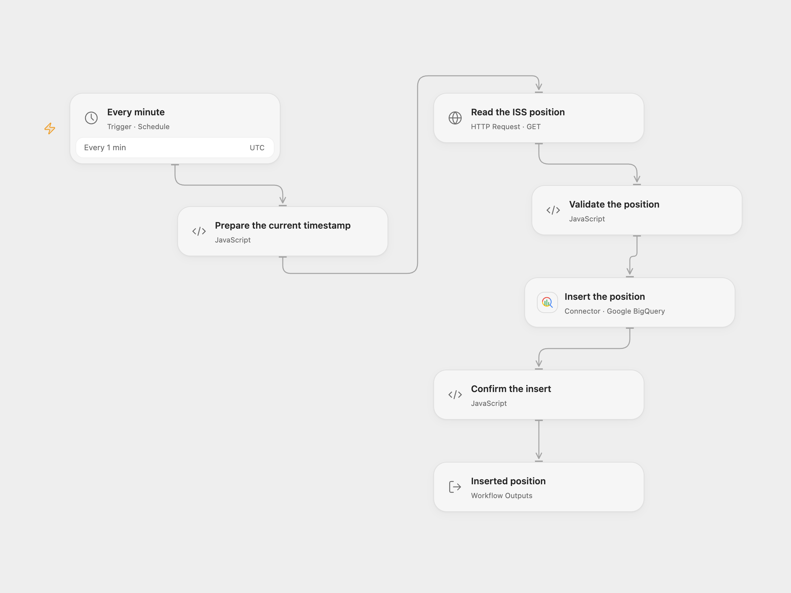

# Log ISS Position to BigQuery

Record the current International Space Station position in a BigQuery table each minute.

<picture>
  <source media="(prefers-color-scheme: dark)" srcset="preview-dark.png">
  
</picture>

[Open Flow JSON](templates/log-iss-position-to-bigquery.openflow.json) · [n8n JSON](templates/log-iss-position-to-bigquery.n8n.json)

## Setup

Create a BigQuery table with columns `name` (STRING), `latitude` and `longitude` (FLOAT), and `timestamp` (INTEGER, Unix seconds). Connect Google BigQuery and set the project, dataset and table IDs on **Insert the position**. Grant the connection permission to insert rows. In n8n, set the same IDs and connect a Google BigQuery OAuth2 credential on **Google BigQuery**. Activate one format.

## Behavior

Each minute the workflow requests the ISS position for the current Unix second and inserts its name, latitude, longitude and timestamp as one row. A malformed position, HTTP failure, BigQuery error or row-level insert error stops the run. The workflow uses UTC as its schedule starting point; the source inherited the n8n instance timezone. n8n Cron V1 selects a fixed second within the minute; Open Flow uses the minute boundary.

A failed or uncertain insert may have reached BigQuery. Check the table before retrying; the workflow does not assign a deduplication ID or automatically retry. Repeated runs can create duplicate rows. Open Flow does not follow HTTP redirects and applies a 30-second timeout and 4 MiB response limit; n8n uses its HTTP node defaults. The position API is rate limited.

Inspiration &amp; credits

## Changes to the source

- Replace private BigQuery identifiers with configuration, and send the current Unix time in seconds instead of milliseconds.
- Validate the returned position and inspect BigQuery row-level errors. Set UTC explicitly.

Adapted from [ISS position to BigQuery](https://github.com/Zie619/n8n-workflows/blob/ae8cf6dc5b873cbb4f74587aa9180ed3a9f70682/workflows/Http/0023_HTTP_Googlebigquery_Automation_Scheduled.json) in [Zie619/n8n-workflows](https://github.com/Zie619/n8n-workflows). The matching [n8n listing](https://n8n.io/workflows/1049-send-location-updates-of-the-iss-every-minute-to-a-table-in-google-bigquery/) credits Harshil Agrawal. The original template does not state a separate license.

The collection’s [MIT notice](https://github.com/Zie619/n8n-workflows/blob/94007c1445d9258a7da116646b79473e7c7c3282/LICENSE) is pinned at a later revision. This is the collection notice at that revision; it does not establish a separate original template author's license. Our changes are listed above; see [repository licensing](../../README.md#licensing).

> MIT License
>
> Copyright (c) 2025 Zie619
>
> Permission is hereby granted, free of charge, to any person obtaining a copy
> of this software and associated documentation files (the "Software"), to deal
> in the Software without restriction, including without limitation the rights
> to use, copy, modify, merge, publish, distribute, sublicense, and/or sell
> copies of the Software, and to permit persons to whom the Software is
> furnished to do so, subject to the following conditions:
>
> The above copyright notice and this permission notice shall be included in all
> copies or substantial portions of the Software.
>
> THE SOFTWARE IS PROVIDED "AS IS", WITHOUT WARRANTY OF ANY KIND, EXPRESS OR
> IMPLIED, INCLUDING BUT NOT LIMITED TO THE WARRANTIES OF MERCHANTABILITY,
> FITNESS FOR A PARTICULAR PURPOSE AND NONINFRINGEMENT. IN NO EVENT SHALL THE
> AUTHORS OR COPYRIGHT HOLDERS BE LIABLE FOR ANY CLAIM, DAMAGES OR OTHER
> LIABILITY, WHETHER IN AN ACTION OF CONTRACT, TORT OR OTHERWISE, ARISING FROM,
> OUT OF OR IN CONNECTION WITH THE SOFTWARE OR THE USE OR OTHER DEALINGS IN THE
> SOFTWARE.

