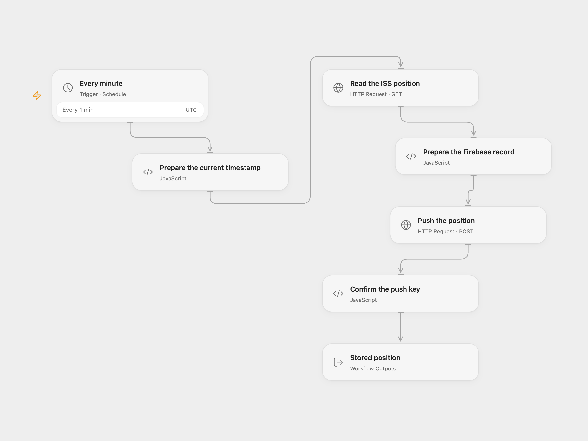

# Log ISS Position to Firebase

Append the current International Space Station position to Firebase Realtime Database every minute.

<picture>
  <source media="(prefers-color-scheme: dark)" srcset="preview-dark.png">
  
</picture>

[Open Flow JSON](templates/log-iss-position-to-firebase.openflow.json) · [n8n JSON](templates/log-iss-position-to-firebase.n8n.json)

## Setup

In Open Flow, use a Firebase Realtime Database that already has a legacy database secret. Set its HTTPS database URL ending in /iss.json in **Prepare the Firebase record**. Create a secret Variable with that database secret and bind it to **Auth Token** in **Push the position**. Legacy database secrets are administrative credentials; restrict access to the Variable and database. The Firebase REST API still supports them, but they are not the same as Firebase API keys or user ID tokens.

In n8n, connect a Google Firebase Realtime Database OAuth2 credential and select the database in **Google Cloud Realtime Database**. The configured account must be permitted to write /iss. Activate one format.

## Behavior

Each minute the workflow requests the ISS position for the current Unix second and appends latitude, longitude and timestamp under /iss with a generated Firebase key. A malformed position, API failure or missing returned key stops the run. The workflow uses UTC as its schedule starting point; the source inherited the n8n instance timezone. n8n Cron V1 selects a fixed second within the minute; Open Flow uses the minute boundary.

A failed or uncertain push may have reached Firebase. Check /iss before retrying; the workflow does not assign a deduplication ID or add a workflow retry, and repeated runs can create duplicates. Open Flow sends its legacy secret in the request URL; URLs may appear in service or proxy logs. n8n sends an OAuth2 bearer token. Open Flow does not follow redirects and applies a 30-second timeout and 4 MiB response limit; n8n uses its HTTP node defaults.

Inspiration &amp; credits

## Changes to the source

- Replace the database identifier with configuration and send current Unix time in seconds instead of milliseconds.
- Validate the returned position and the Firebase push key, and set UTC explicitly. Open Flow uses the Firebase REST API and a legacy database secret; n8n retains its native Firebase OAuth2 node.

Adapted from [ISS position to Firebase Realtime Database](https://github.com/Zie619/n8n-workflows/blob/ae8cf6dc5b873cbb4f74587aa9180ed3a9f70682/workflows/Http/0136_HTTP_Googlefirebaserealtimedatabase_Update_Webhook.json) in [Zie619/n8n-workflows](https://github.com/Zie619/n8n-workflows). The matching [n8n listing](https://n8n.io/workflows/787-receive-updates-for-the-position-of-the-iss-and-push-it-to-a-firbase/) credits Harshil Agrawal. The original template does not state a separate license.

The collection’s [MIT notice](https://github.com/Zie619/n8n-workflows/blob/94007c1445d9258a7da116646b79473e7c7c3282/LICENSE) is pinned at a later revision. This is the collection notice at that revision; it does not establish a separate original template author's license. Our changes are listed above; see [repository licensing](../../README.md#licensing).

> MIT License
>
> Copyright (c) 2025 Zie619
>
> Permission is hereby granted, free of charge, to any person obtaining a copy
> of this software and associated documentation files (the "Software"), to deal
> in the Software without restriction, including without limitation the rights
> to use, copy, modify, merge, publish, distribute, sublicense, and/or sell
> copies of the Software, and to permit persons to whom the Software is
> furnished to do so, subject to the following conditions:
>
> The above copyright notice and this permission notice shall be included in all
> copies or substantial portions of the Software.
>
> THE SOFTWARE IS PROVIDED "AS IS", WITHOUT WARRANTY OF ANY KIND, EXPRESS OR
> IMPLIED, INCLUDING BUT NOT LIMITED TO THE WARRANTIES OF MERCHANTABILITY,
> FITNESS FOR A PARTICULAR PURPOSE AND NONINFRINGEMENT. IN NO EVENT SHALL THE
> AUTHORS OR COPYRIGHT HOLDERS BE LIABLE FOR ANY CLAIM, DAMAGES OR OTHER
> LIABILITY, WHETHER IN AN ACTION OF CONTRACT, TORT OR OTHERWISE, ARISING FROM,
> OUT OF OR IN CONNECTION WITH THE SOFTWARE OR THE USE OR OTHER DEALINGS IN THE
> SOFTWARE.

