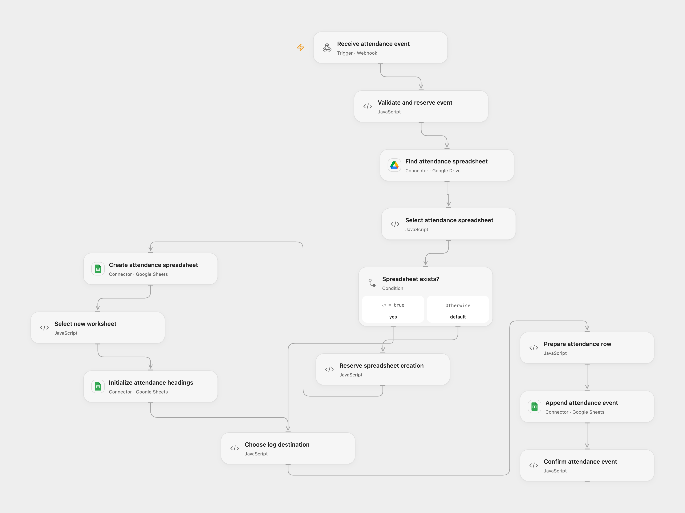

# Log Location Attendance to Sheets

Log check-in and check-out events from location shortcuts to a Google Sheet.

<!-- template-actions:start -->
 
<!-- template-actions:end -->

<picture>
  <source media="(prefers-color-scheme: dark)" srcset="preview-dark.png">
  
</picture>

## Setup and use

Connect Drive and Sheets and enable persistent State. Set ATTENDANCE_WEBHOOK_AUTH to the shared signing secret. Create iPhone location automations that call the webhook with Direction set to Check-In or Check-Out, a unique Request-ID for each event, and X-Signature set to the hex HMAC-SHA256 of Request-ID, a newline and Direction using that secret. Retain the same Request-ID when retrying. Dates and times use UTC. Configure Google Drive and Sheets credentials on their nodes, including the Sheets HTTP node.

The workflow finds the spreadsheet named WorkTimeTracking or creates it and its headings. Existing spreadsheets need a Worklog worksheet with Date, Time and Direction columns. A newly created spreadsheet uses its default worksheet. Avoid simultaneous first runs. Inspect the spreadsheet and pending state before any retry after an uncertain write; a repeated request does not append automatically. In Open Flow clear the exact attendance:<Request-ID> pending State only after verifying that no row was added; if it was added, mark it done. If spreadsheet creation or heading initialization is uncertain, inspect the spreadsheet and its attendance:spreadsheet checkpoint before another creation.

In n8n

In self-hosted n8n, set ATTENDANCE_WEBHOOK_AUTH in the environment, enable NODE_FUNCTION_ALLOW_BUILTIN=crypto and set N8N_BLOCK_ENV_ACCESS_IN_NODE=false. Select a Data Table with text columns item_key and status on all checkpoint nodes. In n8n inspect and reconcile that key in the Data Table.

Inspiration &amp; credits

Associate created spreadsheets with their first log entry and add authenticated requests and pending checkpoints.

Adapted from [Automated Work Attendance with Location Triggers](https://github.com/Zie619/n8n-workflows/blob/ae8cf6dc5b873cbb4f74587aa9180ed3a9f70682/workflows/Code/2008_Code_Webhook_Automate_Webhook.json) in [Zie619/n8n-workflows](https://github.com/Zie619/n8n-workflows). Attribution: Zie619 / n8n-workflows.

The collection’s [MIT notice](https://github.com/Zie619/n8n-workflows/blob/94007c1445d9258a7da116646b79473e7c7c3282/LICENSE) is pinned at a later revision. This is the collection notice at that revision; it does not establish a separate original template author's license. Our changes are listed above; see [repository licensing](../../README.md#licensing).

> MIT License
>
> Copyright (c) 2025 Zie619
>
> Permission is hereby granted, free of charge, to any person obtaining a copy
> of this software and associated documentation files (the "Software"), to deal
> in the Software without restriction, including without limitation the rights
> to use, copy, modify, merge, publish, distribute, sublicense, and/or sell
> copies of the Software, and to permit persons to whom the Software is
> furnished to do so, subject to the following conditions:
>
> The above copyright notice and this permission notice shall be included in all
> copies or substantial portions of the Software.
>
> THE SOFTWARE IS PROVIDED "AS IS", WITHOUT WARRANTY OF ANY KIND, EXPRESS OR
> IMPLIED, INCLUDING BUT NOT LIMITED TO THE WARRANTIES OF MERCHANTABILITY,
> FITNESS FOR A PARTICULAR PURPOSE AND NONINFRINGEMENT. IN NO EVENT SHALL THE
> AUTHORS OR COPYRIGHT HOLDERS BE LIABLE FOR ANY CLAIM, DAMAGES OR OTHER
> LIABILITY, WHETHER IN AN ACTION OF CONTRACT, TORT OR OTHERWISE, ARISING FROM,
> OUT OF OR IN CONNECTION WITH THE SOFTWARE OR THE USE OR OTHER DEALINGS IN THE
> SOFTWARE.

