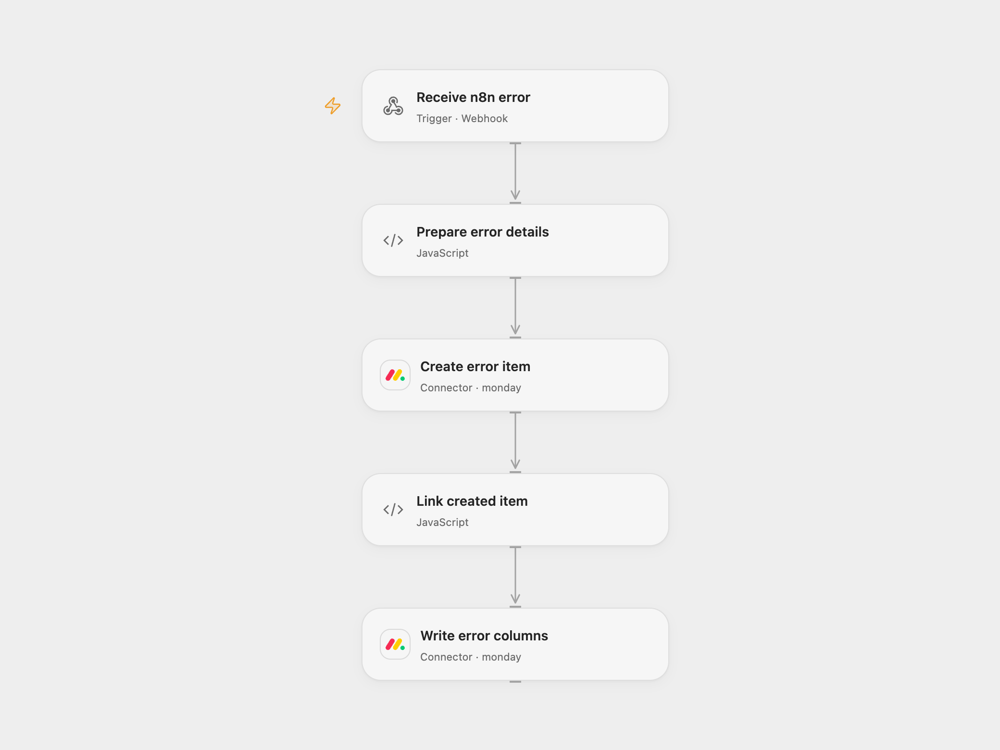

# Log n8n Execution Errors to Monday

Create a Monday item for an n8n execution error and save its details in board columns.

<picture>
  <source media="(prefers-color-scheme: dark)" srcset="preview-dark.png">
  
</picture>

[Open Flow JSON](templates/log-n8n-execution-errors-to-monday.openflow.json) · [n8n JSON](templates/log-n8n-execution-errors-to-monday.n8n.json)

## Setup

Connect Monday and set the same board ID in **Create error item** and **Write error columns**, and the group ID in **Create error item**. Set four distinct column IDs for workflow name (text), escaped stack (long text), error message (text) and date (text) in **Prepare error details**. Deploy the Open Flow webhook. In the bundled n8n workflow, set **Choose delivery mode** to `relay` and configure the Open Flow URL in **Forward error to Open Flow**. Select this workflow as the error workflow for the workflows to monitor. Do not assign it to itself.

For n8n-only operation select `direct`, connect Monday, set its board and group, and configure the four column IDs in **Prepare Monday columns**. Use one mode. The webhook is unauthenticated and can create Monday items; restrict access to trusted callers.

## Behavior

An error event creates an item named with its execution ID, then fills columns with workflow name, the source-style escaped stack, error message and current UTC time. The webhook acknowledges before the Monday writes complete. The escaped stack must fit the Monday long-text limit of 2,000 characters. Error details can contain sensitive information; restrict board and execution access. A failed or uncertain create may have succeeded and an uncertain update may also have succeeded. Check Monday before retrying.

Inspiration &amp; credits

## Changes to the source

- Replace private board and placeholder columns with required configuration, use valid JSON for column values and add an optional n8n error-event relay for Open Flow.

Adapted from [Log n8n errors to Monday](https://github.com/Zie619/n8n-workflows/blob/ae8cf6dc5b873cbb4f74587aa9180ed3a9f70682/workflows/Error/0395_Error_Mondaycom_Update_Triggered.json) in [Zie619/n8n-workflows](https://github.com/Zie619/n8n-workflows). The source export does not identify a separate template author or license.

The collection’s [MIT notice](https://github.com/Zie619/n8n-workflows/blob/94007c1445d9258a7da116646b79473e7c7c3282/LICENSE) is pinned at a later revision. This is the collection notice at that revision; it does not establish a separate original template author's license. Our changes are listed above; see [repository licensing](../../README.md#licensing).

> MIT License
>
> Copyright (c) 2025 Zie619
>
> Permission is hereby granted, free of charge, to any person obtaining a copy
> of this software and associated documentation files (the "Software"), to deal
> in the Software without restriction, including without limitation the rights
> to use, copy, modify, merge, publish, distribute, sublicense, and/or sell
> copies of the Software, and to permit persons to whom the Software is
> furnished to do so, subject to the following conditions:
>
> The above copyright notice and this permission notice shall be included in all
> copies or substantial portions of the Software.
>
> THE SOFTWARE IS PROVIDED "AS IS", WITHOUT WARRANTY OF ANY KIND, EXPRESS OR
> IMPLIED, INCLUDING BUT NOT LIMITED TO THE WARRANTIES OF MERCHANTABILITY,
> FITNESS FOR A PARTICULAR PURPOSE AND NONINFRINGEMENT. IN NO EVENT SHALL THE
> AUTHORS OR COPYRIGHT HOLDERS BE LIABLE FOR ANY CLAIM, DAMAGES OR OTHER
> LIABILITY, WHETHER IN AN ACTION OF CONTRACT, TORT OR OTHERWISE, ARISING FROM,
> OUT OF OR IN CONNECTION WITH THE SOFTWARE OR THE USE OR OTHER DEALINGS IN THE
> SOFTWARE.

