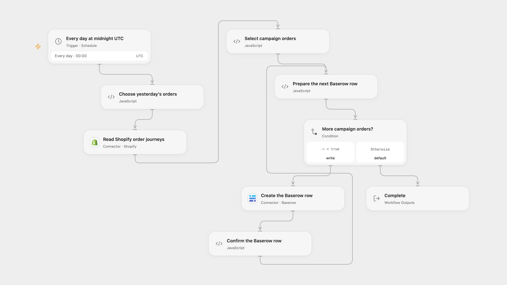

# Log Shopify Order Campaigns in Baserow

Record Shopify orders with a first-visit campaign in Baserow each day.

<picture>
  <source media="(prefers-color-scheme: dark)" srcset="preview-dark.png">
  
</picture>

[Open Flow JSON](templates/log-shopify-order-campaigns-in-baserow.openflow.json) · [n8n JSON](templates/log-shopify-order-campaigns-in-baserow.n8n.json)

## Setup

Connect Shopify with the read_orders scope and Baserow Cloud with permission to create rows. Set the Baserow table ID in **Create the Baserow row**. Create fields named Order, Campaign, Content, Medium, Source, Revenue and Currency; Configure Revenue as a decimal field with sufficient precision for the shop currency and Currency as text. In n8n, configure the Shopify shop domain and Header Auth credential with name X-Shopify-Access-Token and a Shopify Admin API token, connect a Baserow username/password credential, select its database and table, and map the order, campaign, content, medium, source, revenue and currency expressions to their matching fields. Enable only one format and avoid overlapping runs.

## Behavior

At midnight UTC, request the first 100 Shopify orders created during the previous UTC calendar day. For each whose first visit has a campaign value, create a Baserow row with the order name, campaign, content, medium, source, total received in shop currency, and that currency. An empty campaign string is a present value. Missing journey or first-visit data is skipped; a journey that Shopify reports as not ready stops before any Baserow writes. All selected order data is validated before writes begin.

Only the first 100 orders are checked, as in the source; Open Flow reports whether Shopify has more. When attribution is not ready, the whole batch stops before writing and later scheduled runs move to a new date. To retry that batch, set the override date in **Choose yesterday’s orders** to its UTC date in YYYY-MM-DD format, run the workflow, then clear the override. Older orders can require Shopify all-orders access. A Baserow write can succeed even if the response is lost. Earlier rows remain if a later create fails, and retrying can create duplicates. Check Baserow before retrying. Open Flow starts at the minute boundary; n8n chooses a fixed second within the minute.

Inspiration &amp; credits

## Changes to the source

- Replace private shop, table and field IDs, use the current Shopify money object and include its shop currency with the amount.
- Correct Source to the UTM source rather than the original medium mapping. Keep decimal amounts as strings rather than converting them to floating point.
- Use the previous UTC calendar day instead of the n8n instance timezone, validate order data before writes and stop when attribution is not ready.

Adapted from [Shopify order UTM to Baserow](https://github.com/Zie619/n8n-workflows/blob/ae8cf6dc5b873cbb4f74587aa9180ed3a9f70682/workflows/Splitout/1780_Splitout_Schedule_Automation_Scheduled.json) in [Zie619/n8n-workflows](https://github.com/Zie619/n8n-workflows). The source export does not identify a separate template author or license.

The collection’s [MIT notice](https://github.com/Zie619/n8n-workflows/blob/94007c1445d9258a7da116646b79473e7c7c3282/LICENSE) is pinned at a later revision. This is the collection notice at that revision; it does not establish a separate original template author's license. Our changes are listed above; see [repository licensing](../../README.md#licensing).

> MIT License
>
> Copyright (c) 2025 Zie619
>
> Permission is hereby granted, free of charge, to any person obtaining a copy
> of this software and associated documentation files (the "Software"), to deal
> in the Software without restriction, including without limitation the rights
> to use, copy, modify, merge, publish, distribute, sublicense, and/or sell
> copies of the Software, and to permit persons to whom the Software is
> furnished to do so, subject to the following conditions:
>
> The above copyright notice and this permission notice shall be included in all
> copies or substantial portions of the Software.
>
> THE SOFTWARE IS PROVIDED "AS IS", WITHOUT WARRANTY OF ANY KIND, EXPRESS OR
> IMPLIED, INCLUDING BUT NOT LIMITED TO THE WARRANTIES OF MERCHANTABILITY,
> FITNESS FOR A PARTICULAR PURPOSE AND NONINFRINGEMENT. IN NO EVENT SHALL THE
> AUTHORS OR COPYRIGHT HOLDERS BE LIABLE FOR ANY CLAIM, DAMAGES OR OTHER
> LIABILITY, WHETHER IN AN ACTION OF CONTRACT, TORT OR OTHERWISE, ARISING FROM,
> OUT OF OR IN CONNECTION WITH THE SOFTWARE OR THE USE OR OTHER DEALINGS IN THE
> SOFTWARE.

