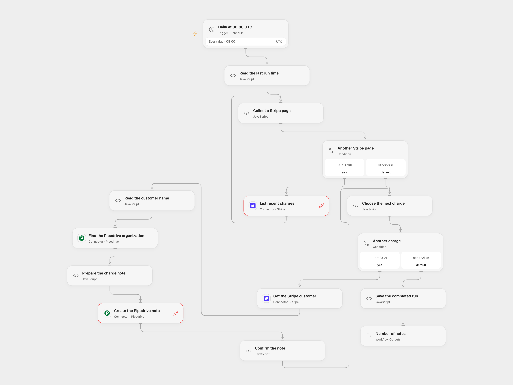

# Log Stripe Charges in Pipedrive

Find recent successful Stripe charges and add their details to matching Pipedrive organizations.

<picture>
  <source media="(prefers-color-scheme: dark)" srcset="preview-dark.png">
  
</picture>

[Open Flow JSON](templates/log-stripe-charges-in-pipedrive.openflow.json) · [n8n JSON](templates/log-stripe-charges-in-pipedrive.n8n.json)

## Setup

Connect Stripe to the charge search and customer lookup. Connect Pipedrive to the organization search and note request, and grant Provider API access. Keep workflow State persistent and avoid overlapping runs. In n8n, connect the same Stripe and Pipedrive accounts. Activate one format.

## Behavior

Each day during 08:00 UTC, find succeeded Stripe charges created from the saved run time up to, but excluding, the current run time, resolve each charge customer and find the Pipedrive organization by customer name. Open Flow runs at the minute boundary; n8n uses a fixed second within that minute. The first run saves a baseline at the current time before reading, even if the read subsequently fails. Each note contains the charge description, original charge amount formatted using Stripe charge currency units, and currency. The amount is not reduced for later refunds. It follows [Stripe charge currency rules](https://docs.stripe.com/currencies), including zero- and three-decimal currencies and the ISK/UGX compatibility rules. Unsupported currency codes stop before writing. Both formats require each charge to have a customer with a name and exactly one case-insensitive matching Pipedrive organization; missing or ambiguous matches stop the run. Open Flow reads every Stripe search page subject to the host execution limits. n8n stops with an error if more than 100 charge pages are needed. The source did not specify a timezone; review the UTC setting. Charges that were not yet successful when their created-time window was read are not revisited later. When at least one note is created and all notes are confirmed, the workflow advances the saved run time. An empty successful set keeps the previous time and is read again on the next run; in n8n this can eventually reach the 100-page limit. A failed or uncertain note does not advance an existing baseline and can already exist; inspect Pipedrive before rerunning. Earlier notes in the run may have been created; if a note or final State save fails, a retry may duplicate them.

## Changes to the source

- Correct the source assumption that every currency uses two decimal places; apply Stripe charge-specific units. Connect the otherwise disconnected customer data path, read all charge pages rather than only the first, and match organizations by exact name rather than an unassociated result. Escape the note text as HTML.
- Read the Stripe charges list by creation time and filter for successful charges, avoiding the source search index delay. Use the Stripe and Pipedrive Provider APIs and current Connector Actions.

Source and license

Adapted from [Create notes in Pipedrive for Stripe charges](https://github.com/Zie619/n8n-workflows/blob/ae8cf6dc5b873cbb4f74587aa9180ed3a9f70682/workflows/Functionitem/0246_Functionitem_Pipedrive_Create_Scheduled.json) in [Zie619/n8n-workflows](https://github.com/Zie619/n8n-workflows). The matching [n8n listing](https://n8n.io/workflows/1776-sync-payment-and-customer-data-between-stripe-and-pipedrive/) credits n8n Team. No separate original template license was found.

The collection’s [MIT notice](https://github.com/Zie619/n8n-workflows/blob/94007c1445d9258a7da116646b79473e7c7c3282/LICENSE) is pinned at a later revision. This is the collection notice at that revision; it does not establish a separate original template author's license. Our changes are listed above; see [repository licensing](../../README.md#licensing).

> MIT License
>
> Copyright (c) 2025 Zie619
>
> Permission is hereby granted, free of charge, to any person obtaining a copy
> of this software and associated documentation files (the "Software"), to deal
> in the Software without restriction, including without limitation the rights
> to use, copy, modify, merge, publish, distribute, sublicense, and/or sell
> copies of the Software, and to permit persons to whom the Software is
> furnished to do so, subject to the following conditions:
>
> The above copyright notice and this permission notice shall be included in all
> copies or substantial portions of the Software.
>
> THE SOFTWARE IS PROVIDED "AS IS", WITHOUT WARRANTY OF ANY KIND, EXPRESS OR
> IMPLIED, INCLUDING BUT NOT LIMITED TO THE WARRANTIES OF MERCHANTABILITY,
> FITNESS FOR A PARTICULAR PURPOSE AND NONINFRINGEMENT. IN NO EVENT SHALL THE
> AUTHORS OR COPYRIGHT HOLDERS BE LIABLE FOR ANY CLAIM, DAMAGES OR OTHER
> LIABILITY, WHETHER IN AN ACTION OF CONTRACT, TORT OR OTHERWISE, ARISING FROM,
> OUT OF OR IN CONNECTION WITH THE SOFTWARE OR THE USE OR OTHER DEALINGS IN THE
> SOFTWARE.

