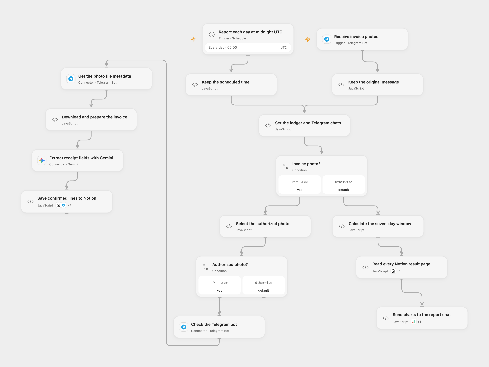

# Log Telegram Invoices and Report Spending

Read invoice photos from Telegram, record the line items in Notion, and send spending charts to a configured chat.

<!-- template-actions:start -->
 
<!-- template-actions:end -->

<picture>
  <source media="(prefers-color-scheme: dark)" srcset="preview-dark.png">
  
</picture>

## Setup

1. In **Set the ledger and Telegram chats**, set the Notion data source ID, the Telegram chat IDs allowed to submit invoices, and the destination chat ID for reports. Set a report topic ID for a Telegram forum. Leave it empty for other chats.
2. Create a Notion data source with these properties. Share it with a connection that can read and add pages.

| Property | Type |
| --- | --- |
| Name | Title |
| Quantity, Price, Total, Tax, Line, Receipt Lines | Number |
| Date | Date |
| Category | Select |
| Currency, Receipt Key | Text |

3. Use the same Notion connection for **Save confirmed lines to Notion** and **Read every Notion result page**. Connect the same Telegram bot in **Receive invoice photos**, **Check the Telegram bot**, **Get the photo file metadata**, **Save confirmed lines to Notion**. Bind its matching token in **Download and prepare the invoice** and **Send charts to the report chat** as a secret Variable named `TELEGRAM_INVOICE_BOT_TOKEN`. Select a Gemini connection with access to Gemini 3.5 Flash-Lite in **Extract receipt fields with Gemini** and authorize Provider API access.
4. If the invoices all use a known local currency, set **Default currency** to its ISO code. Leave it blank to require a readable currency on each invoice. Publish and enable the workflow. One bot can have one active webhook. [Gemini image input](https://ai.google.dev/gemini-api/docs/image-understanding)

## Behavior

Send one JPG or PNG invoice photo of up to 1 MiB in an approved chat. Gemini receives the image and reads up to 20 line items. The workflow records the printed invoice date or, if missing, the message's UTC date. It takes the printed currency when readable and uses the configured default for an unspecified currency. It leaves tax blank when it is unreadable and keeps the printed line totals. Review the extracted values in Notion.

The workflow replies in the original chat after Notion confirms all invoice lines. It records one attempt per receipt photo and chat. If a write or reply is uncertain, inspect the ledger and chat before recovering the attempt.

Each day at 00:00 UTC, the workflow reads the previous seven days of Notion creation times. It counts complete receipts, sums their line totals per category, and sends one chart per currency to the configured chat or topic. QuickChart receives only category totals and currency codes. Telegram fetches the rendered chart from QuickChart. The chart includes complete receipts recorded by this workflow. Existing entries without receipt keys and line counts are excluded. To include verified older receipts, use the same unique key starting with `telegram-receipt:legacy-` for all lines of one receipt. Add the known currency code, a line number starting at 1, and the total line count. Existing ledgers can rename the old text Date property before adding the Date property listed above.

In n8n

Set the same source, chat, topic and currency in **Set the ledger and Telegram chats**. Use the same Telegram bot credential in **Receive invoice photos**, **Get the photo file metadata**, **Confirm to the original chat**, and **Send the currency chart**. Set **Restrict to Chat IDs** in **Receive invoice photos** as appropriate. Use a Header Auth credential named `x-goog-api-key` in **Extract receipt fields with Gemini**. Use the same Notion API credential in **Save confirmed lines to Notion** and **Read every Notion result page**.

Use one production execution slot and a dedicated Data Table with text columns `key`, `status`, and `receipt`. Select it in **Check earlier receipt attempts**, **Reserve the Notion receipt**, **Record the Notion result**, **Check earlier chart attempts**, **Reserve the scheduled currency report**, and **Record the chart message ID**. Inspect Notion or Telegram before recovering a pending entry. Retrying a write or send node directly bypasses the reservation.

Inspiration &amp; credits

Adapted from [Log Telegram Invoices and Report Spending](https://github.com/Zie619/n8n-workflows/blob/ae8cf6dc5b873cbb4f74587aa9180ed3a9f70682/workflows/Telegram/0931_Telegram_Splitout_Monitor_Scheduled.json) in [Zie619/n8n-workflows](https://github.com/Zie619/n8n-workflows). Attribution: Rizqi Pratama Ramadhani (original workflow) / Zie619 (collection).

The collection’s [MIT notice](https://github.com/Zie619/n8n-workflows/blob/94007c1445d9258a7da116646b79473e7c7c3282/LICENSE) is pinned at a later revision. This is the collection notice at that revision; it does not establish a separate original template author's license. Our changes are listed above; see [repository licensing](../../README.md#licensing).

> MIT License
>
> Copyright (c) 2025 Zie619
>
> Permission is hereby granted, free of charge, to any person obtaining a copy
> of this software and associated documentation files (the "Software"), to deal
> in the Software without restriction, including without limitation the rights
> to use, copy, modify, merge, publish, distribute, sublicense, and/or sell
> copies of the Software, and to permit persons to whom the Software is
> furnished to do so, subject to the following conditions:
>
> The above copyright notice and this permission notice shall be included in all
> copies or substantial portions of the Software.
>
> THE SOFTWARE IS PROVIDED "AS IS", WITHOUT WARRANTY OF ANY KIND, EXPRESS OR
> IMPLIED, INCLUDING BUT NOT LIMITED TO THE WARRANTIES OF MERCHANTABILITY,
> FITNESS FOR A PARTICULAR PURPOSE AND NONINFRINGEMENT. IN NO EVENT SHALL THE
> AUTHORS OR COPYRIGHT HOLDERS BE LIABLE FOR ANY CLAIM, DAMAGES OR OTHER
> LIABILITY, WHETHER IN AN ACTION OF CONTRACT, TORT OR OTHERWISE, ARISING FROM,
> OUT OF OR IN CONNECTION WITH THE SOFTWARE OR THE USE OR OTHER DEALINGS IN THE
> SOFTWARE.

[Original n8n workflow by Rizqi Pratama Ramadhani](https://n8n.io/workflows/3960-automated-financial-tracker-telegram-invoices-to-notion-with-gemini-ai-reports/). This adaptation checks the receipt fields and Notion result, adds a currency column, and charts each currency separately.

