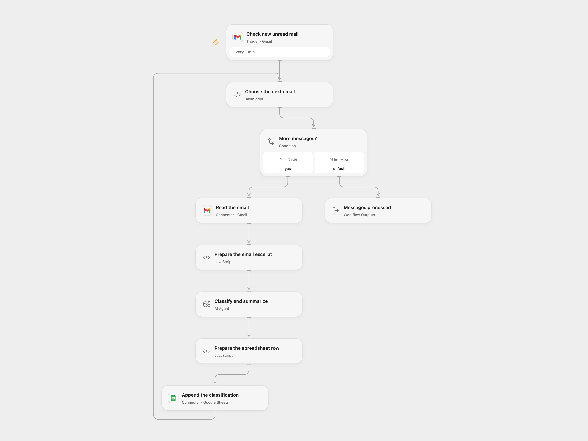

# Log Unread Gmail Classifications to Sheets

Classify new unread Gmail messages and log the results in a spreadsheet.

<picture>
  <source media="(prefers-color-scheme: dark)" srcset="preview-dark.png">
  
</picture>

[Open Flow JSON](templates/log-unread-gmail-classifications-to-sheets.openflow.json) · [n8n JSON](templates/log-unread-gmail-classifications-to-sheets.n8n.json)

## Setup

Connect Gmail on **Check new unread mail** and **Read the email** to the same mailbox. Connect Google Sheets and set the spreadsheet ID and A1 range in **Append the classification**. The default range is `'Lite Log'!A:E`; the sheet must have the headers Date, From, Subject, Category and Summary in that order. Configure an AI model. In n8n, connect Gmail, OpenAI and Google Sheets, and select the same spreadsheet and sheet in **Log to Sheets**. Activate one format.

## Behavior

Every minute, new unread messages are classified as urgent, important, informational or spam; each row records its date, sender, subject, category and one-sentence summary. The model receives the sender, subject and first 500 characters of the message body, which can include HTML markup. Review classifications before relying on them. Each processed message needs a sender address. Drafts, spam and trash are excluded; messages are not marked read or moved.

Open Flow handles up to 100 messages per poll sequentially. A failed or invalid model response or append stops later messages in the run; earlier rows remain. An uncertain append may have succeeded; inspect the sheet before retrying. Neither format deduplicates rows, and concurrent or repeated runs can create duplicates. n8n retries the model up to three times; Open Flow does not automatically retry it.

Inspiration &amp; credits

## Changes to the source

- Process every message separately and keep its classification associated with the same message. The source's first-item expressions could drop other messages.
- Use a short body excerpt because the source's full Gmail output does not provide the requested snippet. Use the current n8n OpenAI node and explicit sheet-column mapping, stop on invalid classification instead of silently labeling it informational; exclude drafts, explicitly append rows, and avoid automatic retry of uncertain sheet writes.

Adapted from [InboxZero Lite - AI Email Classifier](https://github.com/enescingoz/awesome-n8n-templates/blob/827110332c21cbe000ab13f6d292d5adb1f1f8db/Gmail_and_Email_Automation/InboxZero%20Lite%20-%20AI%20Email%20Classifier.json) in [enescingoz/awesome-n8n-templates](https://github.com/enescingoz/awesome-n8n-templates).

Source collection notice: © 2024–2026 Enes Cingoz, [CC BY 4.0](https://github.com/enescingoz/awesome-n8n-templates/blob/827110332c21cbe000ab13f6d292d5adb1f1f8db/LICENSE). The source export does not identify a separate template author or license. See [repository licensing](../../README.md#licensing) for the scope of OOMOL contributions and third-party material.

