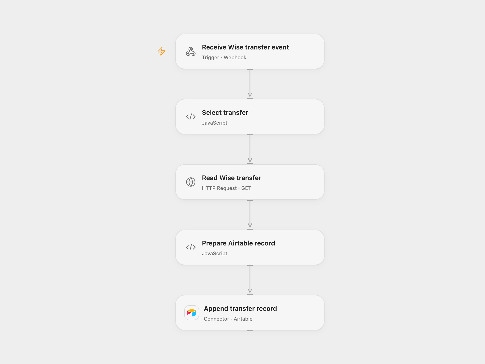

# Log Wise Transfer Changes to Airtable

Append transfer details to Airtable when a Wise transfer changes state.

<picture>
  <source media="(prefers-color-scheme: dark)" srcset="preview-dark.png">
  
</picture>

[Open Flow JSON](templates/log-wise-transfer-changes-to-airtable.openflow.json) · [n8n JSON](templates/log-wise-transfer-changes-to-airtable.n8n.json)

## Setup

Create an Airtable table with text fields `Transfer ID`, `Date`, `Reference` and `Amount`. Connect Airtable and select the base and table in **Append transfer record**. Bind a Wise API token as Secret Variable `WISE_API_TOKEN`. Deploy Open Flow, import the n8n workflow, connect Wise, choose your Wise profile in **Wise Trigger**, set **Choose delivery mode** to `relay`, and set the Open Flow URL in **Forward event to Open Flow**. Restrict access to the Open Flow URL; it does not authenticate the relay.

For direct n8n processing, select `direct`, connect Wise and Airtable, and select the same fields, base and table. Activate one mode.

## Behavior

Each transfer state change reads that transfer and appends its ID, creation date, reference and source amount. Multiple changes for the same transfer create separate rows. A webhook acknowledgment does not confirm the Airtable write. If the result of an Airtable write is unknown, inspect the table before replaying the event.

Inspiration &amp; credits

## Changes to the source

- Open Flow receives events through the included n8n Wise Trigger relay and reads transfers through the Wise API.
- Replace the original account-specific profile ID and require explicit table configuration.

Adapted from [Record Wise transfers in Airtable](https://github.com/Zie619/n8n-workflows/blob/ae8cf6dc5b873cbb4f74587aa9180ed3a9f70682/workflows/Wise/1230_Wise_Airtable_Automate_Triggered.json) in [Zie619/n8n-workflows](https://github.com/Zie619/n8n-workflows). The source export does not identify a separate template author or license.

The collection’s [MIT notice](https://github.com/Zie619/n8n-workflows/blob/94007c1445d9258a7da116646b79473e7c7c3282/LICENSE) is pinned at a later revision. This is the collection notice at that revision; it does not establish a separate original template author's license. Our changes are listed above; see [repository licensing](../../README.md#licensing).

> MIT License
>
> Copyright (c) 2025 Zie619
>
> Permission is hereby granted, free of charge, to any person obtaining a copy
> of this software and associated documentation files (the "Software"), to deal
> in the Software without restriction, including without limitation the rights
> to use, copy, modify, merge, publish, distribute, sublicense, and/or sell
> copies of the Software, and to permit persons to whom the Software is
> furnished to do so, subject to the following conditions:
>
> The above copyright notice and this permission notice shall be included in all
> copies or substantial portions of the Software.
>
> THE SOFTWARE IS PROVIDED "AS IS", WITHOUT WARRANTY OF ANY KIND, EXPRESS OR
> IMPLIED, INCLUDING BUT NOT LIMITED TO THE WARRANTIES OF MERCHANTABILITY,
> FITNESS FOR A PARTICULAR PURPOSE AND NONINFRINGEMENT. IN NO EVENT SHALL THE
> AUTHORS OR COPYRIGHT HOLDERS BE LIABLE FOR ANY CLAIM, DAMAGES OR OTHER
> LIABILITY, WHETHER IN AN ACTION OF CONTRACT, TORT OR OTHERWISE, ARISING FROM,
> OUT OF OR IN CONNECTION WITH THE SOFTWARE OR THE USE OR OTHER DEALINGS IN THE
> SOFTWARE.

