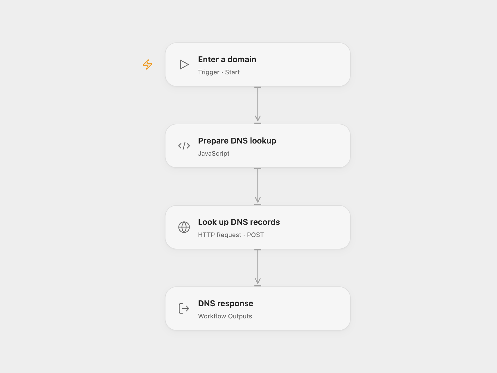

# Look Up Domain DNS Records with Uproc

Request DNS records for a domain using Uproc.

<picture>
  <source media="(prefers-color-scheme: dark)" srcset="preview-dark.png">
  
</picture>

[Open Flow JSON](templates/look-up-domain-dns-records-with-uproc.openflow.json) · [n8n JSON](templates/look-up-domain-dns-records-with-uproc.n8n.json)

## Setup

The workflow uses Uproc’s legacy v2 process API. In Open Flow, create secret Variables for the Uproc account email and API key, then bind them to **Auth Username** and **Auth Password** in **Look up DNS records**. Run with a domain such as `example.com`.

In n8n, connect a Uproc API credential and set the domain in **Create Domain Item**. Run either format manually.

## Behavior

Each run submits one domain and returns the response supplied by Uproc. The workflow does not filter or interpret DNS record types. Open Flow returns the complete JSON response; if Uproc returns an array, n8n emits its elements as individual items. Request failures stop the run. Open Flow has a 30-second HTTP timeout and a 4 MiB response limit.

Inspiration &amp; credits

## Changes to the source

- Open Flow accepts the domain as a run input and sends the equivalent request using native HTTP.

Adapted from [Get DNS entries](https://github.com/Zie619/n8n-workflows/blob/ae8cf6dc5b873cbb4f74587aa9180ed3a9f70682/workflows/Manual/0063_Manual_Uproc_Import_Triggered.json) in [Zie619/n8n-workflows](https://github.com/Zie619/n8n-workflows). The matching [n8n community listing](https://n8n.io/workflows/862-get-dns-entries-of-any-domain-with-uproc/) credits Miquel Colomer. The original template does not state a separate license.

The collection’s [MIT notice](https://github.com/Zie619/n8n-workflows/blob/94007c1445d9258a7da116646b79473e7c7c3282/LICENSE) is pinned at a later revision. This is the collection notice at that revision; it does not establish a separate original template author's license. Our changes are listed above; see [repository licensing](../../README.md#licensing).

> MIT License
>
> Copyright (c) 2025 Zie619
>
> Permission is hereby granted, free of charge, to any person obtaining a copy
> of this software and associated documentation files (the "Software"), to deal
> in the Software without restriction, including without limitation the rights
> to use, copy, modify, merge, publish, distribute, sublicense, and/or sell
> copies of the Software, and to permit persons to whom the Software is
> furnished to do so, subject to the following conditions:
>
> The above copyright notice and this permission notice shall be included in all
> copies or substantial portions of the Software.
>
> THE SOFTWARE IS PROVIDED "AS IS", WITHOUT WARRANTY OF ANY KIND, EXPRESS OR
> IMPLIED, INCLUDING BUT NOT LIMITED TO THE WARRANTIES OF MERCHANTABILITY,
> FITNESS FOR A PARTICULAR PURPOSE AND NONINFRINGEMENT. IN NO EVENT SHALL THE
> AUTHORS OR COPYRIGHT HOLDERS BE LIABLE FOR ANY CLAIM, DAMAGES OR OTHER
> LIABILITY, WHETHER IN AN ACTION OF CONTRACT, TORT OR OTHERWISE, ARISING FROM,
> OUT OF OR IN CONNECTION WITH THE SOFTWARE OR THE USE OR OTHER DEALINGS IN THE
> SOFTWARE.

