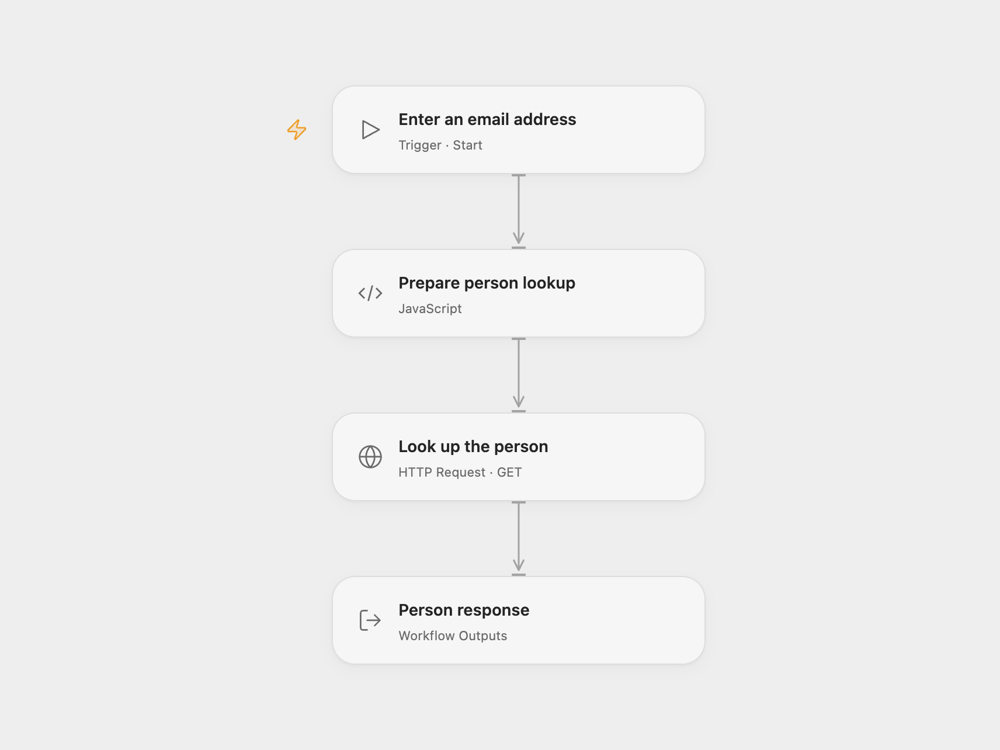

# Look Up a Person by Email with Clearbit

Look up a person using an email address with Clearbit.

<picture>
  <source media="(prefers-color-scheme: dark)" srcset="preview-dark.png">
  
</picture>

[Open Flow JSON](templates/look-up-person-by-email-with-clearbit.openflow.json) · [n8n JSON](templates/look-up-person-by-email-with-clearbit.n8n.json)

## Setup

In Open Flow, create a secret Variable containing a Clearbit API key with Person API access and bind it to **Auth Token** in **Look up the person**. Run with an email address. In n8n, connect a Clearbit API credential and enter an email in **Clearbit**. Run one format for each lookup.

## Behavior

A manual run requests person enrichment for one email and returns the service response without filtering. If the service returns an array, Open Flow returns the complete array and n8n emits its elements as individual items. An empty HTTP 202 response produces a null Open Flow response; it is not a completed person record. Request failures, including a not-found response, stop the workflow. Open Flow applies a 30-second HTTP timeout and a 4 MiB response limit.

Inspiration &amp; credits

## Changes to the source

- Open Flow accepts the email as a run input and calls the same Person API endpoint using native HTTP.

Adapted from [Look up a person using their email in Clearbit](https://github.com/Zie619/n8n-workflows/blob/ae8cf6dc5b873cbb4f74587aa9180ed3a9f70682/workflows/Manual/0024_Manual_Clearbit_Send_Triggered.json) in [Zie619/n8n-workflows](https://github.com/Zie619/n8n-workflows). The matching [n8n community listing](https://n8n.io/workflows/484-look-up-a-person-using-their-email-in-clearbit/) credits tanaypant. The original template does not state a separate license.

The collection’s [MIT notice](https://github.com/Zie619/n8n-workflows/blob/94007c1445d9258a7da116646b79473e7c7c3282/LICENSE) is pinned at a later revision. This is the collection notice at that revision; it does not establish a separate original template author's license. Our changes are listed above; see [repository licensing](../../README.md#licensing).

> MIT License
>
> Copyright (c) 2025 Zie619
>
> Permission is hereby granted, free of charge, to any person obtaining a copy
> of this software and associated documentation files (the "Software"), to deal
> in the Software without restriction, including without limitation the rights
> to use, copy, modify, merge, publish, distribute, sublicense, and/or sell
> copies of the Software, and to permit persons to whom the Software is
> furnished to do so, subject to the following conditions:
>
> The above copyright notice and this permission notice shall be included in all
> copies or substantial portions of the Software.
>
> THE SOFTWARE IS PROVIDED "AS IS", WITHOUT WARRANTY OF ANY KIND, EXPRESS OR
> IMPLIED, INCLUDING BUT NOT LIMITED TO THE WARRANTIES OF MERCHANTABILITY,
> FITNESS FOR A PARTICULAR PURPOSE AND NONINFRINGEMENT. IN NO EVENT SHALL THE
> AUTHORS OR COPYRIGHT HOLDERS BE LIABLE FOR ANY CLAIM, DAMAGES OR OTHER
> LIABILITY, WHETHER IN AN ACTION OF CONTRACT, TORT OR OTHERWISE, ARISING FROM,
> OUT OF OR IN CONNECTION WITH THE SOFTWARE OR THE USE OR OTHER DEALINGS IN THE
> SOFTWARE.

