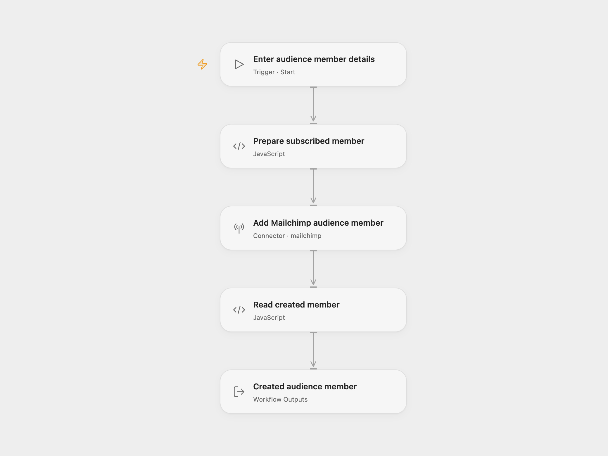

# Mailchimp Member Creator

Add a new Mailchimp audience member with `subscribed` status and save their first name in the audience’s `FNAME` merge field.

<picture>
  <source media="(prefers-color-scheme: dark)" srcset="preview-dark.png">
  
</picture>

[Open Flow JSON](templates/mailchimp-member-creator.openflow.json) · [n8n JSON](templates/mailchimp-member-creator.n8n.json)

## Setup

Select your Mailchimp account in **Add Mailchimp audience member** and grant **Provider API** access. This permission is separate from individual Action permissions. Run with **List ID** (the audience ID), **Email** and **First Name**. The audience must have a `FNAME` merge field. If it requires other merge fields, add them to the request before running. In n8n, choose **OAuth2** credentials and set the audience, email and `FNAME` value in **Mailchimp**.

Use contacts who have agreed to receive your marketing. The template sends `subscribed` directly; it does not run a confirmation signup flow. Account automations may respond to the new subscription.

Each run sends one add-member request and returns the complete member response. An email already in the audience produces an error instead of updating the existing member. The workflow does not send a campaign, change another member or add tags. n8n also reads Mailchimp’s OAuth metadata to resolve the account’s API server before adding the member.

A failed request or unexpected member response stops the run. No automatic retry or rollback is configured. Check the audience before repeating a request with an uncertain result.

## Changes to the source

- Replace the source’s audience, email and first-name examples with user configuration.
- Use OAuth2 credentials in n8n.
- Require audience ID, email and first name as Open Flow run inputs and expose the created member.

## Source and license

Adapted from [Mailchimp add-member workflow](https://github.com/Zie619/n8n-workflows/blob/ae8cf6dc5b873cbb4f74587aa9180ed3a9f70682/workflows/Manual/0938_Manual_Mailchimp_Automation_Triggered.json) in [Zie619/n8n-workflows](https://github.com/Zie619/n8n-workflows). The source export does not identify a separate template author or license.

The collection’s [MIT notice](https://github.com/Zie619/n8n-workflows/blob/94007c1445d9258a7da116646b79473e7c7c3282/LICENSE) is pinned at a later revision. This is the collection notice at that revision; it does not establish a separate original template author's license. Our changes are listed above; see [repository licensing](../../README.md#licensing).

> MIT License
>
> Copyright (c) 2025 Zie619
>
> Permission is hereby granted, free of charge, to any person obtaining a copy
> of this software and associated documentation files (the "Software"), to deal
> in the Software without restriction, including without limitation the rights
> to use, copy, modify, merge, publish, distribute, sublicense, and/or sell
> copies of the Software, and to permit persons to whom the Software is
> furnished to do so, subject to the following conditions:
>
> The above copyright notice and this permission notice shall be included in all
> copies or substantial portions of the Software.
>
> THE SOFTWARE IS PROVIDED "AS IS", WITHOUT WARRANTY OF ANY KIND, EXPRESS OR
> IMPLIED, INCLUDING BUT NOT LIMITED TO THE WARRANTIES OF MERCHANTABILITY,
> FITNESS FOR A PARTICULAR PURPOSE AND NONINFRINGEMENT. IN NO EVENT SHALL THE
> AUTHORS OR COPYRIGHT HOLDERS BE LIABLE FOR ANY CLAIM, DAMAGES OR OTHER
> LIABILITY, WHETHER IN AN ACTION OF CONTRACT, TORT OR OTHERWISE, ARISING FROM,
> OUT OF OR IN CONNECTION WITH THE SOFTWARE OR THE USE OR OTHER DEALINGS IN THE
> SOFTWARE.
