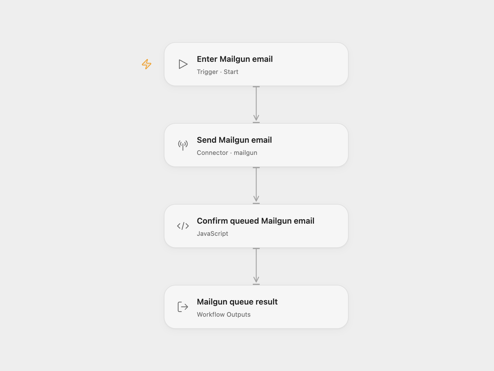

# Mailgun Email Sender

Send a plain-text email through Mailgun and return the message ID and complete queue acceptance result.

<picture>
  <source media="(prefers-color-scheme: dark)" srcset="preview-dark.png">
  
</picture>

[Open Flow JSON](templates/mailgun-email-sender.openflow.json) · [n8n JSON](templates/mailgun-email-sender.n8n.json)

## Setup

Select your Mailgun account in **Send Mailgun email** and allow `mailgun.send_email`. Configure its API key and US or EU API base URL to match the sending domain’s region. Run with **Domain**, **From**, **To**, **Subject** and **Text**. **To** is an array of recipient addresses or Mailgun-supported friendly-name addresses. Use a verified sending domain; sandbox domains can send only to authorized recipients.

In n8n, select Mailgun credentials, set the API region and sending domain in those credentials, and replace the sender, recipients, subject and text in **Mailgun**. Separate multiple recipients with commas.

Each run makes one send request with the configured recipients and plain text. It adds no attachment, template, CC or BCC. The result preserves the API’s message ID and other returned fields. Queue acceptance does not confirm inbox delivery. Sending can consume your Mailgun plan allowance.

This template sends real email and leaves tracking and delivery settings at Mailgun’s account defaults. No duplicate check or automatic retry is configured. A rejected request, missing message ID or request failure stops the run; check Mailgun before repeating an uncertain send.

## Changes to the source

- Replace example email content and account details with user configuration.
- Check the queued message ID in both formats and expose the full result in Open Flow.

## Source and license

Adapted from [Mailgun email send workflow](https://github.com/Zie619/n8n-workflows/blob/ae8cf6dc5b873cbb4f74587aa9180ed3a9f70682/workflows/Manual/0995_Manual_Mailgun_Automate_Triggered.json) in [Zie619/n8n-workflows](https://github.com/Zie619/n8n-workflows). The source export does not identify a separate template author or license.

The collection’s [MIT notice](https://github.com/Zie619/n8n-workflows/blob/94007c1445d9258a7da116646b79473e7c7c3282/LICENSE) is pinned at a later revision. This is the collection notice at that revision; it does not establish a separate original template author's license. Our changes are listed above; see [repository licensing](../../README.md#licensing).

> MIT License
>
> Copyright (c) 2025 Zie619
>
> Permission is hereby granted, free of charge, to any person obtaining a copy
> of this software and associated documentation files (the "Software"), to deal
> in the Software without restriction, including without limitation the rights
> to use, copy, modify, merge, publish, distribute, sublicense, and/or sell
> copies of the Software, and to permit persons to whom the Software is
> furnished to do so, subject to the following conditions:
>
> The above copyright notice and this permission notice shall be included in all
> copies or substantial portions of the Software.
>
> THE SOFTWARE IS PROVIDED "AS IS", WITHOUT WARRANTY OF ANY KIND, EXPRESS OR
> IMPLIED, INCLUDING BUT NOT LIMITED TO THE WARRANTIES OF MERCHANTABILITY,
> FITNESS FOR A PARTICULAR PURPOSE AND NONINFRINGEMENT. IN NO EVENT SHALL THE
> AUTHORS OR COPYRIGHT HOLDERS BE LIABLE FOR ANY CLAIM, DAMAGES OR OTHER
> LIABILITY, WHETHER IN AN ACTION OF CONTRACT, TORT OR OTHERWISE, ARISING FROM,
> OUT OF OR IN CONNECTION WITH THE SOFTWARE OR THE USE OR OTHER DEALINGS IN THE
> SOFTWARE.
