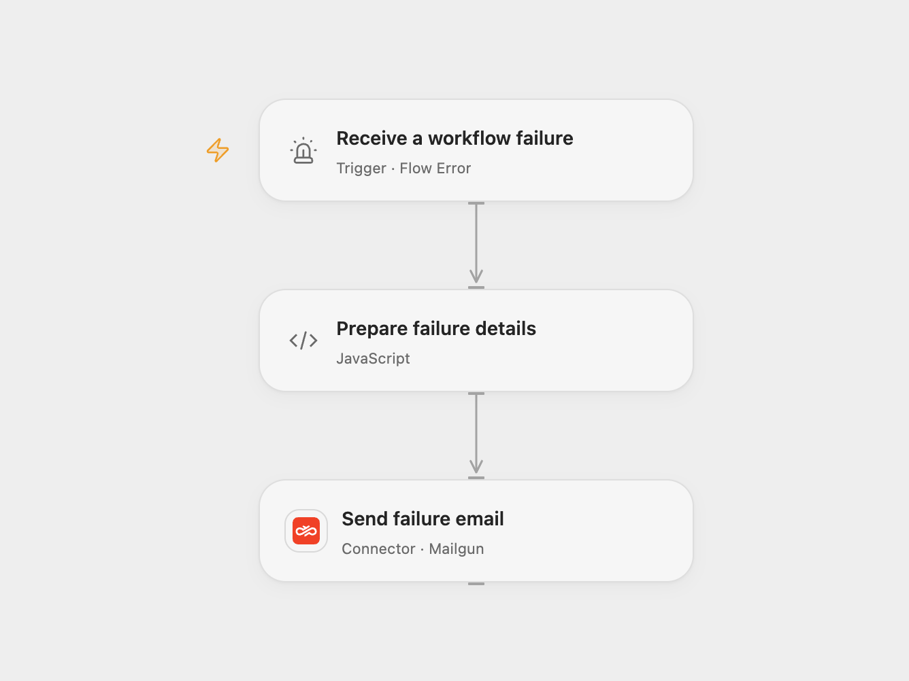

# Send Workflow Failure Alerts with Mailgun

Send a Mailgun email with diagnostics when a configured workflow fails.

<picture>
  <source media="(prefers-color-scheme: dark)" srcset="preview-dark.png">
  
</picture>

[Open Flow JSON](templates/mailgun-workflow-failure-alert.openflow.json) · [n8n JSON](templates/mailgun-workflow-failure-alert.n8n.json)

## Setup

Connect Mailgun and configure the sending domain, verified sender and recipient. In Open Flow, select the source workflows in **Receive a workflow failure**, publish and enable the error workflow. In n8n, assign this error workflow to each source workflow and activate it. Avoid assigning it to itself. Enable only one format.

## Behavior

An automatic failure sends a plain-text email with the workflow name and available diagnostics. Open Flow includes the run ID, error code and message, and any node ID, job ID and path supplied by its error event; it does not provide a stack trace. n8n includes the source error message and stack trace when available. Open Flow also reports indeterminate runs. Manual test runs do not represent automatic error dispatch.

Diagnostics may contain sensitive information; restrict the recipient and execution history. A failed or uncertain email may already have been delivered, so check before retrying.

Inspiration &amp; credits

## Changes to the source

- Configure the previously empty sender and recipient. Open Flow reports the diagnostics provided by its error event; n8n retains the source stack trace.

Adapted from [Send a workflow failure email with Mailgun](https://github.com/Zie619/n8n-workflows/blob/ae8cf6dc5b873cbb4f74587aa9180ed3a9f70682/workflows/Error/1179_Error_Mailgun_Automate_Triggered.json) in [Zie619/n8n-workflows](https://github.com/Zie619/n8n-workflows). The source export does not identify a separate template author or license.

The collection’s [MIT notice](https://github.com/Zie619/n8n-workflows/blob/94007c1445d9258a7da116646b79473e7c7c3282/LICENSE) is pinned at a later revision. This is the collection notice at that revision; it does not establish a separate original template author's license. Our changes are listed above; see [repository licensing](../../README.md#licensing).

> MIT License
>
> Copyright (c) 2025 Zie619
>
> Permission is hereby granted, free of charge, to any person obtaining a copy
> of this software and associated documentation files (the "Software"), to deal
> in the Software without restriction, including without limitation the rights
> to use, copy, modify, merge, publish, distribute, sublicense, and/or sell
> copies of the Software, and to permit persons to whom the Software is
> furnished to do so, subject to the following conditions:
>
> The above copyright notice and this permission notice shall be included in all
> copies or substantial portions of the Software.
>
> THE SOFTWARE IS PROVIDED "AS IS", WITHOUT WARRANTY OF ANY KIND, EXPRESS OR
> IMPLIED, INCLUDING BUT NOT LIMITED TO THE WARRANTIES OF MERCHANTABILITY,
> FITNESS FOR A PARTICULAR PURPOSE AND NONINFRINGEMENT. IN NO EVENT SHALL THE
> AUTHORS OR COPYRIGHT HOLDERS BE LIABLE FOR ANY CLAIM, DAMAGES OR OTHER
> LIABILITY, WHETHER IN AN ACTION OF CONTRACT, TORT OR OTHERWISE, ARISING FROM,
> OUT OF OR IN CONNECTION WITH THE SOFTWARE OR THE USE OR OTHER DEALINGS IN THE
> SOFTWARE.

