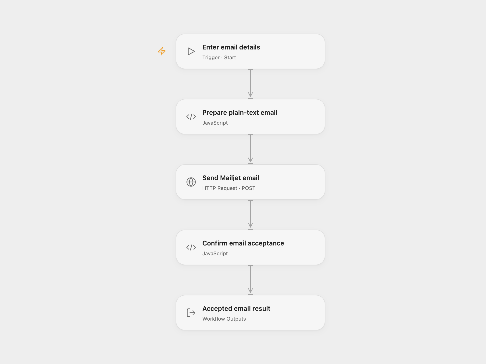

# Mailjet Email Sender

Send one plain-text email to one recipient through Mailjet and return the Send API’s acceptance result.

<picture>
  <source media="(prefers-color-scheme: dark)" srcset="preview-dark.png">
  
</picture>

[Open Flow JSON](templates/mailjet-email-sender.openflow.json) · [n8n JSON](templates/mailjet-email-sender.n8n.json)

## Setup

In Open Flow, create secret Variables for your Mailjet API key and API secret. In **Send Mailjet email**, bind **Authentication Username** (`auth.username`) to the key Variable and **Authentication Password** (`auth.password`) to the secret Variable. Both fields use HTTP Basic authentication. Choose the Variables after import; the shared file contains no credentials or Variable bindings. Run with **From Email**, **To Email**, **Subject** and **Text**. Mailjet must have validated the sender address or its domain.

In n8n, choose Mailjet Email credentials, keep **Sandbox Mode** disabled, and edit the sender, recipient, subject and text in **Mailjet**. This template sends a real email; sandbox mode is disabled in the Open Flow request.

Each run makes one Send API request containing one message for one recipient. It sends plain text, with no template, attachment, CC or BCC. Mailjet can also create a contact record for a new recipient. The result includes Mailjet’s message identifiers. Acceptance means Mailjet has accepted the email for processing; it does not confirm inbox delivery.

The Open Flow HTTP step has a 30-second execution budget. A rejected message, unexpected response or request failure stops the run. Each run can send another email. No duplicate check or automatic retry is configured, so check Mailjet before repeating an uncertain request.

## Changes to the source

- Replace the sender and recipient examples with user configuration.
- Require sender, recipient, subject and text as Open Flow run inputs.
- Use secret Variables for HTTP Basic authentication in Open Flow.
- Check the per-message acceptance result in both formats and expose it in Open Flow.

## Source and license

Adapted from [Mailjet email send workflow](https://github.com/Zie619/n8n-workflows/blob/ae8cf6dc5b873cbb4f74587aa9180ed3a9f70682/workflows/Manual/0993_Manual_Mailjet_Automate_Triggered.json) in [Zie619/n8n-workflows](https://github.com/Zie619/n8n-workflows). The source export does not identify a separate template author or license.

The collection’s [MIT notice](https://github.com/Zie619/n8n-workflows/blob/94007c1445d9258a7da116646b79473e7c7c3282/LICENSE) is pinned at a later revision. This is the collection notice at that revision; it does not establish a separate original template author's license. Our changes are listed above; see [repository licensing](../../README.md#licensing).

> MIT License
>
> Copyright (c) 2025 Zie619
>
> Permission is hereby granted, free of charge, to any person obtaining a copy
> of this software and associated documentation files (the "Software"), to deal
> in the Software without restriction, including without limitation the rights
> to use, copy, modify, merge, publish, distribute, sublicense, and/or sell
> copies of the Software, and to permit persons to whom the Software is
> furnished to do so, subject to the following conditions:
>
> The above copyright notice and this permission notice shall be included in all
> copies or substantial portions of the Software.
>
> THE SOFTWARE IS PROVIDED "AS IS", WITHOUT WARRANTY OF ANY KIND, EXPRESS OR
> IMPLIED, INCLUDING BUT NOT LIMITED TO THE WARRANTIES OF MERCHANTABILITY,
> FITNESS FOR A PARTICULAR PURPOSE AND NONINFRINGEMENT. IN NO EVENT SHALL THE
> AUTHORS OR COPYRIGHT HOLDERS BE LIABLE FOR ANY CLAIM, DAMAGES OR OTHER
> LIABILITY, WHETHER IN AN ACTION OF CONTRACT, TORT OR OTHERWISE, ARISING FROM,
> OUT OF OR IN CONNECTION WITH THE SOFTWARE OR THE USE OR OTHER DEALINGS IN THE
> SOFTWARE.
