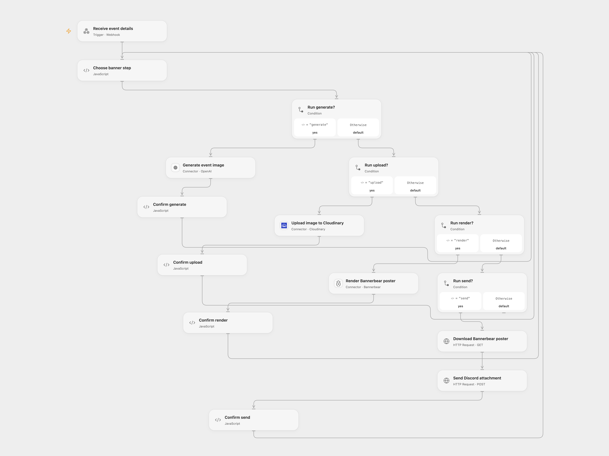

# Make Social Event Banners for Discord

Generate an event poster from a prompt and share it as a Discord attachment.

<!-- template-actions:start -->
 
<!-- template-actions:end -->

<picture>
  <source media="(prefers-color-scheme: dark)" srcset="preview-dark.png">
  
</picture>

## Setup

Connect OpenAI, Cloudinary and Bannerbear. Create a Bannerbear template with layers named placeholder_image, placeholder_text, placeholder_location and placeholder_date. In n8n connect Discord, configure the relay Discord node with your guild ID and credentials, then set its webhook Header Auth credential to Authorization: Bearer followed by your chosen token. Configure a Data Table with text columns item_key and status for the relay checkpoint nodes, then activate the workflow. Set the webhook HTTPS production URL in **Choose banner step** and bind that token as secret Variable N8N_RELAY_TOKEN. Enable persistent State and prevent overlapping executions. Run Open Flow with a unique submission ID, event details, prompt, template ID and Discord channel ID.

For n8n direct mode, configure the form's two template IDs, Cloudinary account and upload preset, Bannerbear and Discord. Select the same Data Table on the form checkpoint nodes. Enable only one format.

## Behavior

The workflow generates an image, uploads it to Cloudinary, renders the event details in Bannerbear, and sends the poster as a Discord file. Image generation and rendering may take time. The source n8n workflow polls the asynchronous Bannerbear job; Open Flow uses the synchronous endpoint.

If an external write has an unknown result, inspect the corresponding service. In **Choose banner step**, enter the pending key and resolution confirmed or absent. For a confirmed image generation, upload or render enter its resulting HTTPS URL; then rerun with the same submission ID and details and clear the fields. For a pending direct-form row, inspect the affected service and complete any remaining actions manually before marking it done. For a pending relay row, mark it done if the Discord message exists and confirm the Open Flow step; if no message exists, delete the relay row and resolve the Open Flow step as absent before retrying. Protect the relay endpoint and execution history.

Inspiration &amp; credits

## Changes to the source

Added an authenticated Discord attachment relay, configurable account settings, and write checkpoints.

Adapted from [Speed Up Social Media Banners With BannerBear.com](https://github.com/enescingoz/awesome-n8n-templates/blob/827110332c21cbe000ab13f6d292d5adb1f1f8db/Instagram_Twitter_Social_Media/Speed%20Up%20Social%20Media%20Banners%20With%20BannerBear.com.json) in [enescingoz/awesome-n8n-templates](https://github.com/enescingoz/awesome-n8n-templates).

Source collection notice: © 2024–2026 Enes Cingoz, [CC BY 4.0](https://github.com/enescingoz/awesome-n8n-templates/blob/827110332c21cbe000ab13f6d292d5adb1f1f8db/LICENSE). The source export does not identify a separate template author or license. See [repository licensing](../../README.md#licensing) for the scope of OOMOL contributions and third-party material.

