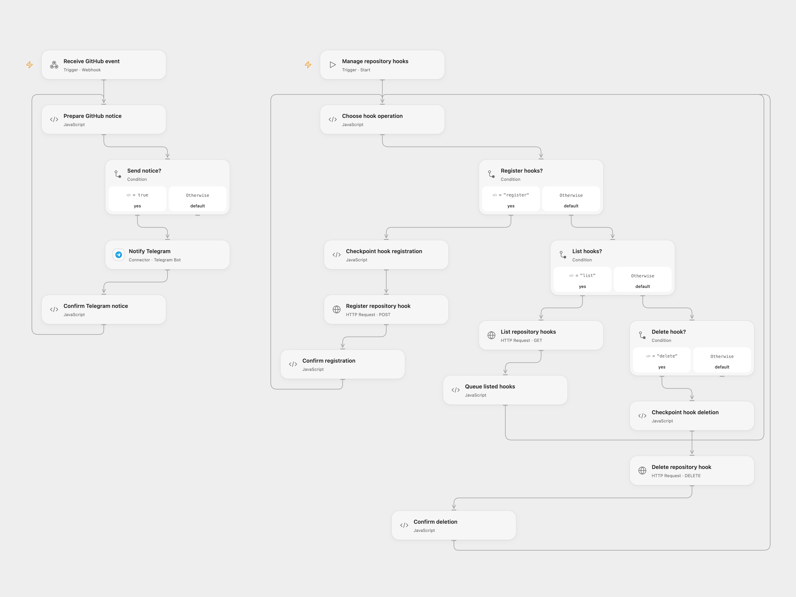

# Manage GitHub Hooks and Notify Telegram

Register or delete repository webhooks and send push and pull request updates to Telegram.

<picture>
  <source media="(prefers-color-scheme: dark)" srcset="preview-dark.png">
  
</picture>

[Open Flow JSON](templates/manage-github-hooks-and-notify-telegram.openflow.json) · [n8n JSON](templates/manage-github-hooks-and-notify-telegram.n8n.json)

## Setup

Bind a GitHub token with webhook administration access as Secret Variable `GITHUB_TOKEN`. Connect Telegram and set the same chat ID in **Prepare GitHub notice** and **Notify Telegram**. Enable persistent State and prevent overlapping runs. Deploy the webhook and enter its public HTTPS URL in **Choose hook operation**, together with your `owner/repository` list. Select `register` and run **Manage repository hooks** manually.

To remove hooks, set the operation to `delete` and run manually. This can delete **all repository webhooks** on each configured repository, including hooks created by other applications, matching the source. Inspect the repository hooks before using it. The incoming webhook has no signature verification; restrict access to its URL.

In n8n, configure the repository lists, callback URL, GitHub Header Auth and Telegram credential/chat ID. Use the manual registration or deletion trigger deliberately; activate the webhook trigger for notifications. Use one format.

## Behavior

A push reports the first commit's author, message, modified files and URL; a pull request reports its action, number, title and URL. Empty pushes are ignored. Registration subscribes to push and pull request events. Open Flow traverses all hook pages. The n8n deletion branch processes the first page returned by GitHub; run it again if more hooks remain.

In Open Flow, if a GitHub write or Telegram delivery is uncertain, inspect the relevant service before entering the pending key in **Choose hook operation** or the delivery ID in **Prepare GitHub notice**. The acknowledged operation is treated as handled. Do not automatically replay uncertain writes.

Inspiration &amp; credits

## Changes to the source

- Replace sample repositories, callback URL and chat ID with configuration, and expose the previously disconnected deletion path as an explicit manual trigger.
- Handle pull request payloads separately from push commits and preserve pending writes.

Adapted from [Monitor GitHub repositories with webhooks](https://github.com/Zie619/n8n-workflows/blob/ae8cf6dc5b873cbb4f74587aa9180ed3a9f70682/workflows/Telegram/0585_Telegram_Splitout_Automation_Webhook.json) in [Zie619/n8n-workflows](https://github.com/Zie619/n8n-workflows). The source export does not identify a separate template author or license.

The collection’s [MIT notice](https://github.com/Zie619/n8n-workflows/blob/94007c1445d9258a7da116646b79473e7c7c3282/LICENSE) is pinned at a later revision. This is the collection notice at that revision; it does not establish a separate original template author's license. Our changes are listed above; see [repository licensing](../../README.md#licensing).

> MIT License
>
> Copyright (c) 2025 Zie619
>
> Permission is hereby granted, free of charge, to any person obtaining a copy
> of this software and associated documentation files (the "Software"), to deal
> in the Software without restriction, including without limitation the rights
> to use, copy, modify, merge, publish, distribute, sublicense, and/or sell
> copies of the Software, and to permit persons to whom the Software is
> furnished to do so, subject to the following conditions:
>
> The above copyright notice and this permission notice shall be included in all
> copies or substantial portions of the Software.
>
> THE SOFTWARE IS PROVIDED "AS IS", WITHOUT WARRANTY OF ANY KIND, EXPRESS OR
> IMPLIED, INCLUDING BUT NOT LIMITED TO THE WARRANTIES OF MERCHANTABILITY,
> FITNESS FOR A PARTICULAR PURPOSE AND NONINFRINGEMENT. IN NO EVENT SHALL THE
> AUTHORS OR COPYRIGHT HOLDERS BE LIABLE FOR ANY CLAIM, DAMAGES OR OTHER
> LIABILITY, WHETHER IN AN ACTION OF CONTRACT, TORT OR OTHERWISE, ARISING FROM,
> OUT OF OR IN CONNECTION WITH THE SOFTWARE OR THE USE OR OTHER DEALINGS IN THE
> SOFTWARE.

