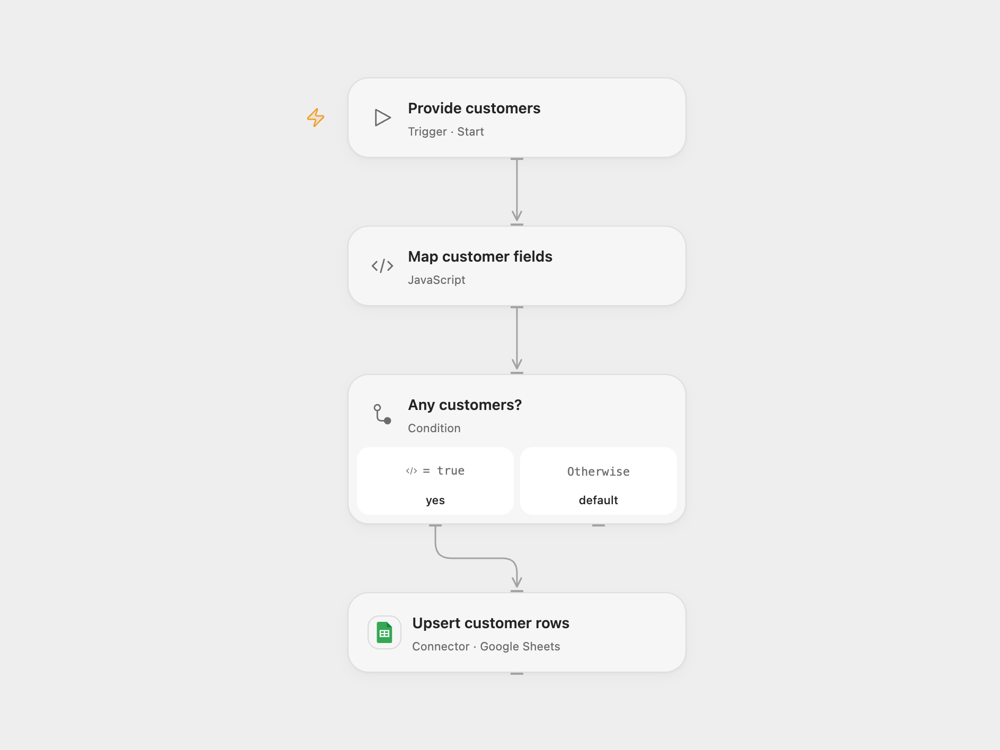

# Map Customers to Google Sheets

Map customer fields and upsert them by ID in a Google Sheet.

<picture>
  <source media="(prefers-color-scheme: dark)" srcset="preview-dark.png">
  
</picture>

[Open Flow JSON](templates/map-customers-to-google-sheet.openflow.json) · [n8n JSON](templates/map-customers-to-google-sheet.n8n.json)

## Setup and use

Create a sheet with headers **ID**, **Full name**, **Email**, **Created time** in that order. Configure the spreadsheet and Google Sheets connection. Provide customer records with id, name and email in Open Flow. In n8n configure the sheet and run the training datastore workflow.

## Behavior

Each customer is mapped to those four columns, with the current time in Created time, and inserted or updated by ID. A later run updates the timestamp as well. An empty Open Flow input performs no write. The n8n upsert may append some rows before a later update fails. If a write result is unknown, inspect the sheet before retrying.

Inspiration &amp; credits

## Changes to the source

- Configure the sheet, extend the n8n range to A:D and explicitly match string **ID**; the source used A:C, a lowercase default key and numeric IDs. Open Flow accepts customer input rather than the n8n training datastore.

Adapted from [Map customer records to a sheet](https://github.com/Zie619/n8n-workflows/blob/ae8cf6dc5b873cbb4f74587aa9180ed3a9f70682/workflows/Manual/0233_Manual_N8Ntrainingcustomerdatastore_Create_Triggered.json) in [Zie619/n8n-workflows](https://github.com/Zie619/n8n-workflows). The source export does not identify a separate template author or license.

The collection’s [MIT notice](https://github.com/Zie619/n8n-workflows/blob/94007c1445d9258a7da116646b79473e7c7c3282/LICENSE) is pinned at a later revision. This is the collection notice at that revision; it does not establish a separate original template author's license. Our changes are listed above; see [repository licensing](../../README.md#licensing).

> MIT License
>
> Copyright (c) 2025 Zie619
>
> Permission is hereby granted, free of charge, to any person obtaining a copy
> of this software and associated documentation files (the "Software"), to deal
> in the Software without restriction, including without limitation the rights
> to use, copy, modify, merge, publish, distribute, sublicense, and/or sell
> copies of the Software, and to permit persons to whom the Software is
> furnished to do so, subject to the following conditions:
>
> The above copyright notice and this permission notice shall be included in all
> copies or substantial portions of the Software.
>
> THE SOFTWARE IS PROVIDED "AS IS", WITHOUT WARRANTY OF ANY KIND, EXPRESS OR
> IMPLIED, INCLUDING BUT NOT LIMITED TO THE WARRANTIES OF MERCHANTABILITY,
> FITNESS FOR A PARTICULAR PURPOSE AND NONINFRINGEMENT. IN NO EVENT SHALL THE
> AUTHORS OR COPYRIGHT HOLDERS BE LIABLE FOR ANY CLAIM, DAMAGES OR OTHER
> LIABILITY, WHETHER IN AN ACTION OF CONTRACT, TORT OR OTHERWISE, ARISING FROM,
> OUT OF OR IN CONNECTION WITH THE SOFTWARE OR THE USE OR OTHER DEALINGS IN THE
> SOFTWARE.

