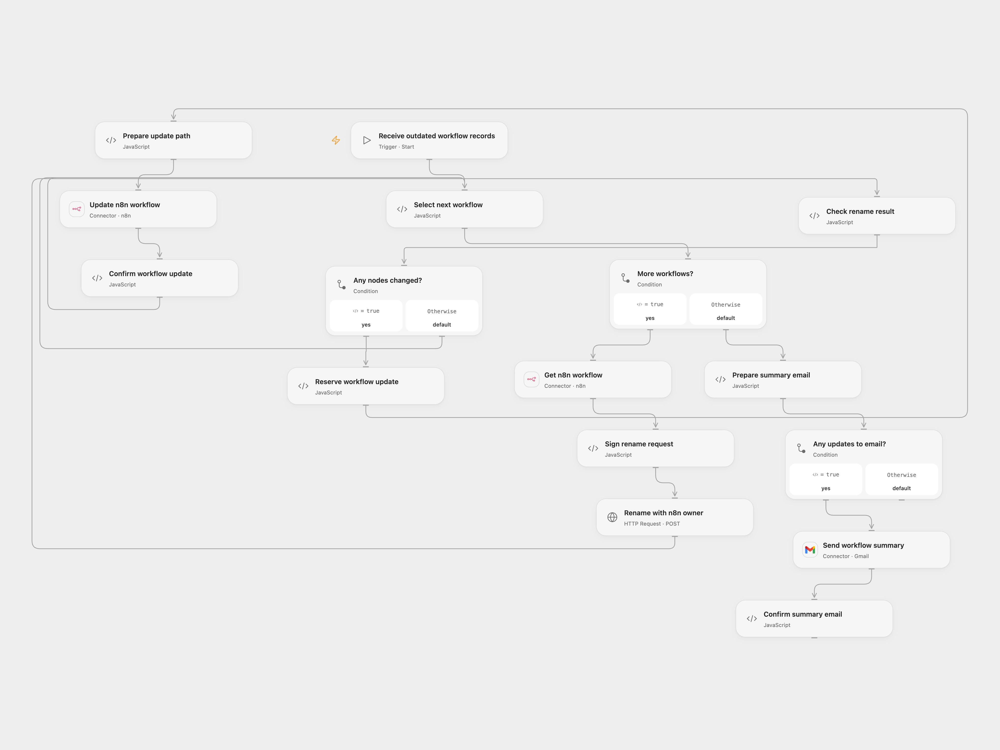

# Mark Outdated n8n Workflow Nodes

Mark outdated nodes in specified n8n workflows and send a summary.

<picture>
  <source media="(prefers-color-scheme: dark)" srcset="preview-dark.png">
  
</picture>

[Open Flow JSON](templates/mark-outdated-n8n-workflow-nodes.openflow.json) · [n8n JSON](templates/mark-outdated-n8n-workflow-nodes.n8n.json)

## Setup and use

Provide an array of records with Id and outdated_nodes (each entry has name, version and latestVersion), and a stable runId when invoking the workflow. Connect n8n and Gmail; set the recipient and n8n instance URL. In Sign rename request configure the marker, whether only major changes are marked, and whether to add disconnected copies at the newer version. Connect n8n's GET and PUT to the same instance and enable persistent State.

The Open Flow version calls the rename relay in the included n8n workflow. Configure its URL and set N8N_RENAME_RELAY_SECRET to the same Secret Variable in Open Flow and environment variable in n8n. Use self-hosted n8n with n8n-workflow 2.47.0 available in its task runner, NODE_FUNCTION_ALLOW_EXTERNAL=n8n-workflow, NODE_FUNCTION_ALLOW_BUILTIN=crypto and N8N_BLOCK_ENV_ACCESS_IN_NODE=false. Configure the corresponding n8n credentials and Data Table with item_key, status, workflow_id and workflow_name text columns. Do not expose the relay secret.

Each changed workflow is marked pending before update and a summary email is marked pending before sending. If a write has an uncertain result, inspect the workflow or mailbox and reconcile its node-update:<runId>:<workflowId> or node-update:<runId>:mail checkpoint before retrying the same run. Avoid overlapping runs. Review added node copies before enabling them; the workflow does not upgrade or connect them automatically.

Inspiration &amp; credits

Use n8n’s own rename owner to update expression references and all connection types, and add pending checkpoints for workflow updates and email.

Adapted from [Addon for Workflow Nodes Update Check Template](https://github.com/Zie619/n8n-workflows/blob/ae8cf6dc5b873cbb4f74587aa9180ed3a9f70682/workflows/Code/2020_Code_Noop_Create_Triggered.json) in [Zie619/n8n-workflows](https://github.com/Zie619/n8n-workflows). Attribution: Zie619 / n8n-workflows.

The collection’s [MIT notice](https://github.com/Zie619/n8n-workflows/blob/94007c1445d9258a7da116646b79473e7c7c3282/LICENSE) is pinned at a later revision. This is the collection notice at that revision; it does not establish a separate original template author's license. Our changes are listed above; see [repository licensing](../../README.md#licensing).

> MIT License
>
> Copyright (c) 2025 Zie619
>
> Permission is hereby granted, free of charge, to any person obtaining a copy
> of this software and associated documentation files (the "Software"), to deal
> in the Software without restriction, including without limitation the rights
> to use, copy, modify, merge, publish, distribute, sublicense, and/or sell
> copies of the Software, and to permit persons to whom the Software is
> furnished to do so, subject to the following conditions:
>
> The above copyright notice and this permission notice shall be included in all
> copies or substantial portions of the Software.
>
> THE SOFTWARE IS PROVIDED "AS IS", WITHOUT WARRANTY OF ANY KIND, EXPRESS OR
> IMPLIED, INCLUDING BUT NOT LIMITED TO THE WARRANTIES OF MERCHANTABILITY,
> FITNESS FOR A PARTICULAR PURPOSE AND NONINFRINGEMENT. IN NO EVENT SHALL THE
> AUTHORS OR COPYRIGHT HOLDERS BE LIABLE FOR ANY CLAIM, DAMAGES OR OTHER
> LIABILITY, WHETHER IN AN ACTION OF CONTRACT, TORT OR OTHERWISE, ARISING FROM,
> OUT OF OR IN CONNECTION WITH THE SOFTWARE OR THE USE OR OTHER DEALINGS IN THE
> SOFTWARE.

