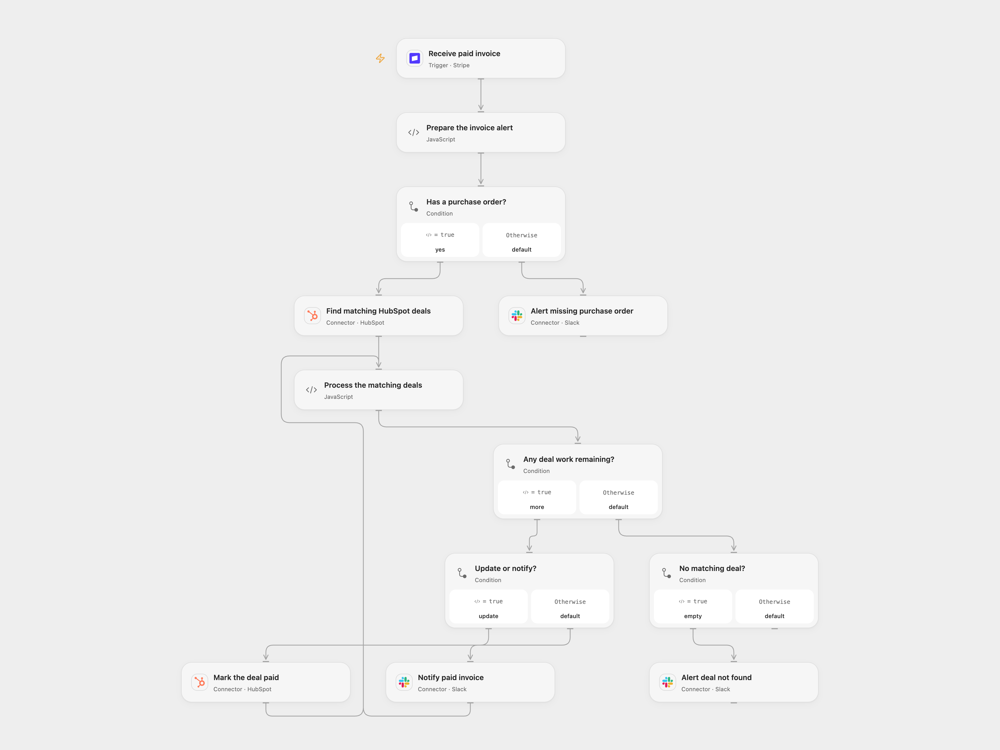

# Mark HubSpot Deals Paid from Stripe Invoices

Find HubSpot deals by purchase order when Stripe reports an invoice payment, mark them paid and notify Slack.

<picture>
  <source media="(prefers-color-scheme: dark)" srcset="preview-dark.png">
  
</picture>

[Open Flow JSON](templates/mark-paid-hubspot-deal-from-stripe-invoice.openflow.json) · [n8n JSON](templates/mark-paid-hubspot-deal-from-stripe-invoice.n8n.json)

## Setup

Connect Stripe in **Receive paid invoice** with permission to manage webhooks. Connect HubSpot in both deal nodes. Each deal must have a text property named **po_number** and a property named **paid** that accepts Yes. Connect Slack in the three alert nodes and set the channel ID in **Prepare the invoice alert**.

In n8n, connect Stripe, HubSpot and Slack. Ensure the Stripe credential has the webhook signing secret, or verify that the automatically created webhook has stored its secret. The n8n Stripe trigger accepts requests without signature verification if neither secret is available. Select the same Slack channel in the three Slack nodes. Enable only one format.

## Behavior

On an invoice.payment_succeeded event, the workflow reads the first Stripe invoice custom field as the purchase order. Missing purchase orders generate a Slack alert. With a purchase order it searches HubSpot by exact po_number. No match sends a different alert. For matching deals, it sets paid to Yes for each deal, then sends one paid-invoice alert per deal. Both formats stop before writing if more than 100 deals match; inspect HubSpot and reconcile duplicates. Open Flow orders the returned deals by creation time, newest first.

Alerts contain the Stripe event ID, customer name and email, purchase order where present, currency and amount in Stripe’s minor units. For example, 1000 USD minor units is 10 USD, while 100 JPY minor units is 100 JPY. Check Stripe’s currency rules before interpreting the value.

A failure stops subsequent work. Some deals may already be marked paid or messages sent; inspect HubSpot and Slack before retrying an uncertain run. HubSpot search can lag recent changes. Repeated events or manual retries can produce duplicate alerts; avoid overlapping runs.

## Changes to the source

- Replace account/channel details with setup and explicitly validate the invoice. Missing deal results now reach the alert branch.
- Fail before updates when more than 100 deals match, rather than silently processing only the first 100. Report Stripe amounts in minor units instead of dividing every currency by 100.

Source and license

Adapted from [On new Stripe Invoice Payment update Hubspot and notify the team in Slack](https://github.com/Zie619/n8n-workflows/blob/ae8cf6dc5b873cbb4f74587aa9180ed3a9f70682/workflows/Slack/0008_Slack_Stripe_Create_Triggered.json) in [Zie619/n8n-workflows](https://github.com/Zie619/n8n-workflows). The source export does not identify a separate template author or license.

The collection’s [MIT notice](https://github.com/Zie619/n8n-workflows/blob/94007c1445d9258a7da116646b79473e7c7c3282/LICENSE) is pinned at a later revision. This is the collection notice at that revision; it does not establish a separate original template author's license. Our changes are listed above; see [repository licensing](../../README.md#licensing).

> MIT License
>
> Copyright (c) 2025 Zie619
>
> Permission is hereby granted, free of charge, to any person obtaining a copy
> of this software and associated documentation files (the "Software"), to deal
> in the Software without restriction, including without limitation the rights
> to use, copy, modify, merge, publish, distribute, sublicense, and/or sell
> copies of the Software, and to permit persons to whom the Software is
> furnished to do so, subject to the following conditions:
>
> The above copyright notice and this permission notice shall be included in all
> copies or substantial portions of the Software.
>
> THE SOFTWARE IS PROVIDED "AS IS", WITHOUT WARRANTY OF ANY KIND, EXPRESS OR
> IMPLIED, INCLUDING BUT NOT LIMITED TO THE WARRANTIES OF MERCHANTABILITY,
> FITNESS FOR A PARTICULAR PURPOSE AND NONINFRINGEMENT. IN NO EVENT SHALL THE
> AUTHORS OR COPYRIGHT HOLDERS BE LIABLE FOR ANY CLAIM, DAMAGES OR OTHER
> LIABILITY, WHETHER IN AN ACTION OF CONTRACT, TORT OR OTHERWISE, ARISING FROM,
> OUT OF OR IN CONNECTION WITH THE SOFTWARE OR THE USE OR OTHER DEALINGS IN THE
> SOFTWARE.

