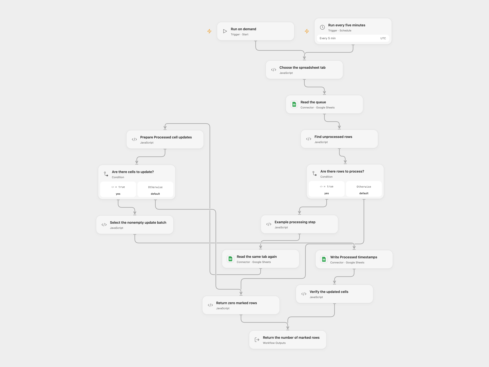

# Mark Processed Google Sheets Rows by ID

Use Google Sheets as a work queue and mark only the rows the processing step reports as complete.

<!-- template-actions:start -->
 
<!-- template-actions:end -->

<picture>
  <source media="(prefers-color-scheme: dark)" srcset="preview-dark.png">
  
</picture>

## Setup

1. Connect Google Sheets in both read nodes and in **Write Processed timestamps**. In **Choose the spreadsheet tab**, enter the spreadsheet ID and exact tab title.
2. Put unique text headings in row 1, starting at A1. The headings must include `ID` and `Processed`. Give each populated row a unique, stable text or integer ID. Leave `Processed` blank for pending rows.
3. Test on a dedicated tab. **Example processing step** is a no-op example that reports all selected IDs as complete. Running the unmodified example writes timestamps. Replace the example with your processing and return only successful IDs in `completed`.
4. Run on demand or publish the five-minute schedule. Keep one active run and avoid sorting, moving, deleting, or editing queue rows or headers while it runs.

## Behavior

The workflow selects rows with blank `Processed` cells. It reads formulas as expressions so a formula in the `Processed` column is preserved. After processing succeeds, it reads the same tab again, finds each completed ID and writes only its still-blank `Processed` cell as a UTC ISO timestamp. A duplicate, missing completed ID or mismatched sheet stops the update.

Sheets applies updates by cell address. The second read checks identity before writing, and the update cannot protect against someone moving a row between that read and the write. If a write is uncertain, check the sheet before running again. When you replace the example, make its work safe to repeat for an ID if processing completed and marking failed.

In n8n

Select the same Google Sheets OAuth2 credential on both read nodes and the update node. Set the spreadsheet ID and tab in **Choose the spreadsheet tab**. The example takes the selected rows as JSON and returns `completed`. Avoid overlapping manual and scheduled executions. On a self-hosted regular-mode instance, `N8N_CONCURRENCY_PRODUCTION_LIMIT=1` serializes production executions.

Inspiration &amp; credits

## Changes to the source

Place the example processing step before the mark, then look up its successful IDs again and update only the corresponding timestamp cells.

Adapted from [Google Sheets row processing example](https://github.com/Zie619/n8n-workflows/blob/ae8cf6dc5b873cbb4f74587aa9180ed3a9f70682/workflows/Manual/0236_Manual_GoogleSheets_Create_Scheduled.json) in [Zie619/n8n-workflows](https://github.com/Zie619/n8n-workflows). Attribution: Zie619 / n8n-workflows.

The collection’s [MIT notice](https://github.com/Zie619/n8n-workflows/blob/94007c1445d9258a7da116646b79473e7c7c3282/LICENSE) is pinned at a later revision. This is the collection notice at that revision; it does not establish a separate original template author's license. Our changes are listed above; see [repository licensing](../../README.md#licensing).

> MIT License
>
> Copyright (c) 2025 Zie619
>
> Permission is hereby granted, free of charge, to any person obtaining a copy
> of this software and associated documentation files (the "Software"), to deal
> in the Software without restriction, including without limitation the rights
> to use, copy, modify, merge, publish, distribute, sublicense, and/or sell
> copies of the Software, and to permit persons to whom the Software is
> furnished to do so, subject to the following conditions:
>
> The above copyright notice and this permission notice shall be included in all
> copies or substantial portions of the Software.
>
> THE SOFTWARE IS PROVIDED "AS IS", WITHOUT WARRANTY OF ANY KIND, EXPRESS OR
> IMPLIED, INCLUDING BUT NOT LIMITED TO THE WARRANTIES OF MERCHANTABILITY,
> FITNESS FOR A PARTICULAR PURPOSE AND NONINFRINGEMENT. IN NO EVENT SHALL THE
> AUTHORS OR COPYRIGHT HOLDERS BE LIABLE FOR ANY CLAIM, DAMAGES OR OTHER
> LIABILITY, WHETHER IN AN ACTION OF CONTRACT, TORT OR OTHERWISE, ARISING FROM,
> OUT OF OR IN CONNECTION WITH THE SOFTWARE OR THE USE OR OTHER DEALINGS IN THE
> SOFTWARE.

