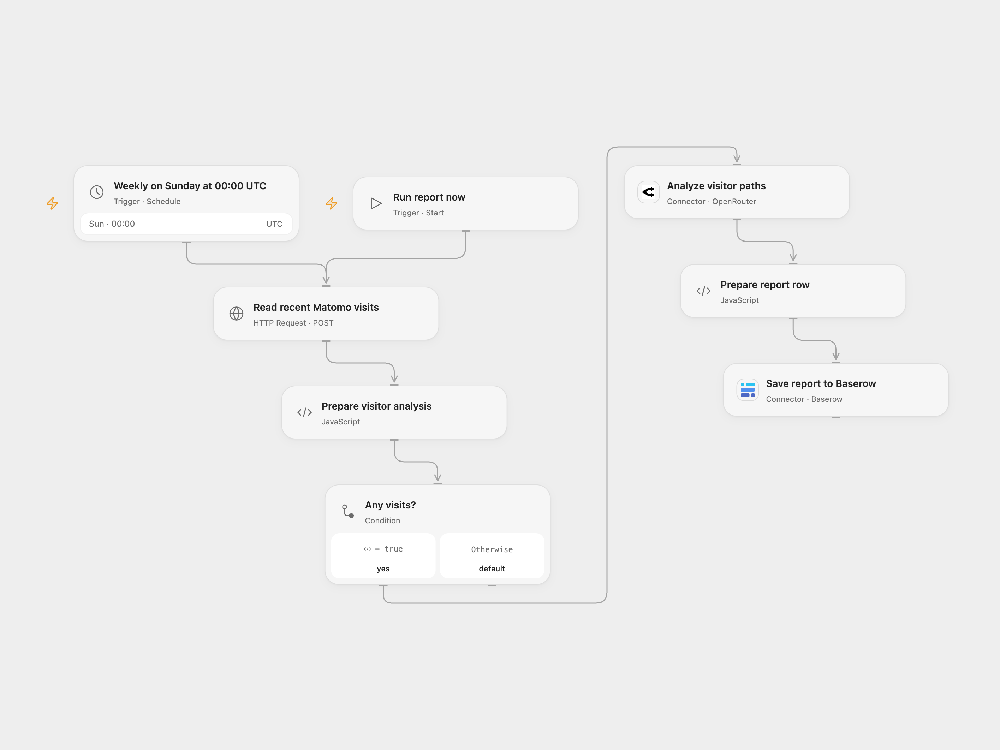

# Matomo Repeat Visits SEO Report

Analyze recent repeat-visitor paths with an OpenRouter model and save the report to Baserow.

<picture>
  <source media="(prefers-color-scheme: dark)" srcset="preview-dark.png">
  
</picture>

[Open Flow JSON](templates/matomo-repeat-visits-seo-report.openflow.json) · [n8n JSON](templates/matomo-repeat-visits-seo-report.n8n.json)

## Setup

In **Read recent Matomo visits**, set your public HTTPS Matomo `index.php` URL and site ID. Create a read-only Matomo token. Store the form text `token_auth=YOUR_URL_ENCODED_TOKEN` as a secret Variable and bind **Body** to it. URL-encode the token value; POST-only tokens are supported.

Connect OpenRouter in **Analyze visitor paths** and set a currently available model ID. Model availability depends on your account and provider. Connect Baserow Cloud in **Save report to Baserow**, set the table ID and create fields named `Date`, `Note` and `Blog`; set your site label in **Prepare report row**. In n8n configure the same Matomo URL and site ID with an HTTP Query Auth credential named `token_auth` and a token that permits URL authentication, OpenRouter HTTP Header Auth credential with name `Authorization` and value `Bearer YOUR_OPENROUTER_API_KEY`, and a model ID, Baserow database-token credentials and field IDs, and replace `YOUR_BLOG_NAME` in the **Prepare report row** Code node. The n8n request sends the token in the URL, where proxies or server logs may record it; restrict log access. POST-only tokens may not work with n8n. Use HTTPS and a token with the least required permissions. Enable one format only.

## Behavior

A manual run or a weekly Sunday run reads at most 100 visits from the last 30 calendar days including today in the Matomo site timezone, with more than three visits. It asks the model for paths, popular pages, engagement and recommendations, then saves one report row. It does not calculate or compare two weekly periods. An empty visit list creates no report. The source left its weekly hour and minute unspecified and used the n8n instance timezone. Both formats start at Sunday 00:00 UTC; n8n uses a stable second while Open Flow runs on the minute boundary. The report date is UTC.

Visitor IDs, page titles, URLs and time spent are sent to OpenRouter; Matomo also returns visitor IP addresses to the workflow. Ensure your analytics and model provider settings permit that transfer and restrict access to run history. The model’s conclusions can be inaccurate; review them before acting. A read error, invalid visit data, empty or truncated model response or failed save stops the run. A Baserow request with an uncertain outcome may already have created a row; inspect the table before replaying. No automatic retry or duplicate check is configured.

## Changes to the source

- Remove private host, site, table, field and credential values. Bind the Matomo token from a secret Variable in the Open Flow POST body; n8n uses a Query Auth credential and sends the token in the URL.
- Require an available model instead of the source’s fixed model, and construct the prompt without URL-encoding its contents.
- Validate visits and model output before saving; make UTC and the empty-list behavior explicit.

Source and license

Adapted from [Matomo Analytics Report](https://github.com/Zie619/n8n-workflows/blob/ae8cf6dc5b873cbb4f74587aa9180ed3a9f70682/workflows/Code/1594_Code_Schedule_Automation_Webhook.json) in [Zie619/n8n-workflows](https://github.com/Zie619/n8n-workflows). The matching [n8n community listing](https://n8n.io/workflows/2561-send-matomo-analytics-data-to-ai-to-analyze-then-save-results-in-baserow/) credits Keith Rumjahn. The original template does not state a separate license.

The collection’s [MIT notice](https://github.com/Zie619/n8n-workflows/blob/94007c1445d9258a7da116646b79473e7c7c3282/LICENSE) is pinned at a later revision. This is the collection notice at that revision; it does not establish a separate original template author's license. Our changes are listed above; see [repository licensing](../../README.md#licensing).

> MIT License
>
> Copyright (c) 2025 Zie619
>
> Permission is hereby granted, free of charge, to any person obtaining a copy
> of this software and associated documentation files (the "Software"), to deal
> in the Software without restriction, including without limitation the rights
> to use, copy, modify, merge, publish, distribute, sublicense, and/or sell
> copies of the Software, and to permit persons to whom the Software is
> furnished to do so, subject to the following conditions:
>
> The above copyright notice and this permission notice shall be included in all
> copies or substantial portions of the Software.
>
> THE SOFTWARE IS PROVIDED "AS IS", WITHOUT WARRANTY OF ANY KIND, EXPRESS OR
> IMPLIED, INCLUDING BUT NOT LIMITED TO THE WARRANTIES OF MERCHANTABILITY,
> FITNESS FOR A PARTICULAR PURPOSE AND NONINFRINGEMENT. IN NO EVENT SHALL THE
> AUTHORS OR COPYRIGHT HOLDERS BE LIABLE FOR ANY CLAIM, DAMAGES OR OTHER
> LIABILITY, WHETHER IN AN ACTION OF CONTRACT, TORT OR OTHERWISE, ARISING FROM,
> OUT OF OR IN CONNECTION WITH THE SOFTWARE OR THE USE OR OTHER DEALINGS IN THE
> SOFTWARE.

