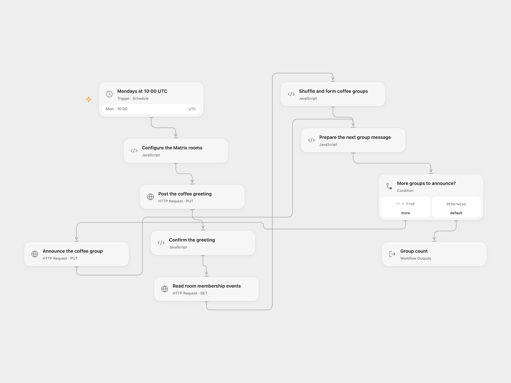

# Weekly Matrix Coffee Groups

Shuffle Matrix room members into small groups and announce them for a weekly virtual coffee.

<picture>
  <source media="(prefers-color-scheme: dark)" srcset="preview-dark.png">
  
</picture>

[Open Flow JSON](templates/matrix-weekly-coffee-groups.openflow.json) · [n8n JSON](templates/matrix-weekly-coffee-groups.n8n.json)

## Setup

In Open Flow, set your HTTPS Matrix homeserver and both room IDs in **Configure the Matrix rooms**. The greeting and member lookup use the first room; group messages use the second. They can be the same room. Create a secret Variable named `MATRIX_ACCESS_TOKEN` and bind it to all three Matrix HTTP nodes. The account must be allowed to read the member room and post in both rooms.

In n8n, set the same homeserver and room IDs in **Configure the Matrix rooms**. Configure Matrix credentials on both message nodes. For **Read room membership events**, create HTTP Header Auth with name `Authorization` and value `Bearer YOUR_MATRIX_ACCESS_TOKEN` using the same account. Enable one format.

## Behavior

At 10:00 each Monday the workflow posts a greeting, reads the member room's membership events, shuffles their Matrix user IDs and announces groups of three. If the final group has one person, one member moves from the previous group into it so both groups have two members. With fewer than two members, the greeting is posted and no group messages are sent.

The source requested membership **Any**. This workflow also sends no membership filter, so invited, departed or banned accounts and the bot can appear in the returned membership events. Use a room whose membership state is appropriate for this activity. It does not schedule calendar invitations. The source timezone came from the n8n instance; the template starts in UTC. n8n Cron V1 chooses a fixed randomized second within the minute, while Open Flow uses the minute boundary.

The greeting is sent before the member lookup. If lookup or grouping fails, it remains posted. If a group post fails or its outcome is unknown, earlier posts remain and the current message may have arrived. Check the rooms before rerunning; no automatic retry or rollback is configured. Matrix transaction IDs are generated for individual posts, and rerunning creates new IDs. Large membership lists must fit runtime response and Code limits.

Inspiration &amp; credits

## Changes to the source

- Configure both room IDs and the homeserver without personal credentials. Read the Matrix event's `state_key` user ID; the original grouping code expected a `user_id` field absent from standard membership events.
- Omit empty membership query values while preserving the source's Any scope, handle a single member without an index error and validate each post result.

Adapted from [Coffee Bot (Matrix)](https://github.com/Zie619/n8n-workflows/blob/ae8cf6dc5b873cbb4f74587aa9180ed3a9f70682/workflows/Matrix/1236_Matrix_Cron_Automate_Scheduled.json) in [Zie619/n8n-workflows](https://github.com/Zie619/n8n-workflows). The matching [n8n tutorial](https://blog.n8n.io/how-to-host-virtual-coffee-breaks-with-n8n/) credits Jason McFeetors. The original template does not state a separate license.

The collection’s [MIT notice](https://github.com/Zie619/n8n-workflows/blob/94007c1445d9258a7da116646b79473e7c7c3282/LICENSE) is pinned at a later revision. This is the collection notice at that revision; it does not establish a separate original template author's license. Our changes are listed above; see [repository licensing](../../README.md#licensing).

> MIT License
>
> Copyright (c) 2025 Zie619
>
> Permission is hereby granted, free of charge, to any person obtaining a copy
> of this software and associated documentation files (the "Software"), to deal
> in the Software without restriction, including without limitation the rights
> to use, copy, modify, merge, publish, distribute, sublicense, and/or sell
> copies of the Software, and to permit persons to whom the Software is
> furnished to do so, subject to the following conditions:
>
> The above copyright notice and this permission notice shall be included in all
> copies or substantial portions of the Software.
>
> THE SOFTWARE IS PROVIDED "AS IS", WITHOUT WARRANTY OF ANY KIND, EXPRESS OR
> IMPLIED, INCLUDING BUT NOT LIMITED TO THE WARRANTIES OF MERCHANTABILITY,
> FITNESS FOR A PARTICULAR PURPOSE AND NONINFRINGEMENT. IN NO EVENT SHALL THE
> AUTHORS OR COPYRIGHT HOLDERS BE LIABLE FOR ANY CLAIM, DAMAGES OR OTHER
> LIABILITY, WHETHER IN AN ACTION OF CONTRACT, TORT OR OTHERWISE, ARISING FROM,
> OUT OF OR IN CONNECTION WITH THE SOFTWARE OR THE USE OR OTHER DEALINGS IN THE
> SOFTWARE.

