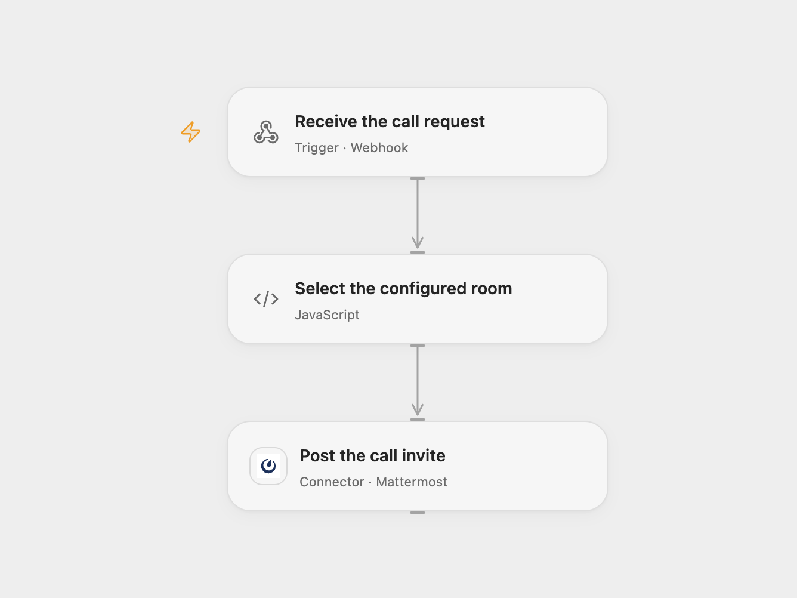

# Mattermost Webhook Call Invite

Post a Whereby room invite to a Mattermost channel from a webhook request.

<picture>
  <source media="(prefers-color-scheme: dark)" srcset="preview-dark.png">
  
</picture>

[Open Flow JSON](templates/mattermost-webhook-call-invite.openflow.json) · [n8n JSON](templates/mattermost-webhook-call-invite.n8n.json)

## Setup

Connect Mattermost with permission to post in the intended channel. Set **Select the configured room** to the exact `user_name` expected in webhook requests and the slug of an existing Whereby room. Deploy the public HTTPS webhook and send JSON containing `channel_id` and `user_name`. Protect the endpoint URL; anyone who can call it can request a post to channels available to the connected Mattermost account.

In n8n, set the same user-name-to-room mapping in **Set**, configure the Mattermost credential and activate the webhook.

## Behavior

A matching request posts “Join me in a video call:” to the supplied Mattermost channel and attaches a link to the configured Whereby room. Both formats stop before posting when the username is missing or does not match the configured mapping. The source only defines one user-to-room mapping. This workflow does not create a Whereby room or verify that the room is active. An uncertain post may already have arrived, so check Mattermost before retrying.

## Changes to the source

- Replace the personal username, channel ID, and hard-coded room with setup values.
- Validate the request username against the configured mapping before posting.

Source and license

Adapted from [Mattermost webhook call invite](https://github.com/Zie619/n8n-workflows/blob/ae8cf6dc5b873cbb4f74587aa9180ed3a9f70682/workflows/Mattermost/1077_Mattermost_Webhook_Automate_Webhook.json) in [Zie619/n8n-workflows](https://github.com/Zie619/n8n-workflows). The source export does not identify a separate template author or license.

The collection’s [MIT notice](https://github.com/Zie619/n8n-workflows/blob/94007c1445d9258a7da116646b79473e7c7c3282/LICENSE) is pinned at a later revision. This is the collection notice at that revision; it does not establish a separate original template author's license. Our changes are listed above; see [repository licensing](../../README.md#licensing).

> MIT License
>
> Copyright (c) 2025 Zie619
>
> Permission is hereby granted, free of charge, to any person obtaining a copy
> of this software and associated documentation files (the "Software"), to deal
> in the Software without restriction, including without limitation the rights
> to use, copy, modify, merge, publish, distribute, sublicense, and/or sell
> copies of the Software, and to permit persons to whom the Software is
> furnished to do so, subject to the following conditions:
>
> The above copyright notice and this permission notice shall be included in all
> copies or substantial portions of the Software.
>
> THE SOFTWARE IS PROVIDED "AS IS", WITHOUT WARRANTY OF ANY KIND, EXPRESS OR
> IMPLIED, INCLUDING BUT NOT LIMITED TO THE WARRANTIES OF MERCHANTABILITY,
> FITNESS FOR A PARTICULAR PURPOSE AND NONINFRINGEMENT. IN NO EVENT SHALL THE
> AUTHORS OR COPYRIGHT HOLDERS BE LIABLE FOR ANY CLAIM, DAMAGES OR OTHER
> LIABILITY, WHETHER IN AN ACTION OF CONTRACT, TORT OR OTHERWISE, ARISING FROM,
> OUT OF OR IN CONNECTION WITH THE SOFTWARE OR THE USE OR OTHER DEALINGS IN THE
> SOFTWARE.

