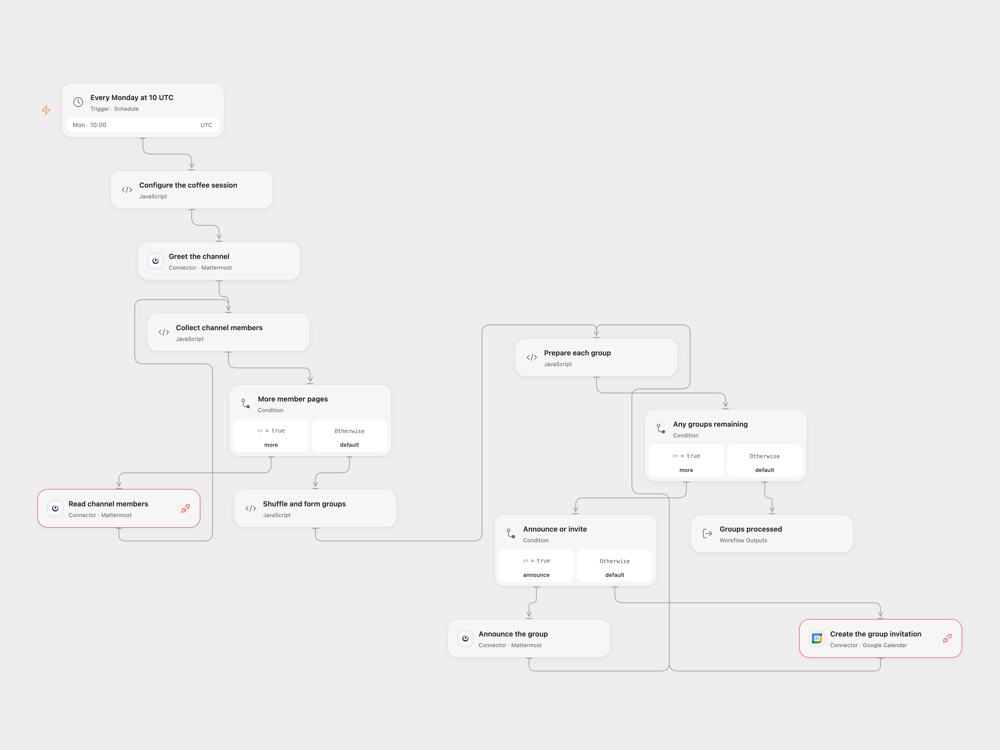

# Weekly Mattermost Coffee Groups

Shuffle channel members into small coffee groups, announce each group and create Google Calendar invitations with Meet.

<picture>
  <source media="(prefers-color-scheme: dark)" srcset="preview-dark.png">
  
</picture>

[Open Flow JSON](templates/mattermost-weekly-coffee-groups.openflow.json) · [n8n JSON](templates/mattermost-weekly-coffee-groups.n8n.json)

## Setup

Connect the Mattermost account in the greeting, user request and announcement nodes. It needs access to list users in the selected channel and send posts; Provider API Request access is required. Set the channel ID and Google Calendar ID in **Configure the coffee session**. Connect Google Calendar to the invitation request and allow event creation and Provider API Request access. Every channel member must expose a username and email to the Mattermost account.

In n8n, connect Mattermost and Google Calendar credentials, set the channel ID in **Greetings**, set the Calendar ID in **Choose session time**, and select the Google Calendar OAuth credential in **Send calendar invites**. Deploy one format for this channel. The Calendar account must be able to create Google Meet conferences.

## Behavior

At 10:00 UTC each Monday, the workflow greets the channel, reads all member pages, shuffles members into groups of three and moves one member from the previous group when a group would contain one person. It announces each group, then creates a 30-minute event for each group. Open Flow schedules it one hour after the trigger time; n8n uses one hour after the workflow starts. Each event includes all group emails, requests a Google Meet, allows guests to modify it and asks Google to send invitation updates. Google may create the Meet asynchronously; check the event for the outcome. With fewer than two members, the greeting is sent and no groups or invitations are created.

Errors stop the remaining steps. Earlier messages or invitations may already exist; inspect Mattermost and Calendar before retrying. Invites and groups are not deduplicated. Member data and groups must fit the execution limits; Open Flow stops if channel listing reaches 100 pages rather than silently truncating. Restrict access to member emails and workflow history.

## Changes to the source

- Replace the fixed 2020 event date with a future session relative to each weekly trigger, and request invitation emails. The schedule timezone is explicitly UTC.
- Fix the source single-member grouping error by skipping grouping with fewer than two people.
- Open Flow uses the formal Mattermost and Google Calendar Provider APIs for complete membership pagination and invitation fields. n8n connects announcements before invitations and uses an authenticated Calendar HTTP request to supply the documented Google Meet conference key.

Source and license

Adapted from [Mattermost Coffee Bot](https://github.com/Zie619/n8n-workflows/blob/ae8cf6dc5b873cbb4f74587aa9180ed3a9f70682/workflows/Mattermost/1137_Mattermost_Cron_Automate_Scheduled.json) in [Zie619/n8n-workflows](https://github.com/Zie619/n8n-workflows). The source export does not identify a separate template author or license.

The collection’s [MIT notice](https://github.com/Zie619/n8n-workflows/blob/94007c1445d9258a7da116646b79473e7c7c3282/LICENSE) is pinned at a later revision. This is the collection notice at that revision; it does not establish a separate original template author's license. Our changes are listed above; see [repository licensing](../../README.md#licensing).

> MIT License
>
> Copyright (c) 2025 Zie619
>
> Permission is hereby granted, free of charge, to any person obtaining a copy
> of this software and associated documentation files (the "Software"), to deal
> in the Software without restriction, including without limitation the rights
> to use, copy, modify, merge, publish, distribute, sublicense, and/or sell
> copies of the Software, and to permit persons to whom the Software is
> furnished to do so, subject to the following conditions:
>
> The above copyright notice and this permission notice shall be included in all
> copies or substantial portions of the Software.
>
> THE SOFTWARE IS PROVIDED "AS IS", WITHOUT WARRANTY OF ANY KIND, EXPRESS OR
> IMPLIED, INCLUDING BUT NOT LIMITED TO THE WARRANTIES OF MERCHANTABILITY,
> FITNESS FOR A PARTICULAR PURPOSE AND NONINFRINGEMENT. IN NO EVENT SHALL THE
> AUTHORS OR COPYRIGHT HOLDERS BE LIABLE FOR ANY CLAIM, DAMAGES OR OTHER
> LIABILITY, WHETHER IN AN ACTION OF CONTRACT, TORT OR OTHERWISE, ARISING FROM,
> OUT OF OR IN CONNECTION WITH THE SOFTWARE OR THE USE OR OTHER DEALINGS IN THE
> SOFTWARE.

