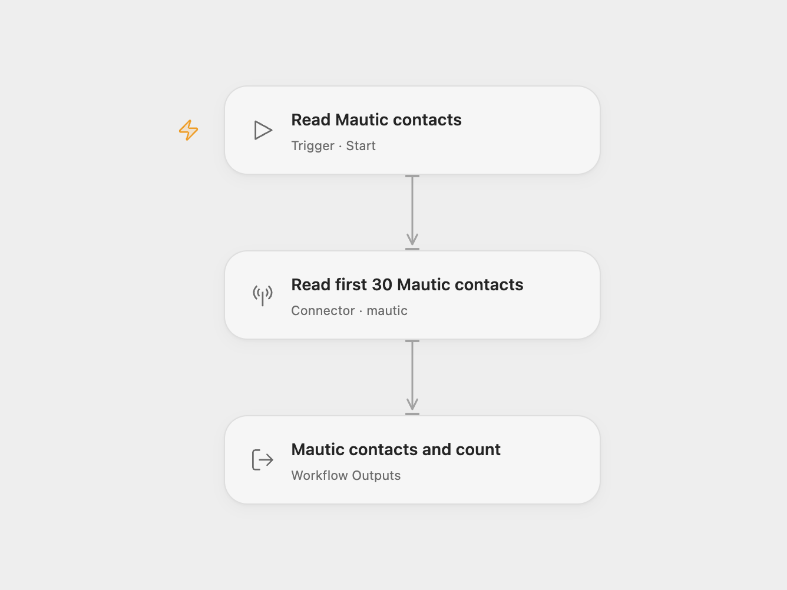

# Mautic Contact Reader

Read up to 30 contact records from a Mautic instance, including their grouped fields and other returned properties.

<picture>
  <source media="(prefers-color-scheme: dark)" srcset="preview-dark.png">
  
</picture>

[Open Flow JSON](templates/mautic-contact-reader.openflow.json) · [n8n JSON](templates/mautic-contact-reader.n8n.json)

## Setup

Enable the API on your Mautic instance. In Open Flow, select your Mautic account in **Read first 30 Mautic contacts** and allow `mautic.list_contacts`. Configure the instance URL, username and password in the connection; the instance must permit API Basic authentication, and the user needs permission to view contacts.

The n8n format retains the source’s OAuth2 authentication. Configure Mautic OAuth2 credentials for the same instance in **Mautic**. The two formats use different authentication methods, so configure each connection separately. Run the workflow manually.

Each run reads one page of up to 30 contacts, starting at row zero, with no search or ordering filter. It retains the complete contact objects, including grouped fields and null values supplied by Mautic. Open Flow also returns the matching total reported by the API; this can exceed the number of returned records. An empty result returns an empty contacts array.

This workflow does not collect every page, flatten contact fields, create contacts or change campaigns or segments. A failed request stops the run without an automatic retry.

Inspiration &amp; credits

## Changes to the source

- Make the source’s 30-contact limit explicit.
- Expose contact records and the API’s total count in Open Flow.

Adapted from [Mautic contact list workflow](https://github.com/Zie619/n8n-workflows/blob/ae8cf6dc5b873cbb4f74587aa9180ed3a9f70682/workflows/Manual/1017_Manual_Mautic_Automate_Triggered.json) in [Zie619/n8n-workflows](https://github.com/Zie619/n8n-workflows). The source export does not identify a separate template author or license.

The collection’s [MIT notice](https://github.com/Zie619/n8n-workflows/blob/94007c1445d9258a7da116646b79473e7c7c3282/LICENSE) is pinned at a later revision. This is the collection notice at that revision; it does not establish a separate original template author's license. Our changes are listed above; see [repository licensing](../../README.md#licensing).

> MIT License
>
> Copyright (c) 2025 Zie619
>
> Permission is hereby granted, free of charge, to any person obtaining a copy
> of this software and associated documentation files (the "Software"), to deal
> in the Software without restriction, including without limitation the rights
> to use, copy, modify, merge, publish, distribute, sublicense, and/or sell
> copies of the Software, and to permit persons to whom the Software is
> furnished to do so, subject to the following conditions:
>
> The above copyright notice and this permission notice shall be included in all
> copies or substantial portions of the Software.
>
> THE SOFTWARE IS PROVIDED "AS IS", WITHOUT WARRANTY OF ANY KIND, EXPRESS OR
> IMPLIED, INCLUDING BUT NOT LIMITED TO THE WARRANTIES OF MERCHANTABILITY,
> FITNESS FOR A PARTICULAR PURPOSE AND NONINFRINGEMENT. IN NO EVENT SHALL THE
> AUTHORS OR COPYRIGHT HOLDERS BE LIABLE FOR ANY CLAIM, DAMAGES OR OTHER
> LIABILITY, WHETHER IN AN ACTION OF CONTRACT, TORT OR OTHERWISE, ARISING FROM,
> OUT OF OR IN CONNECTION WITH THE SOFTWARE OR THE USE OR OTHER DEALINGS IN THE
> SOFTWARE.

