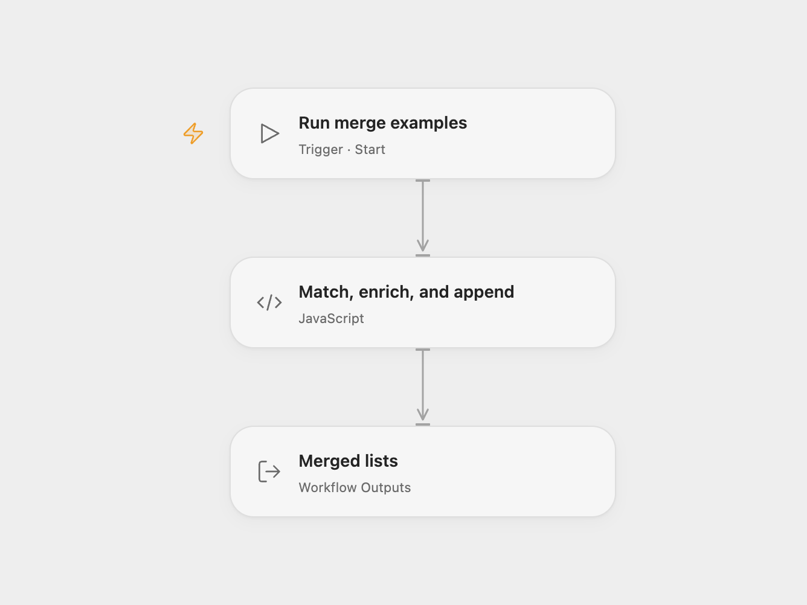

# Merge Ingredient and Band Lists

Learn matching, enrichment, and append operations with ingredient and musician examples.

<picture>
  <source media="(prefers-color-scheme: dark)" srcset="preview-dark.png">
  
</picture>

[Open Flow JSON](templates/merge-ingredient-and-band-lists.openflow.json) · [n8n JSON](templates/merge-ingredient-and-band-lists.n8n.json)

## Setup and use

Run the workflow manually to see the three examples. In n8n, the input lists are in the six Code nodes; in Open Flow, edit **Match, enrich, and append** to experiment with the sample data.

## Behavior

- Keep needed ingredients that also appear in the stock list: Eggs, Lemon, and Sugar.
- Add matching recipe quantities to the ingredient list. Milk has no match and remains without a quantity; Salt has no corresponding ingredient and is omitted.
- Append the Led Zeppelin sample list after the Queen sample list, preserving every record and its fields.

The musician names and instruments are source sample data. The examples demonstrate list operations and do not verify biographical facts. The fixed examples use unique names; adapting them to duplicate match keys may require a different join implementation.

Inspiration &amp; credits

## Changes to the source

- Open Flow combines the sample lists and three operations in one Code node and returns three arrays.

Adapted from [Aggregating data with the Merge node](https://github.com/Zie619/n8n-workflows/blob/ae8cf6dc5b873cbb4f74587aa9180ed3a9f70682/workflows/Manual/0228_Manual_Stickynote_Automate_Triggered.json) in [Zie619/n8n-workflows](https://github.com/Zie619/n8n-workflows). The source export does not identify a separate template author or license.

The collection’s [MIT notice](https://github.com/Zie619/n8n-workflows/blob/94007c1445d9258a7da116646b79473e7c7c3282/LICENSE) is pinned at a later revision. This is the collection notice at that revision; it does not establish a separate original template author's license. Our changes are listed above; see [repository licensing](../../README.md#licensing).

> MIT License
>
> Copyright (c) 2025 Zie619
>
> Permission is hereby granted, free of charge, to any person obtaining a copy
> of this software and associated documentation files (the "Software"), to deal
> in the Software without restriction, including without limitation the rights
> to use, copy, modify, merge, publish, distribute, sublicense, and/or sell
> copies of the Software, and to permit persons to whom the Software is
> furnished to do so, subject to the following conditions:
>
> The above copyright notice and this permission notice shall be included in all
> copies or substantial portions of the Software.
>
> THE SOFTWARE IS PROVIDED "AS IS", WITHOUT WARRANTY OF ANY KIND, EXPRESS OR
> IMPLIED, INCLUDING BUT NOT LIMITED TO THE WARRANTIES OF MERCHANTABILITY,
> FITNESS FOR A PARTICULAR PURPOSE AND NONINFRINGEMENT. IN NO EVENT SHALL THE
> AUTHORS OR COPYRIGHT HOLDERS BE LIABLE FOR ANY CLAIM, DAMAGES OR OTHER
> LIABILITY, WHETHER IN AN ACTION OF CONTRACT, TORT OR OTHERWISE, ARISING FROM,
> OUT OF OR IN CONNECTION WITH THE SOFTWARE OR THE USE OR OTHER DEALINGS IN THE
> SOFTWARE.

