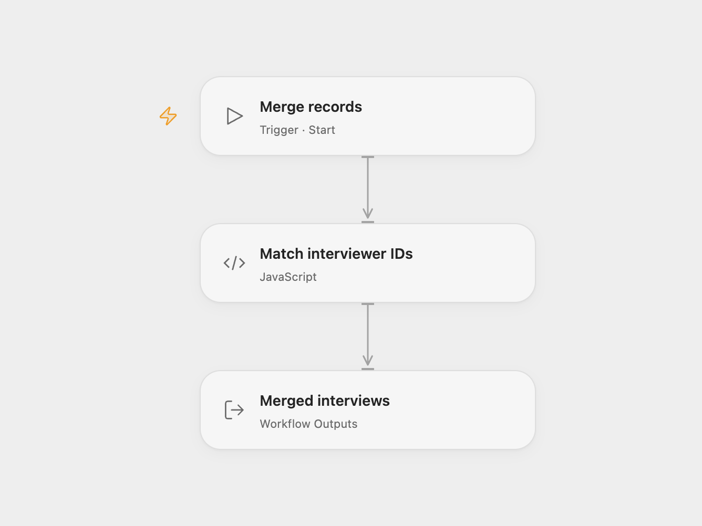

# Merge Interviews with Staff Records

Join interview records with staff records using the first interviewer ID.

<picture>
  <source media="(prefers-color-scheme: dark)" srcset="preview-dark.png">
  
</picture>

[Open Flow JSON](templates/merge-interviews-with-staff-records.openflow.json) · [n8n JSON](templates/merge-interviews-with-staff-records.n8n.json)

## Setup and use

Replace the example interviews and staff arrays in **Match interviewer IDs** with your data and run manually. In n8n replace the example JSON in **Data 1** and **Data 2**. Interview records use interviewers[0].id and staff records use fields.eid.

## Behavior

The workflow keeps each interview with an interviewer ID and copies top-level fields from the matching staff record. Unmatched interviews remain unchanged; if multiple staff entries share an ID, the last one is used. Open Flow returns the records as an array. In n8n an empty branch may stop before the merge node runs.

Inspiration &amp; credits

## Changes to the source

- Add a manual trigger and replace the sample personal details with fictional data.

Adapted from [Merge interviewer and staff data](https://github.com/Zie619/n8n-workflows/blob/ae8cf6dc5b873cbb4f74587aa9180ed3a9f70682/workflows/Process/0009_Process.json) in [Zie619/n8n-workflows](https://github.com/Zie619/n8n-workflows). The source export does not identify a separate template author or license.

The collection’s [MIT notice](https://github.com/Zie619/n8n-workflows/blob/94007c1445d9258a7da116646b79473e7c7c3282/LICENSE) is pinned at a later revision. This is the collection notice at that revision; it does not establish a separate original template author's license. Our changes are listed above; see [repository licensing](../../README.md#licensing).

> MIT License
>
> Copyright (c) 2025 Zie619
>
> Permission is hereby granted, free of charge, to any person obtaining a copy
> of this software and associated documentation files (the "Software"), to deal
> in the Software without restriction, including without limitation the rights
> to use, copy, modify, merge, publish, distribute, sublicense, and/or sell
> copies of the Software, and to permit persons to whom the Software is
> furnished to do so, subject to the following conditions:
>
> The above copyright notice and this permission notice shall be included in all
> copies or substantial portions of the Software.
>
> THE SOFTWARE IS PROVIDED "AS IS", WITHOUT WARRANTY OF ANY KIND, EXPRESS OR
> IMPLIED, INCLUDING BUT NOT LIMITED TO THE WARRANTIES OF MERCHANTABILITY,
> FITNESS FOR A PARTICULAR PURPOSE AND NONINFRINGEMENT. IN NO EVENT SHALL THE
> AUTHORS OR COPYRIGHT HOLDERS BE LIABLE FOR ANY CLAIM, DAMAGES OR OTHER
> LIABILITY, WHETHER IN AN ACTION OF CONTRACT, TORT OR OTHERWISE, ARISING FROM,
> OUT OF OR IN CONNECTION WITH THE SOFTWARE OR THE USE OR OTHER DEALINGS IN THE
> SOFTWARE.

