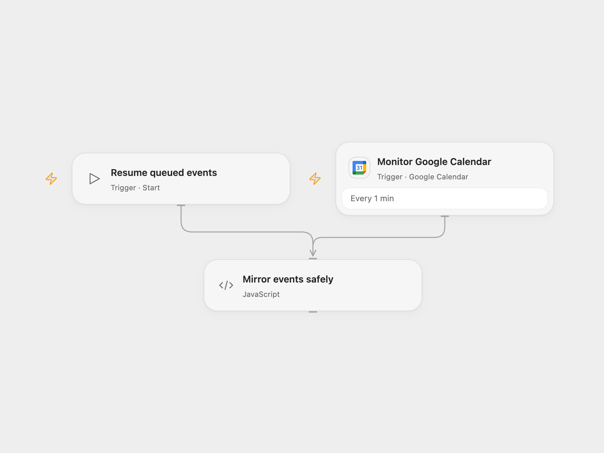

# Mirror Google Calendar Events to Outlook

Create Outlook events for new Google Calendar events and delete their matching copies when cancelled.

<picture>
  <source media="(prefers-color-scheme: dark)" srcset="preview-dark.png">
  
</picture>

[Open Flow JSON](templates/mirror-google-calendar-events-to-outlook.openflow.json) · [n8n JSON](templates/mirror-google-calendar-events-to-outlook.n8n.json)

## Setup

Connect Google Calendar and select the source calendar. Enable persistent State and prevent overlapping runs. For Open Flow register a Microsoft Entra application with admin-consented application permissions **Calendars.ReadWrite** and **Mail.Send**. Set tenant ID, client ID, target mailbox ID, calendar ID and notification email in **Mirror events safely**, and store the client secret in Secret Variable `MICROSOFT_CLIENT_SECRET`. This grants the application access according to your tenant's policies; restrict the application to the intended mailbox. In n8n connect Google Calendar and Microsoft Outlook, set the source and target calendars and notification recipient, set the Outlook calendar ID in **Create Outlook Event** and **Delete Event**, create a mapping Data Table with text columns google_id, outlook_id, subject and status, and a queue Data Table with text columns kind, payload and status. Select each table in its corresponding nodes. Activate one format.

## Behavior

The Google Calendar poll monitors newly created and cancelled events. A new event creates an Outlook event titled “From private: ” plus the Google title, with its start, end and description. An all-day event uses UTC midnight boundaries. On cancellation the workflow deletes only the Outlook event mapped to that Google event ID, then emails the configured recipient. It does not synchronize later edits or recreate full recurrence rules. The initial poll establishes a baseline and does not import existing events. Events without a stored mapping are skipped on cancellation.

Keep the mapping State or Data Table. Overlapping runs can race. An error or unknown outcome can leave an event created, deleted or an email sent. Open Flow stops when it encounters a pending event; n8n stops on a pending queue row. Neither automatically replays that event. Both formats save incoming batches before processing; later events remain queued when an operation is pending. Inspect Outlook and finish missing actions manually. In Open Flow set **ackEventId** to the pending Google ID: for a create set **ackResolution** to `created` with **ackOutlookId**, or `absent` if nothing was created, which retries that queued event; for a cancellation finish deletion and email, then use `cancelled`. Run **Resume queued events** manually, then clear the acknowledgement fields. In n8n inspect Outlook and the pending queue row. For a create, ensure the Outlook event exists and set its ID and status `created` in the mapping row. For a cancellation, complete deletion and the email and set the mapping status to `cancelled`. Mark the queue row `done`, then run **Resume queued events**. If no side effect occurred, remove any pending mapping and set the queue row back to `queued` instead. If saving an incoming batch fails or has an unknown result, inspect the queue and source calendar and backfill missing events manually. Restrict access to both tables because they contain event data; periodically remove completed queue rows.

Inspiration &amp; credits

## Changes to the source

- Replace subject substring matching with a persistent Google ID → Outlook ID mapping, so cancellation cannot delete an unrelated event with a similar title.
- Open Flow calls Microsoft Graph with application credentials because its managed Outlook connection does not grant calendar access. It sends plain-text event descriptions and uses UTC boundaries. n8n uses its Outlook connection and a Graph DELETE request for the configured calendar.

Adapted from [Google calendar to Outlook](https://github.com/Zie619/n8n-workflows/blob/ae8cf6dc5b873cbb4f74587aa9180ed3a9f70682/workflows/Microsoftoutlook/1870_Microsoftoutlook_GoogleCalendar_Automation_Triggered.json) in [Zie619/n8n-workflows](https://github.com/Zie619/n8n-workflows). The source export does not identify a separate template author or license.

The collection’s [MIT notice](https://github.com/Zie619/n8n-workflows/blob/94007c1445d9258a7da116646b79473e7c7c3282/LICENSE) is pinned at a later revision. This is the collection notice at that revision; it does not establish a separate original template author's license. Our changes are listed above; see [repository licensing](../../README.md#licensing).

> MIT License
>
> Copyright (c) 2025 Zie619
>
> Permission is hereby granted, free of charge, to any person obtaining a copy
> of this software and associated documentation files (the "Software"), to deal
> in the Software without restriction, including without limitation the rights
> to use, copy, modify, merge, publish, distribute, sublicense, and/or sell
> copies of the Software, and to permit persons to whom the Software is
> furnished to do so, subject to the following conditions:
>
> The above copyright notice and this permission notice shall be included in all
> copies or substantial portions of the Software.
>
> THE SOFTWARE IS PROVIDED "AS IS", WITHOUT WARRANTY OF ANY KIND, EXPRESS OR
> IMPLIED, INCLUDING BUT NOT LIMITED TO THE WARRANTIES OF MERCHANTABILITY,
> FITNESS FOR A PARTICULAR PURPOSE AND NONINFRINGEMENT. IN NO EVENT SHALL THE
> AUTHORS OR COPYRIGHT HOLDERS BE LIABLE FOR ANY CLAIM, DAMAGES OR OTHER
> LIABILITY, WHETHER IN AN ACTION OF CONTRACT, TORT OR OTHERWISE, ARISING FROM,
> OUT OF OR IN CONNECTION WITH THE SOFTWARE OR THE USE OR OTHER DEALINGS IN THE
> SOFTWARE.

