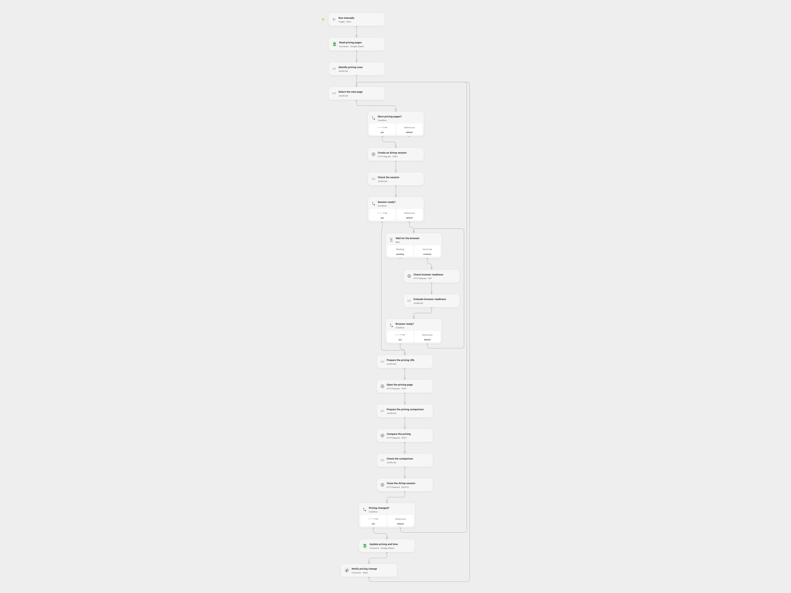

# Monitor Competitor Pricing Changes

Compare competitor pricing pages with saved summaries and notify a Slack channel of changes.

<picture>
  <source media="(prefers-color-scheme: dark)" srcset="preview-dark.png">
  
</picture>

[Open Flow JSON](templates/monitor-competitor-pricing-changes.openflow.json) · [n8n JSON](templates/monitor-competitor-pricing-changes.n8n.json)

## Setup

Connect Google Sheets and Slack, set the spreadsheet ID on **Read pricing pages** and **Update pricing and time**, and set a Slack channel in **Notify pricing change**. The sheet needs unique headers `Pricing URL`, `Pricing` and `Time`. Set the sheet name in the read range and **Identify pricing rows**. Create secret Variable AIRTOP_API_KEY and bind it to each Airtop request. In n8n connect Airtop, Sheets and Slack and select the same spreadsheet and sheet. Run one format.

## Behavior

For each nonempty pricing URL, Airtop reads the page and compares its plans with the saved summary. A result whose status does not contain `SIMILAR` updates that row's Pricing and Time cells and sends its differences to Slack. Similar results leave the row unchanged. Model output can miss or misinterpret a plan; review the page and the result.

Open Flow processes rows in order, updates before notifying and closes successful Airtop sessions. Earlier changes remain if a later step fails. Check the sheet and Slack before retrying an uncertain write. Avoid overlapping runs or reordering rows during a run. Airtop requests have a 30-second HTTP timeout and 4 MiB response limit; browser readiness is checked up to 60 times at five-second intervals. Errors before session close can leave a session until its idle timeout.

Inspiration &amp; credits

## Changes to the source

- Replace private spreadsheet and channel identifiers with configuration. Open Flow uses Airtop's official HTTP API because no Airtop Provider is available.
- Preserve the Pricing URL cell while updating Pricing and Time, and process rows in order.

Adapted from [Monitor Competitor Pricing](https://github.com/Zie619/n8n-workflows/blob/ae8cf6dc5b873cbb4f74587aa9180ed3a9f70682/workflows/Code/1759_Code_Filter_Monitor_Triggered.json) in [Zie619/n8n-workflows](https://github.com/Zie619/n8n-workflows). The matching [n8n listing](https://n8n.io/workflows/3480-get-notified-when-your-competitors-change-their-pricing-with-airtop-and-slack/) credits Airtop. The original template does not state a separate license.

The collection’s [MIT notice](https://github.com/Zie619/n8n-workflows/blob/94007c1445d9258a7da116646b79473e7c7c3282/LICENSE) is pinned at a later revision. This is the collection notice at that revision; it does not establish a separate original template author's license. Our changes are listed above; see [repository licensing](../../README.md#licensing).

> MIT License
>
> Copyright (c) 2025 Zie619
>
> Permission is hereby granted, free of charge, to any person obtaining a copy
> of this software and associated documentation files (the "Software"), to deal
> in the Software without restriction, including without limitation the rights
> to use, copy, modify, merge, publish, distribute, sublicense, and/or sell
> copies of the Software, and to permit persons to whom the Software is
> furnished to do so, subject to the following conditions:
>
> The above copyright notice and this permission notice shall be included in all
> copies or substantial portions of the Software.
>
> THE SOFTWARE IS PROVIDED "AS IS", WITHOUT WARRANTY OF ANY KIND, EXPRESS OR
> IMPLIED, INCLUDING BUT NOT LIMITED TO THE WARRANTIES OF MERCHANTABILITY,
> FITNESS FOR A PARTICULAR PURPOSE AND NONINFRINGEMENT. IN NO EVENT SHALL THE
> AUTHORS OR COPYRIGHT HOLDERS BE LIABLE FOR ANY CLAIM, DAMAGES OR OTHER
> LIABILITY, WHETHER IN AN ACTION OF CONTRACT, TORT OR OTHERWISE, ARISING FROM,
> OUT OF OR IN CONNECTION WITH THE SOFTWARE OR THE USE OR OTHER DEALINGS IN THE
> SOFTWARE.

