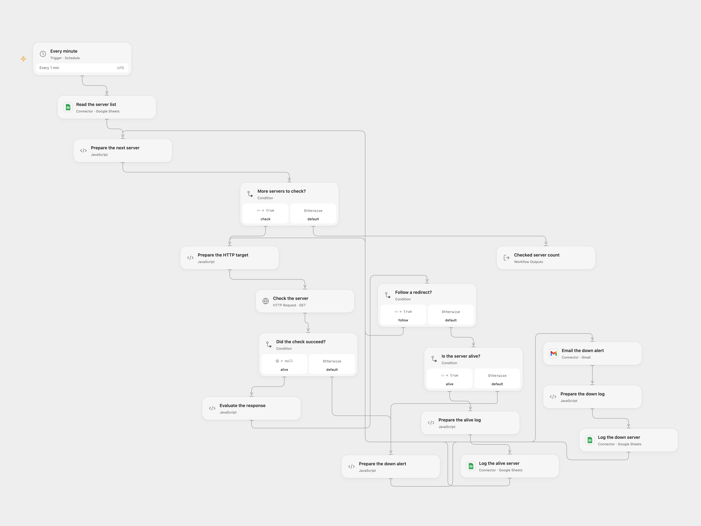

# Monitor Sheet Servers and Email Alerts

Check servers listed in Google Sheets every minute, log their status and email an alert when a check fails.

<picture>
  <source media="(prefers-color-scheme: dark)" srcset="preview-dark.png">
  
</picture>

[Open Flow JSON](templates/monitor-sheet-servers-and-email-alerts.openflow.json) · [n8n JSON](templates/monitor-sheet-servers-and-email-alerts.n8n.json)

## Setup

Connect Google Sheets and Gmail. Set the same spreadsheet ID in all three Sheets nodes. Create a `Server_List` sheet with one `Server` column containing hostnames or IP addresses, optionally with ports and paths. Create `Server_Status_Alive` and `Server_Status_Down` sheets with columns in this order: `Server IP Address`, `TimeStamp`, `Status`. Set the alert email in **Email the down alert**. The deployed host must be able to reach each listed HTTP server.

In n8n, connect Google Sheets and Gmail, select the same spreadsheet and three sheets, and set the Gmail recipient. Activate one format.

## Behavior

Each minute the workflow reads the server list and sends an HTTP GET to `http://` plus each address. Redirects are followed up to 21 hops; final 2xx responses are logged as Alive. A failed request triggers a Gmail alert followed by a Down log entry. Open Flow applies a 30-second timeout to each request hop; n8n applies a 30-second request timeout. Empty lists produce no writes or alerts. This checks HTTP responses, not ICMP ping. Configure addresses that are safe and intended to be contacted.

Both formats use UTC for log and alert timestamps. Open Flow follows redirects explicitly and checks servers sequentially; n8n processes its items according to its execution order. A log or Gmail failure stops the run; earlier actions are not undone. A lost response may hide a completed write or email, so inspect the destination before replaying. There is no deduplication between runs. In Open Flow, a response larger than 4 MiB stops the run without a down alert, and the server list must fit execution limits.

Inspiration &amp; credits

## Changes to the source

- Replace personal spreadsheet IDs and add the missing alert recipient. Use the original server row in the failure alert because the HTTP error output does not contain its `Server` field, and describe the HTTP check accurately.
- Use a 30-second n8n request timeout instead of its five-minute default, plain-text email without the n8n attribution footer, and append rows without interpreting formulas. Both formats use UTC instead of inheriting the n8n instance timezone; Open Flow uses explicit ordered columns.

Adapted from [Web Server Monitor](https://github.com/Zie619/n8n-workflows/blob/ae8cf6dc5b873cbb4f74587aa9180ed3a9f70682/workflows/Schedule/1952_Schedule_HTTP_Monitor_Webhook.json) in [Zie619/n8n-workflows](https://github.com/Zie619/n8n-workflows). The source export does not identify a separate template author or license.

The collection’s [MIT notice](https://github.com/Zie619/n8n-workflows/blob/94007c1445d9258a7da116646b79473e7c7c3282/LICENSE) is pinned at a later revision. This is the collection notice at that revision; it does not establish a separate original template author's license. Our changes are listed above; see [repository licensing](../../README.md#licensing).

> MIT License
>
> Copyright (c) 2025 Zie619
>
> Permission is hereby granted, free of charge, to any person obtaining a copy
> of this software and associated documentation files (the "Software"), to deal
> in the Software without restriction, including without limitation the rights
> to use, copy, modify, merge, publish, distribute, sublicense, and/or sell
> copies of the Software, and to permit persons to whom the Software is
> furnished to do so, subject to the following conditions:
>
> The above copyright notice and this permission notice shall be included in all
> copies or substantial portions of the Software.
>
> THE SOFTWARE IS PROVIDED "AS IS", WITHOUT WARRANTY OF ANY KIND, EXPRESS OR
> IMPLIED, INCLUDING BUT NOT LIMITED TO THE WARRANTIES OF MERCHANTABILITY,
> FITNESS FOR A PARTICULAR PURPOSE AND NONINFRINGEMENT. IN NO EVENT SHALL THE
> AUTHORS OR COPYRIGHT HOLDERS BE LIABLE FOR ANY CLAIM, DAMAGES OR OTHER
> LIABILITY, WHETHER IN AN ACTION OF CONTRACT, TORT OR OTHERWISE, ARISING FROM,
> OUT OF OR IN CONNECTION WITH THE SOFTWARE OR THE USE OR OTHER DEALINGS IN THE
> SOFTWARE.

