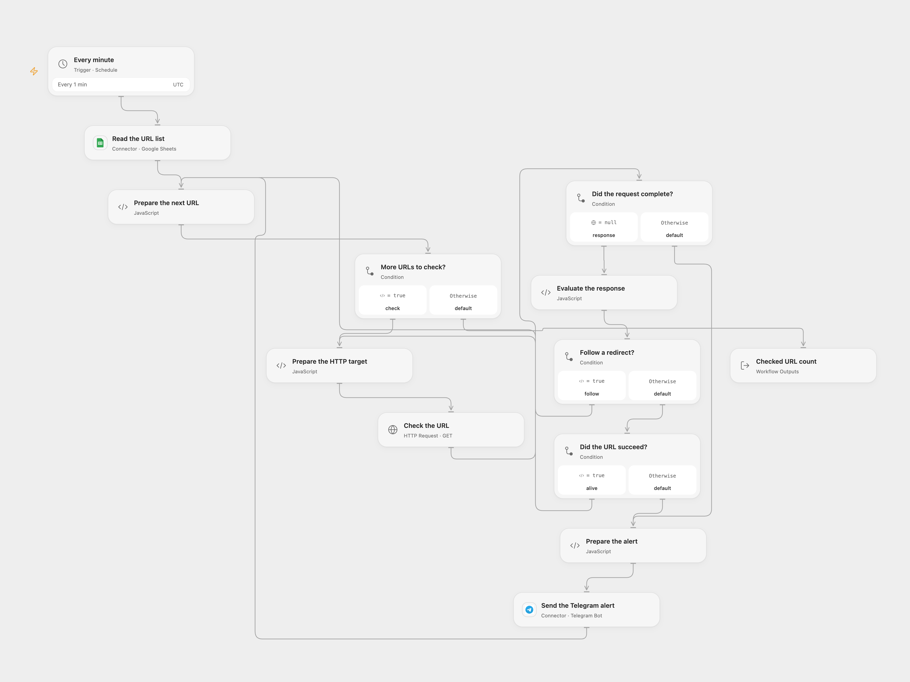

# Monitor Sheet URLs to Telegram

Check URLs in Google Sheets every minute and send failed checks to Telegram.

<picture>
  <source media="(prefers-color-scheme: dark)" srcset="preview-dark.png">
  
</picture>

[Open Flow JSON](templates/monitor-sheet-urls-to-telegram.openflow.json) · [n8n JSON](templates/monitor-sheet-urls-to-telegram.n8n.json)

## Setup

Connect Google Sheets and Telegram. Set the spreadsheet ID in **Read the URL list** and the destination chat ID in **Send the Telegram alert**. The read range defaults to `'Sheet1'!A:Z`; change the A1 range in **Read the URL list** to select your sheet and include the `URLS` column. Name that column `URLS` and list one complete HTTP or HTTPS URL per row. Ensure the bot can send to the chat and the host can reach the URLs.

In n8n, select the spreadsheet and sheet, connect both credentials, and set the Telegram chat ID. Activate one format.

## Behavior

Every minute the workflow checks each URL with HTTP GET and alerts the chat for a failed request or a non-2xx final response. Redirects are followed up to 21 hops. Requests time out after 30 seconds per hop in Open Flow and after 30 seconds in n8n. Empty lists send no alerts. URLs must be HTTP or HTTPS without embedded credentials. Configure only destinations that are safe and intended to be contacted.

Open Flow checks rows sequentially; n8n follows its item execution order. A Telegram failure stops the run; an uncertain send may already have arrived, so check the chat before retrying. Messages use Telegram legacy Markdown, so formatting characters in a URL can affect rendering or cause a send error. Runs are not deduplicated. In Open Flow responses larger than 4 MiB stop the run without an alert and the sheet must fit execution limits. Both schedules start in UTC; the original inherited the n8n instance timezone.

## Changes to the source

- Replace the personal spreadsheet and chat IDs and use the original sheet row for the alert URL.
- Use a consistent failure message rather than relying on the request error code, and validate URLs before requests.
- Use a 30-second n8n timeout and an explicit UTC timezone.

Source and license

Adapted from [MAIA - Health Check](https://github.com/Zie619/n8n-workflows/blob/ae8cf6dc5b873cbb4f74587aa9180ed3a9f70682/workflows/Telegram/2005_Telegram_Schedule_Monitor_Webhook.json) in [Zie619/n8n-workflows](https://github.com/Zie619/n8n-workflows). The source export does not identify a separate template author or license.

The collection’s [MIT notice](https://github.com/Zie619/n8n-workflows/blob/94007c1445d9258a7da116646b79473e7c7c3282/LICENSE) is pinned at a later revision. This is the collection notice at that revision; it does not establish a separate original template author's license. Our changes are listed above; see [repository licensing](../../README.md#licensing).

> MIT License
>
> Copyright (c) 2025 Zie619
>
> Permission is hereby granted, free of charge, to any person obtaining a copy
> of this software and associated documentation files (the "Software"), to deal
> in the Software without restriction, including without limitation the rights
> to use, copy, modify, merge, publish, distribute, sublicense, and/or sell
> copies of the Software, and to permit persons to whom the Software is
> furnished to do so, subject to the following conditions:
>
> The above copyright notice and this permission notice shall be included in all
> copies or substantial portions of the Software.
>
> THE SOFTWARE IS PROVIDED "AS IS", WITHOUT WARRANTY OF ANY KIND, EXPRESS OR
> IMPLIED, INCLUDING BUT NOT LIMITED TO THE WARRANTIES OF MERCHANTABILITY,
> FITNESS FOR A PARTICULAR PURPOSE AND NONINFRINGEMENT. IN NO EVENT SHALL THE
> AUTHORS OR COPYRIGHT HOLDERS BE LIABLE FOR ANY CLAIM, DAMAGES OR OTHER
> LIABILITY, WHETHER IN AN ACTION OF CONTRACT, TORT OR OTHERWISE, ARISING FROM,
> OUT OF OR IN CONNECTION WITH THE SOFTWARE OR THE USE OR OTHER DEALINGS IN THE
> SOFTWARE.

