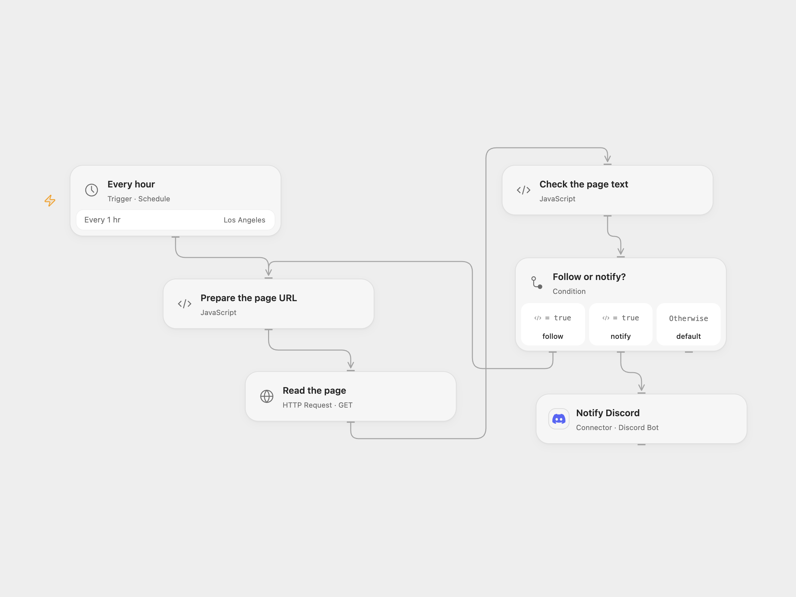

# Notify Discord When Stock Text Is Absent

Check a webpage every hour and notify Discord when the text “Out Of Stock” is absent.

<picture>
  <source media="(prefers-color-scheme: dark)" srcset="preview-dark.png">
  
</picture>

[Open Flow JSON](templates/monitor-stock-text-to-discord.openflow.json) · [n8n JSON](templates/monitor-stock-text-to-discord.n8n.json)

## Setup

Set the page URL in **Prepare the page URL**. Connect a Discord bot that can post to the destination channel and enter its channel ID in **Notify Discord**. In n8n, set the URL in **HTTP Request**, connect Discord Bot credentials and select the server and channel. Activate one format.

## Behavior

Every hour the workflow fetches the page as text and searches for the exact, case-sensitive phrase `Out Of Stock`. When the phrase is absent it sends `value not found` to Discord. When it is present, it sends nothing. A missing phrase does not establish product availability; dynamic pages, wording changes or access restrictions can affect the result.

Redirects are followed up to 21 hops. Open Flow accepts HTTP or HTTPS redirect targets without embedded credentials. A failed request or non-2xx final response stops without a Discord message. Open Flow applies a 30-second timeout per hop; n8n uses its HTTP node default timeout. Open Flow stops without a message if the response exceeds 4 MiB. The schedule uses America/Los_Angeles, matching the source. n8n chooses a fixed second within each hour’s first minute; Open Flow starts at the minute boundary. A Discord failure stops the run; an unknown send may already have succeeded, so inspect the channel before retrying.

## Changes to the source

- Add a page URL and Discord bot destination. Both formats use a bot connection instead of the source Discord webhook.
- Preserve the source’s connected branch: only absence sends a message. The unused “value found” node is removed.

Source and license

Adapted from [Website check](https://github.com/Zie619/n8n-workflows/blob/ae8cf6dc5b873cbb4f74587aa9180ed3a9f70682/workflows/Http/0358_HTTP_Discord_Monitor_Scheduled.json) in [Zie619/n8n-workflows](https://github.com/Zie619/n8n-workflows). The source export does not identify a separate template author or license.

The collection’s [MIT notice](https://github.com/Zie619/n8n-workflows/blob/94007c1445d9258a7da116646b79473e7c7c3282/LICENSE) is pinned at a later revision. This is the collection notice at that revision; it does not establish a separate original template author's license. Our changes are listed above; see [repository licensing](../../README.md#licensing).

> MIT License
>
> Copyright (c) 2025 Zie619
>
> Permission is hereby granted, free of charge, to any person obtaining a copy
> of this software and associated documentation files (the "Software"), to deal
> in the Software without restriction, including without limitation the rights
> to use, copy, modify, merge, publish, distribute, sublicense, and/or sell
> copies of the Software, and to permit persons to whom the Software is
> furnished to do so, subject to the following conditions:
>
> The above copyright notice and this permission notice shall be included in all
> copies or substantial portions of the Software.
>
> THE SOFTWARE IS PROVIDED "AS IS", WITHOUT WARRANTY OF ANY KIND, EXPRESS OR
> IMPLIED, INCLUDING BUT NOT LIMITED TO THE WARRANTIES OF MERCHANTABILITY,
> FITNESS FOR A PARTICULAR PURPOSE AND NONINFRINGEMENT. IN NO EVENT SHALL THE
> AUTHORS OR COPYRIGHT HOLDERS BE LIABLE FOR ANY CLAIM, DAMAGES OR OTHER
> LIABILITY, WHETHER IN AN ACTION OF CONTRACT, TORT OR OTHERWISE, ARISING FROM,
> OUT OF OR IN CONNECTION WITH THE SOFTWARE OR THE USE OR OTHER DEALINGS IN THE
> SOFTWARE.

