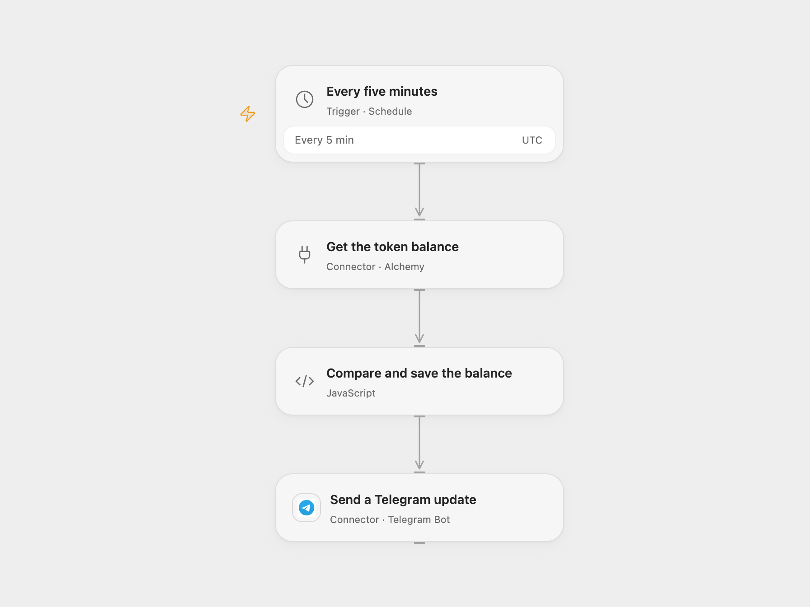

# Monitor USDT Balance on Telegram

Check an Ethereum USDT balance every five minutes and report whether it changed.

<picture>
  <source media="(prefers-color-scheme: dark)" srcset="preview-dark.png">
  
</picture>

[Open Flow JSON](templates/monitor-usdt-balance-on-telegram.openflow.json) · [n8n JSON](templates/monitor-usdt-balance-on-telegram.n8n.json)

## Setup

In Open Flow connect Alchemy for Ethereum mainnet, set your wallet in **Get the token balance** and the Telegram chat ID in **Compare and save the balance**, and connect a Telegram bot. Keep workflow State persistent and prevent overlapping runs.

In n8n, create an Etherscan API key with Ethereum token-balance access, set your wallet in **userData**, configure HTTP Query Auth on **Fetch USDT Balance from Etherscan** with name apikey and your API key as its value, and configure the Telegram bot and both chat IDs. The key is sent in the URL query and can appear in upstream or proxy access logs; restrict access to those logs. Activate one format. The default contract is Ethereum mainnet USDT; the display uses six decimal places. If changing the contract, use a compatible six-decimal token. In Open Flow update both the single-entry tokenSpec in **Get the token balance** and contract in **Compare and save the balance** to the same address. In n8n update the contract in **userData**.

## Behavior

Every five minutes the workflow reads the latest token balance. Open Flow runs at five-minute boundaries; n8n chooses a fixed second within each scheduled minute. The first valid reading establishes a baseline and sends the unchanged message. Later readings send either the previous and current balances when changed or an unchanged message. Every valid run sends a message, including repeated unchanged readings. Changing the wallet or token establishes a new baseline.

The saved baseline is the last sampled balance, not the last confirmed notification. Open Flow persists it before the Telegram call. n8n updates static data before sending and normally persists it at execution end, including on error. If Telegram fails, the next run compares against that sampled value and may report unchanged, so the change notification can be lost. Hard crashes and overlapping runs may behave differently. A failed or uncertain message may have been delivered; inspect the chat before retrying. Alchemy or Etherscan errors or invalid data stop before the balance is saved. Wallet addresses and balances appear in messages and run history.

## Changes to the source

- Open Flow reads Ethereum mainnet through the Alchemy connector; n8n uses Etherscan V2 with chain ID 1 and stores the API key in credentials. Both validate the service response before changing State.
- Reset the baseline when wallet or token changes and format six-decimal balances without floating-point rounding. Open Flow validates its Telegram destination before saving State.

Source and license

Adapted from [Monitor USDT ERC-20 Wallet Balance with Etherscan and Telegram Notifications](https://github.com/Zie619/n8n-workflows/blob/ae8cf6dc5b873cbb4f74587aa9180ed3a9f70682/workflows/Telegram/1304_Telegram_Code_Monitor_Webhook.json) in [Zie619/n8n-workflows](https://github.com/Zie619/n8n-workflows). The source export does not identify a separate template author or license.

The collection’s [MIT notice](https://github.com/Zie619/n8n-workflows/blob/94007c1445d9258a7da116646b79473e7c7c3282/LICENSE) is pinned at a later revision. This is the collection notice at that revision; it does not establish a separate original template author's license. Our changes are listed above; see [repository licensing](../../README.md#licensing).

> MIT License
>
> Copyright (c) 2025 Zie619
>
> Permission is hereby granted, free of charge, to any person obtaining a copy
> of this software and associated documentation files (the "Software"), to deal
> in the Software without restriction, including without limitation the rights
> to use, copy, modify, merge, publish, distribute, sublicense, and/or sell
> copies of the Software, and to permit persons to whom the Software is
> furnished to do so, subject to the following conditions:
>
> The above copyright notice and this permission notice shall be included in all
> copies or substantial portions of the Software.
>
> THE SOFTWARE IS PROVIDED "AS IS", WITHOUT WARRANTY OF ANY KIND, EXPRESS OR
> IMPLIED, INCLUDING BUT NOT LIMITED TO THE WARRANTIES OF MERCHANTABILITY,
> FITNESS FOR A PARTICULAR PURPOSE AND NONINFRINGEMENT. IN NO EVENT SHALL THE
> AUTHORS OR COPYRIGHT HOLDERS BE LIABLE FOR ANY CLAIM, DAMAGES OR OTHER
> LIABILITY, WHETHER IN AN ACTION OF CONTRACT, TORT OR OTHERWISE, ARISING FROM,
> OUT OF OR IN CONNECTION WITH THE SOFTWARE OR THE USE OR OTHER DEALINGS IN THE
> SOFTWARE.

