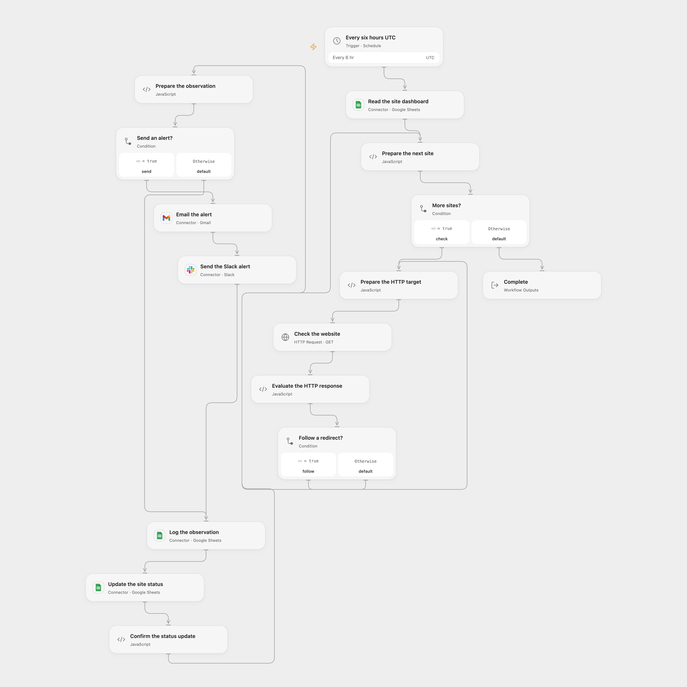

# Monitor Website Status in Google Sheets

Check website status, record observations and alert a team when a site is down or recovers.

<picture>
  <source media="(prefers-color-scheme: dark)" srcset="preview-dark.png">
  
</picture>

[Open Flow JSON](templates/monitor-website-status-in-google-sheets.openflow.json) · [n8n JSON](templates/monitor-website-status-in-google-sheets.n8n.json)

## Setup

Connect Google Sheets, Gmail and Slack. Configure the same spreadsheet ID in each Sheets node, an alert recipient and a Slack channel. In the spreadsheet create a worksheet named dashboard with unique columns Property, Status and Log Sheet. Each Property is a unique HTTP(S) URL; Status starts as UP or DOWN; Log Sheet names an existing worksheet for that site. Its first seven columns must be date, period, Property, UP_FROM_UP, DOWN_FROM_DOWN, UP_FROM_DOWN, DOWN_FROM_UP. Use the same configuration and credentials in n8n. Activate one format and prevent overlapping runs and concurrent dashboard edits.

## Behavior

Every six hours in UTC, each website is checked and its observation logged. A response below 400 is UP; 400 or higher is DOWN. Both a status change and a continuing DOWN state send Gmail and Slack alerts; continuing UP is logged without an alert. Open Flow starts at the minute boundary; n8n uses a fixed second within the scheduled minute. Empty dashboards produce no writes. Failed network requests stop the run. Redirects follow up to 21 hops.

Failed or uncertain alerts and writes may have completed; inspect the destinations before retrying. Earlier side effects are not rolled back. A later check can repeat an alert if its status update did not complete. Open Flow requires each response to fit its host limits.

## Changes to the source

- Replace private identifiers, repair response-to-site association and add per-site Log Sheet configuration: URLs cannot be Google Sheets worksheet names. Record all observation fields and use UTC timestamps rather than relying on a response Date header. Open Flow uses the scheduled time; n8n records the check time.
- Use the same ordered alert, log and status update path, write only the status cell and follow redirects within a bounded limit. Both formats use UTC rather than the source instance timezone.

Source and license

Adapted from [Host your own uptime monitoring with scheduled triggers](https://github.com/Zie619/n8n-workflows/blob/ae8cf6dc5b873cbb4f74587aa9180ed3a9f70682/workflows/Schedule/0529_Schedule_Slack_Update_Webhook.json) in [Zie619/n8n-workflows](https://github.com/Zie619/n8n-workflows). The matching [n8n listing](https://n8n.io/workflows/2327-host-your-own-uptime-monitoring-with-scheduled-triggers/) credits Jimleuk. No separate original template license was found.

The collection’s [MIT notice](https://github.com/Zie619/n8n-workflows/blob/94007c1445d9258a7da116646b79473e7c7c3282/LICENSE) is pinned at a later revision. This is the collection notice at that revision; it does not establish a separate original template author's license. Our changes are listed above; see [repository licensing](../../README.md#licensing).

> MIT License
>
> Copyright (c) 2025 Zie619
>
> Permission is hereby granted, free of charge, to any person obtaining a copy
> of this software and associated documentation files (the "Software"), to deal
> in the Software without restriction, including without limitation the rights
> to use, copy, modify, merge, publish, distribute, sublicense, and/or sell
> copies of the Software, and to permit persons to whom the Software is
> furnished to do so, subject to the following conditions:
>
> The above copyright notice and this permission notice shall be included in all
> copies or substantial portions of the Software.
>
> THE SOFTWARE IS PROVIDED "AS IS", WITHOUT WARRANTY OF ANY KIND, EXPRESS OR
> IMPLIED, INCLUDING BUT NOT LIMITED TO THE WARRANTIES OF MERCHANTABILITY,
> FITNESS FOR A PARTICULAR PURPOSE AND NONINFRINGEMENT. IN NO EVENT SHALL THE
> AUTHORS OR COPYRIGHT HOLDERS BE LIABLE FOR ANY CLAIM, DAMAGES OR OTHER
> LIABILITY, WHETHER IN AN ACTION OF CONTRACT, TORT OR OTHERWISE, ARISING FROM,
> OUT OF OR IN CONNECTION WITH THE SOFTWARE OR THE USE OR OTHER DEALINGS IN THE
> SOFTWARE.

